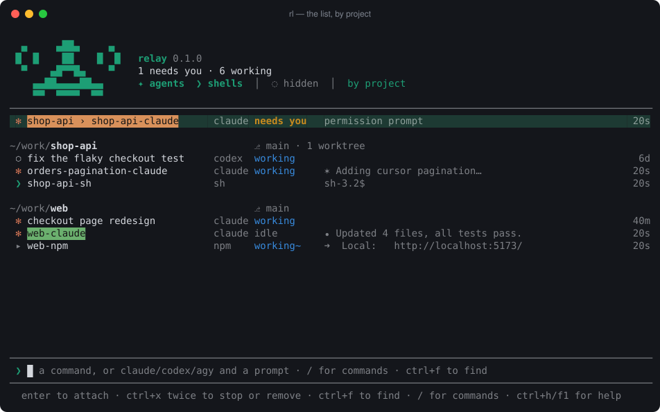
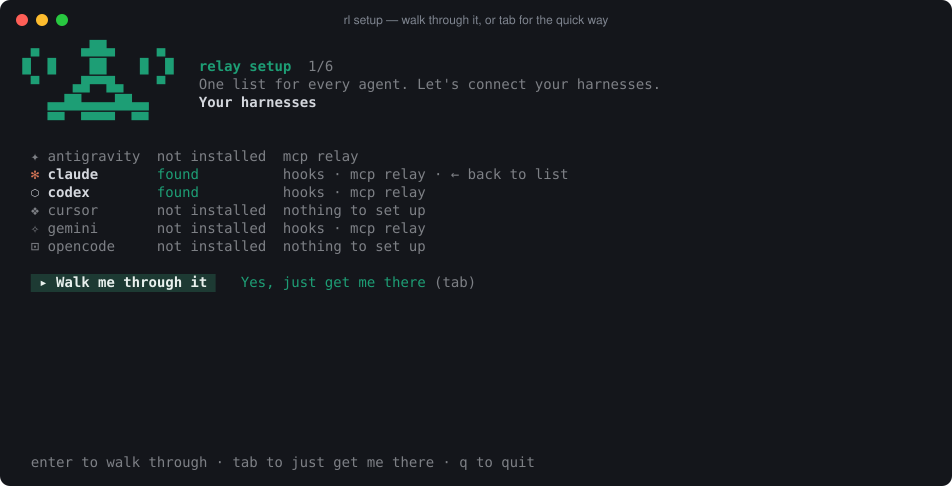
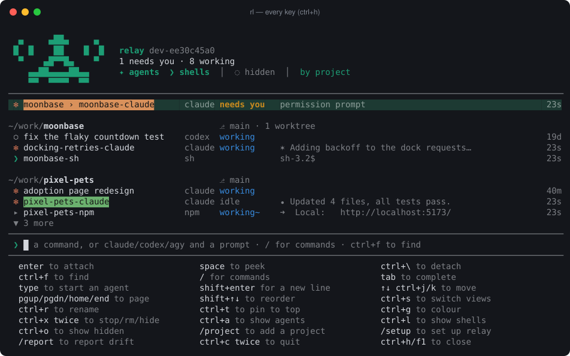
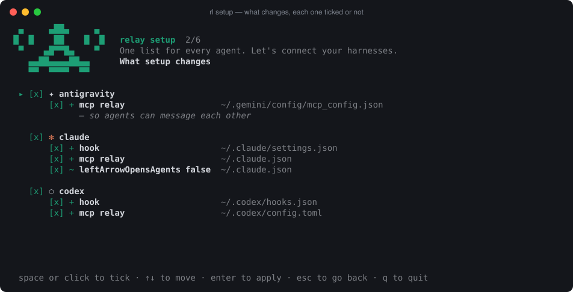

# Relay

Relay is `claude agents` for every harness: one list of your agent sessions (Claude, Codex, Gemini,
Antigravity and the like) and your shells, in the terminal you already use. Enter attaches. Agents
can message each other. No daemon, no model calls; macOS and Linux.



## Get started

You need Rust (1.96 or newer, from [rustup.rs](https://rustup.rs)), `git` and a C linker (on macOS:
`xcode-select --install`).

```sh
git clone https://github.com/instilled/relay && cd relay
scripts/install
rl
```

`scripts/install` builds Relay and links `rl` into `~/.local/bin`. The first `rl` walks you
through setting Relay up for the agents it finds (hooks, and the `relay` MCP server for
messaging): `enter` to walk through it, or `tab` to just set everything up. That's it.



This is a dev install: `rl` runs from your clone and rebuilds itself when the source changes.
[More on installing](#install), and what setup changes, below.

## What you can do

**See every agent at once.** `rl` opens the list. Rows sit under their project, each saying
whether it's working, done or needs you. Move with `↑↓`, `enter` attaches, `ctrl+\` detaches and
leaves it running.

**Start an agent by typing.** The line at the bottom starts things in the folder of the row under
the cursor. Type `claude fix the login` or `codex fix the flaky test`: the first word picks the
agent, the rest is its prompt. Anything else runs as a shell command.


**Keys at a glance.** `ctrl+h` (or `f1`) shows them all:



| key | does |
| --- | --- |
| `enter` | attach (with text typed: start it) |
| `ctrl+\` | detach, back to the list |
| `ctrl+f` | find |
| `ctrl+r` `ctrl+t` `ctrl+g` | rename (the name starts selected: type over it), pin, colour |
| `ctrl+s` | group by project or by state |
| `ctrl+x ctrl+x` | stop, then remove or hide; on a Claude or Codex session, asks: stop, or remove / archive |
| `/` | a command (`/setup`, `/rename`, `/help`, …) |
| `ctrl+c ctrl+c` | quit |

**From the shell.** The same, without the list:

```sh
rl new --harness claude -- fix the login   # start one (no arguments: a shell)
rl ls                                       # list once
rl attach <name>                            # attach; ctrl+\ detaches
```

**Let agents talk.** After setup, every agent has `who`, `send` and `inbox`. Ask in plain words:

> ask the codex session in shop-api to review my diff and send me what it finds

> when the tests pass, tell the claude session "web" to rebase on main

Codex is pinged when mail arrives; an idle Claude is woken to read it, a busy one hears of it
through its hooks. The [messaging guide](docs/messaging.md) has more use cases.

## Install

`scripts/install` checks for Rust, `git` and a C linker, builds once (`cargo build --workspace
--bins`) and links the dev shim `scripts/rl` as `~/.local/bin/rl`. It's safe to run again.

- `--bin-dir DIR` (or `RELAY_BIN_DIR`) links somewhere else. An `rl` there that isn't a symlink
  is left alone; a stale link is replaced.
- It warns when that dir isn't on your `PATH` (and prints the line to add), or when another `rl`
  comes first on it (an old `cargo install`: `cargo uninstall rl`).
- `RELAY_DEV_PROFILE=release` builds and runs the release binaries; keep it set where you run `rl`.
- `rl --version` says the commit it was built from. Put it in bug reports.

**Update:** `git pull`. The next `rl` rebuilds (it prints `building relay…`).

**Uninstall:** `rl setup --remove` takes Relay's hooks and MCP server out of your agents, then
`scripts/install --uninstall` removes the link. Your sessions and settings are in `~/.relay`.

Everything lives under `~/.relay` (`RELAY_HOME` moves it).

## Setup

```sh
rl            # the list; the first time, it walks you through setup
rl setup      # the same walk, any time
```

On a terminal, setup is a short walk in six steps, drawn under your prompt (not full screen): the
harnesses found, what setup changes for each, the changes being made, what is left for you (Codex's
`/hooks`), the keys you'll use, and what you can do now. On the first step `enter` walks through
it and `tab` (or `y`) just sets everything up and leaves a short summary; `q` quits, changing
nothing before step 3. What it did stays in your scrollback.

Every change has its own tick box (space, or a click). Untick one you don't want, such as Claude's
`←` setting, and it is remembered as declined (`setup.declined` in `config.json`): no run makes it,
and neither `--check` nor the list's notice asks for it again. The next walk shows it unticked;
tick it to have it made.



The first `rl` (before there is a `~/.relay/config.json`) walks through it once, then opens the
list; `q` there skips it and `ctrl+c` leaves (either way it is not offered again), never outside a
terminal nor inside a session Relay holds. Later, while a harness found on PATH needs setting up —
installed after setup, or `rl` moved so the entries point at the old one — the list's footer leads
with `setup needed: codex · /setup`, and `/setup` on the command line opens the same walk, then
comes back to the list.

Plain output, for scripts and CI, and whenever `rl setup` is not on a terminal or runs inside a
session Relay holds:

```sh
rl setup --yes      # set everything up (but what you declined), no questions; plain lines
rl setup --check    # change nothing: what setup would change, exit 1 if anything
```

`rl setup --check` prints one line per harness that needs something (`codex: hooks missing · mcp
relay stale (points at /old/rl)`, `claude: ← opens agents on`), or `all set up`, then `(1 declined,
rl setup to change)` when you declined any; it reads the files only and runs no harness's CLI.
`--harness <name>` and `--remove` are plain too.

`rl setup` adds Relay's hook to each harness's user-level settings and registers
`rl mcp --harness <name>` as an MCP server named `relay` (Claude's through `claude mcp add --scope user`
and Antigravity's through `agy mcp add`, so that CLI must be on PATH). Antigravity has no hooks yet, so
it gets only the server. For Claude it also turns off `←` opening Claude's agents view
(`leftArrowOpensAgents: false` in `~/.claude.json`, or `$CLAUDE_CONFIG_DIR/.claude.json`): Relay's
list is that view. Claude has no command that sets it, so Relay writes that one key into the file
itself and keeps the rest. It says what it changed, then a few lines on what you can do now
(messaging, with a link to the [guide](docs/messaging.md)), and `nothing to change` on a second run.
`rl setup --remove` takes the hooks and the server out again, also for a harness no longer
installed, and leaves `leftArrowOpensAgents` as it is; `--harness <name>` (repeatable) limits it to
one.
Codex asks you to trust the hook once (`/hooks` in codex); Claude may ask you to review it in `/hooks`.

## The list

Rows are agents and shells, under their project folder or under Needs input, Working and Done.
Claude's and Codex's own background sessions are on it too. `ctrl+h` or `f1` (for terminals that
send `ctrl+h` as backspace) shows every key as a grid under the command line, in place of the footer's
hints, the way `claude agents` does: `ctrl+r to rename`, `ctrl+f to find`, in up to four columns as
the terminal's width allows. `ctrl+h` again, `f1` or `esc` puts it away; `/help` opens it too. The
footer's hints are entries of the same table.

At the foot of the list is a command line. Type to start a session, in the folder of the row under
the cursor (else where `rl` was started; the line shows only the prompt `❯`):

- `claude fix the login`, `codex …`, or `agy …` (also `gemini` and `antigravity`, which mean
  Google Antigravity's `agy`): that agent, the rest of the line its first prompt. Claude starts in
  its own background (`claude --bg`), Codex on its own app-server daemon (see Codex below); the
  others in a session Relay holds.
- `/` and a name: a command, run on the row under the cursor or on the list (below).
- `!` and a command (`! make test`): a shell command, whatever the default.
- Anything else starts the default, `list.default` in `config.json`: `shell` (as it comes) runs it
  as a shell command, in a shell Relay holds, which stays a shell once it is done; an agent harness
  (`/default claude`) starts that agent with the whole line as its first prompt, so `fix the login`
  is a prompt for Claude while `codex fix the login` still starts Codex.

`shift+enter` adds a line to what is typed: a prompt of several lines goes to the agent whole, its
newlines kept, and a shell runs the lines in order, as a script. `alt+enter` (option+enter) does
the same, for terminals that send `shift+enter` as a plain `enter` (Relay asks the terminal to tell
them apart with the kitty keyboard protocol, where the terminal speaks it — kitty, WezTerm,
Ghostty and others; not Terminal.app or an older tmux). A paste keeps its newlines too, and starts nothing until
`enter`. The line grows to five rows, then scrolls; `↑` `↓` move between its lines, and from its
first or last line move on the list as ever.

The right end of the line says which it is (`agent · claude`, `shell`, `command · pin`, `unknown
command`, or `agent · antigravity (agy not found)`, which will not start). `tab` completes a
harness, a program on `PATH` (only after a `!` where the default is an agent), or a path, and on a
`/` line the command, then its colour or, for `/rename`, the row's name, or for `/default` a
harness that is here or `shell`; the best completion stands dim after the cursor, and `tab` again
cycles. Every letter types; the list's own keys are ctrl keys, the arrows and `enter`. `ctrl+f`
searches.

| command | does |
| --- | --- |
| `/colour <name\|#rrggbb\|none>` (`/color`) | your colour for the row, as `ctrl+g` and `rl color` set it (a colour the harness set wins on screen) |
| `/rename <name>` | rename the row or project; with no name, as `ctrl+r`: the name typed where it stands (empty goes back to its own). A Codex thread is renamed on its daemon (`thread/name/set`), so `codex resume` and Codex's lists show it too; an idle Claude session has `/rename <name>` typed into it (see Known limits). Until the harness has it, or where it can't take it (a busy, stopped or attached Claude, a session its hooks told of), the name is Relay's: yours, the harness's own dim beside it, and the search finds both; once the harness calls it so, Relay keeps no name of its own for it. Empty clears a Codex thread's name on the daemon too; a Claude's only in Relay |
| `/pin` | pin or unpin, as `ctrl+t` |
| `/hide` | hide the row or project, or bring it back |
| `/stop` | stop a live session, held or the harness's own, at once (no second press, no question); a Codex thread has its running turn interrupted and stays |
| `/rm` | remove an ended session Relay holds; on a Claude or Codex session, ask to remove or archive it (`enter` confirms, `esc` cancels) |
| `/agents` `/shells` `/hidden` | show agents, shells, hidden, as `ctrl+a` `ctrl+l` `ctrl+o` |
| `/group` | by project or by state, as `ctrl+s` |
| `/default <harness\|shell>` | what a line that names no harness starts: `shell`, or an agent harness (`claude`, `codex`, `agy`…) that takes the whole line as its prompt; kept in `config.json` as `list.default` |
| `/setup` | the setup walk (as `rl setup`), under the list; back on the list, what it did stands in the footer, and the `setup needed` notice goes |
| `/help` | the keys |
| `/quit` | quit |

A command that does not apply to the row (`/rm` on a live session, `/colour` on a project) says why
in the footer and changes nothing; an unknown one stays on the line to mend.

| key | does |
| --- | --- |
| `enter` | attach (on a line with text: start it) |
| `shift+enter` `alt+enter` | a new line in what is typed |
| typing | the command line; `esc` clears it, `home` `end` go to its ends |
| `↑↓` `ctrl+j` `ctrl+k` | move |
| `pgup` `pgdn` `home` `end` | page (`home` `end` with nothing typed) |
| `/` | a command (above) |
| `ctrl+f` | search |
| `ctrl+x ctrl+x` | stop, then remove or hide; on a Claude or Codex session, a choice in the footer (below, and under Codex) |
| `ctrl+r` | rename: the name stands selected, so what you type or paste replaces it, `backspace` clears it, `←` `→` `home` `end` keep it to edit; `enter` keeps, `esc` cancels |
| `ctrl+t` | pin |
| `ctrl+g` | your colour for the row: none, red, blue, green, yellow, purple, orange, pink, cyan (a colour the harness set wins on screen; a `#rrggbb` set in `config.json` or by `rl color` goes to red) |
| `shift+↑↓` | reorder |
| `ctrl+a` `ctrl+l` `ctrl+o` | show agents, shells, hidden (the header shows which: `✦ ctrl+a  ❯ ctrl+l  │  ◌ ctrl+o`, icons alone on a narrow one-line header) |
| `ctrl+s` | group by project or by state (the header says which) |
| `ctrl+c ctrl+c` | quit |
| `ctrl+h` `f1` | the keys, as a grid; again or `esc` closes it |

The wheel moves the cursor a line a tick and a click puts it on a line; a pointer that only moves
leaves it where it is. The list takes the mouse, so hold shift (option, on macOS) to select text.

`ctrl+\` leaves an attached session running and comes back to the list. In an attached Claude
session, `←` on an empty prompt does the same: it would open Claude's own agents view, which the
list is, so the list comes back in its place and the session keeps running.

`ctrl+x` twice on one of Claude's own sessions asks, in the footer, with the row's name and harness:
`s stop · keeps the conversation   r remove · deletes it and its worktree   esc cancel`. `s` (or
`enter`, so `ctrl+x ctrl+x enter` stops as it always did) runs `claude stop <id>`: its process
ends, `claude attach` opens it again. `r` runs `claude rm <id>`, which deletes it and its worktree
when that is safe, and the row goes. One that has already ended is offered only the remove. A
session Relay holds (a shell, Antigravity, …) is stopped and removed as ever, without a question.

### Codex

Relay never holds a Codex session: every thread runs in Codex's own app-server daemon (`codex
app-server`, started with `codex app-server daemon start` if none runs), and the list shows the
daemon's threads.

- `codex fix the login` on the command line (or `rl new --harness codex -- fix the login`) starts a
  thread on the daemon in the row's folder and its first turn on the prompt, then lets go: the daemon
  runs the turn with no terminal attached. Only the folder is given, so your own `config.toml`
  (model, approvals, sandbox) holds.
- `codex` alone (or `rl new --harness codex`) runs Codex's TUI here in the folder, as an attach
  would; its TUI makes the thread. Quitting it brings the list back.
- Enter on a Codex row runs `codex resume <id>`. Quitting the TUI, or `ctrl+\`, is the detach: the
  thread goes on in the daemon. A turn waiting on an approval shows `needs input`, and `codex resume`
  shows the prompt to answer.
- The daemon lets go of an idle thread with no client after a couple of minutes. The threads Relay
  started (Codex records `relay` as their originator) stay on the list as `resting`, the latest 50
  (`thread/list`). Enter resumes one; mail pings it (`codex queue … --resume` loads it again).
- `ctrl+x` twice on a Codex row asks, in the footer: `s stop the turn   a archive · off the list,
  codex unarchive brings it back   esc cancel`. `s` (or `enter`) interrupts a running turn
  (`turn/interrupt`; the thread stays); `a` runs `codex archive <id>`. A thread with no turn running
  is offered only the archive. `/stop` interrupts at once. Relay never offers `codex delete`.

## Commands

```sh
rl new [--harness claude] [--cwd DIR] [--name-only] [-- ARGV...]   # a shell, or a harness; prints the name
                                # (codex: the words are its prompt, it starts on the daemon, the thread id is printed)
rl ls [--json]                  # the list, once: held, background and terminal sessions
rl attach <name>                # ctrl+\ detaches
rl stop <name>                  # close a running session
rl rm <name>                    # remove one that is not running
rl color <session> <name|#rrggbb|none>  # your colour for a row (a held name, or n:claude:<id> / o:claude:<id>)
rl mcp --harness H              # serve send, who and inbox over stdio (agents call this)
rl setup [--yes | --remove | --check] [--harness H]   # a walk on a terminal; plain otherwise
```

`rl ls` prints one row per session the list shows, with the same dedupe: the sessions Relay holds
(`held`), the harnesses' own background sessions — Claude's, Codex's threads including `resting`
ones (`background`) — and the ones their hooks tell of in other terminals (`terminal`): name,
harness, kind, state, folder and age. `--json` gives each the keys `kind`, `id` (a held session's
name, a background one's harness id, a terminal one's conversation id), `name`, `harness`,
`state`, `status` (`live`, `ended`, `lost`), `folder`, `started` and `holder_pid` (null unless
held). Each harness is asked for at most 5s; one that fails or is slow is left out, and stderr says
which.

`rl hook <agent> <Event>` is what an agent's hook calls. It is not for you to run.

A session lives in a small holder process (`rl-session`) that keeps its terminal, so closing your
terminal or the laptop lid costs nothing. Without a daemon, nothing else is running.

## Files

`~/.relay`:

| path | holds |
| --- | --- |
| `sessions/<name>/` | one held session: `meta.json`, `state.json`, `hook.json`, `exit`, `sock` |
| `state/<agent>/<session_id>.json` | what an agent's hooks said of a session Relay does not hold |
| `mail/<key>/` | messages waiting for an agent, one file each (key: a held session's name, else its conversation id) |
| `config.json` | harnesses offered, badges, how the list stands (grouping, pins, names, colours, order, hidden, `default`: what a typed line starts) |
| `hooks/` | settings files `rl new` passes to a harness (Claude's `--settings`) |
| `detect/*.yaml` | your harness profiles |
| `plugins/gh-pr` | the badge script for project headers |

A socket too long for the OS limit goes under `$TMPDIR/rl-<uid>-<hash>/`.

## Harness profiles

A harness is a file, `detect/<name>.yaml`. The built-in ones are compiled in (`antigravity`,
`claude`, `codex`, `cursor`, `gemini`, `opencode`, `sh`, with `generic` as the floor under all). Yours in
`~/.relay/detect/` merge over them field by field; a new name adds a harness.

Keys a profile accepts:

- `kind`: `agent`, `shell`, `command` or `plugin`
- `bins`: binary names to match
- `words`: first words of the list's command line that start it (the first profile by name to
  claim a word has it)
- `prompt`: where a first prompt goes, with `{prompt}` (`["-i", "{prompt}"]`); without it, last
- `interactive_only`
- `hooks`: `dialect`, `args` (what `rl new` passes the binary; `{hooks_file}` is the settings file)
- `resume`: arguments that carry a conversation on, with `{session}`
- `icon`, `color` (`#rrggbb`)
- `patterns`: `needs_input`, `idle` (regexes over the screen, the fallback when hooks say nothing)
- `timing`: `idle_after`, `stale_after`
- `sessions`: the harness's own sessions
  - `hooks`: `file`, `timeout`, `unit`, `async`, `marker`, `after_install`, `from_env`, `events`, `settings`
  - `list`: `args` and `reader` (`claude-agents` or `codex-threads`)
  - `attach`, `start`, `name`, `stop`: argument lists with `{id}` and `{name}`
  - `ping`: what tells one of its sessions of mail from outside, with `{id}` and `{text}`
  - `rename`: how a name you give one reaches the harness: `{ rpc: <method> }` (a call on its
    daemon, Codex's `thread/name/set`) or `{ type: "/rename {name}" }` (a line typed into an idle
    one through its attach, Claude's)
  - `wake`: how relay mail wakes one: `idle: type` (the mail's line typed into an idle one) and
    `stopped: resume_bg` (one that has stopped carried on in the background with that line as its
    prompt)
  - `typing`: what an attached session's screen shows of its input, for typing into it: `input`
    (a regex for the input line, its first group what is typed there; the last matching line is
    it) and `busy` (regexes that say a turn is running)
  - `agents_view`: regexes over the lines of an attached session's screen that say it shows the
    harness's own list of its sessions; seeing one, the attach lets go and the list comes back
- `mcp`: where `rl setup` registers Relay's MCP server
  - `file`: its servers file, the first whose variables are set (`~` is `$HOME`)
  - `cli`: the harness's own words that add and remove an entry there (`[mcp]`: `agy mcp add`);
    without them Relay writes `mcpServers.relay` into the file itself
  - `note`: said beside what setup did
- `settings`: keys `rl setup` sets at the top of the harness's own global config (JSON)
  - `file`: that file, the first whose variables are set
  - `set`: a list of `{key, value, check}`, `check` being what `--check` says while the key has
    another value (`← opens agents on`)

Unknown keys are an error. Old keys such as `headless`, `model_flag`, `small_model` and `says` no
longer load; remove them. See `detect/claude.yaml` and `detect/codex.yaml` for worked examples.

## Environment

A session Relay holds gets:

| variable | holds |
| --- | --- |
| `RL_SESSION` | the session's name |
| `RL_SESSION_AGENT` | the harness it runs (`sh` for a shell) |
| `RELAY_HOME` | the Relay home it belongs to|

To show it in a zsh prompt: `PROMPT='${RL_SESSION:+[$RL_SESSION] }'$PROMPT`.

## For agents

How to use it, with examples: [docs/messaging.md](docs/messaging.md).

`rl mcp` is a stdio MCP server with three tools:

- `who`: the list's rows, one line each (`address (title) · harness · state · folder`), you marked. The title is the one you gave the row with `ctrl+r`; a native session's address stays the harness's name or id, whatever you named it.
- `send(to, text, from?)`: leave a message for another agent, by address, title or conversation id. An unknown address is an error with close matches.
- `inbox(as?)`: take your waiting messages, oldest first. They are deleted as they are read.

How a recipient learns it has mail depends on its harness:

- **Codex**: pushed. `send` also runs `codex queue --thread <id> --message "relay mail from <you>: call the relay inbox tool to read it" --resume` (the profile's `sessions.ping`) on the recipient's thread: a Codex row's id, which is its thread's. `send` says `· pinged codex`, or why codex didn't take the ping; the message is left either way.
- **Claude**: one of Claude's background sessions that is idle is woken: `send` types `relay mail from <you>: call the relay inbox tool to read it` into it through `claude attach` on a hidden terminal (only when its screen shows an empty prompt and nothing running, and never while you are attached to it from the list), and says `· woke claude`. One that has stopped or ended is carried on with that line as its prompt (`claude --resume <session> --bg "<line>"`), `· resumed claude`. One that is working or waiting on you is told by Relay's hooks, and `send` says so: with mail waiting, each prompt gets a line of context saying so (`UserPromptSubmit`), and at the end of a turn the `Stop` hook keeps Claude going one more turn to read it, once for the same mail (mail Relay typed in counts as told). Needs the hooks `rl setup` installs (or a session Relay holds). Where Relay could not wake one (you are attached, its screen was in doubt), and the sender is a Claude, `send` also suggests waking it with Claude's `SendMessage`, by the name `claude agents` shows for it.
- **Antigravity, shells and the rest**: they find it when they call `inbox`.

Your address is found in this order: `RL_SESSION`, when the held session runs the harness the
server was started for (`RL_SESSION_AGENT`, so an agent started in a held shell is not the shell),
else (Claude) `CLAUDE_CODE_SESSION_ID` matched against the list, else you pass `from` or `as`
yourself. Codex has no automatic address yet, so it passes them.

## Known limits

Not verified against the live CLIs:

- What `claude --bg` prints. Relay takes the first 8-hex word as the session id; if there is none, the start says so.
- `claude stop <id>` and `claude rm <id>` from `ctrl+x`, and `codex archive <id>`: their help was
  read (claude 2.1.322, codex 0.167), the commands were not run.
- `turn/interrupt` from `ctrl+x` on a Codex row, and `codex app-server daemon start` when no daemon
  runs. A started thread's first turn, a pending approval shown by `codex resume`, and an idle
  thread's unloading were checked on codex 0.167.
- The Gemini MCP entry (`mcpServers.relay` in its `settings.json`).
- Typing into an idle Claude (a rename, a wake for mail) reads Claude's screen through `claude
  attach` at 120x40: the input line Relay looks for (`❯` and a no-break space, between two rules)
  and the spinner line of a running turn (`✻ Puttering… (1s · …)`) were read off Claude 2.1.322. A Claude that draws them
  otherwise is left alone, and `send` or the footer says why.
- `claude agents` state mapping against its own screen.
- That `←` in an attached session (`claude attach`) draws the agents view as `claude agents` does:
  the line Relay looks for (`❯ describe a task for a new session`, at the left edge) was read off
  `claude agents` 2.1.322, not off an attach.
- Antigravity (`agy`): no hooks and no screen patterns of its own yet, so its state is the generic guess.
  Whether `agy` hands its MCP servers the held session's environment (`RL_SESSION`), so `rl mcp` there
  knows its caller.
- A Codex thread started with bare `codex` (its TUI) is listed only while the daemon has it loaded:
  its originator is the TUI's, not Relay's, so once unloaded it leaves the list (`codex resume`
  still finds it).
- `rl mcp --harness codex` runs in Codex's app-server daemon, so it can't tell which thread called
  it: a Codex caller passes `from`/`as` itself.

## Docs

- [PRODUCT.md](docs/PRODUCT.md): what Relay is for.
- [messaging.md](docs/messaging.md): agents messaging each other, with examples.
- [ARCHITECTURE.md](docs/ARCHITECTURE.md): how the tree is wired, as built.
- [PRODUCT-ROADMAP.md](docs/PRODUCT-ROADMAP.md): done and next.

The screenshots are made by `scripts/screenshots` (a made-up demo home and stand-in agents, in
tmux; needs tmux and python3).

Relay is a rebuild of [instilled/ax](https://github.com/instilled/ax), kept archived as the legacy reference.
