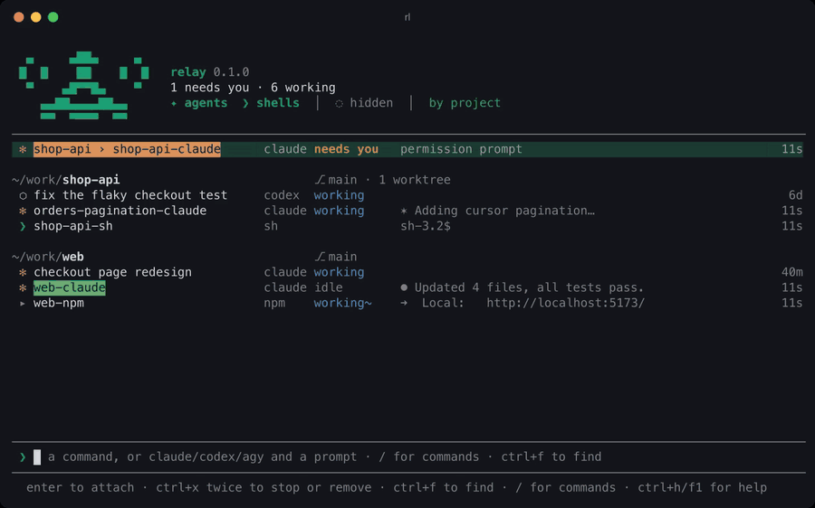
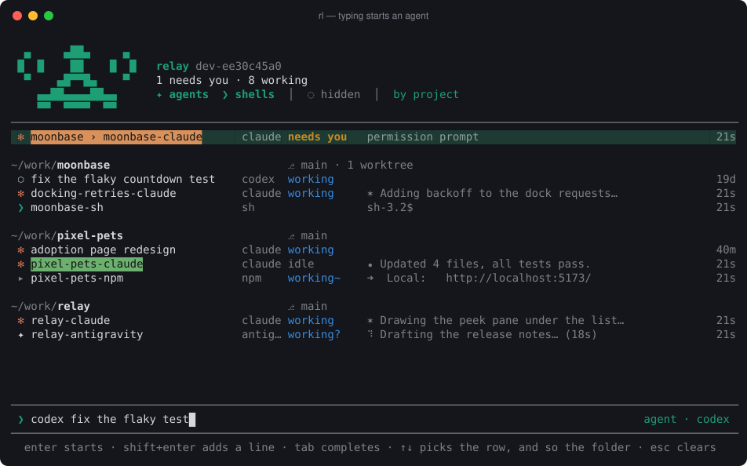

# Relay

Relay is `claude agents` for every harness: one list of your agent sessions (Claude, Codex, Gemini,
Antigravity and the like) and your shells, in the terminal you already use. Enter attaches. Agents
can message each other. No daemon, no model calls; macOS and Linux.



<sub>Typing a prompt starts an agent; `enter` attaches, `ctrl+\` comes back and leaves it running;
`ctrl+l` / `ctrl+o` toggle shells and hidden rows; `ctrl+s` groups by state.</sub>

## Why Relay

- **Your shell at your fingertips.** Agents and shells on one list, in the terminal you already
  use. Type a prompt to start an agent, `! make test` for a shell, `enter` to get into either. No
  new terminal, no panes, no multiplexer.
- **Your harnesses, one way in.** Relay doesn't replace Claude Code, Codex or Gemini: it uses each
  one's own background sessions, CLI and hooks. What it unifies is the interface: start any of them
  the same way, see which are running and which need you, attach to any.
- **Agents talk across harnesses.** A small MCP server (`who`, `send`, `inbox`) lets a Claude ask a
  Codex to review its diff and get the answer back.
- **Nothing leaves your machine.** No account, no server, no daemon, no telemetry, and Relay calls
  no model. It runs your harnesses on your machine and reads what they already keep there; they
  talk to their models as they always do. `gh` is optional: signed in, a project shows its open
  PR and `/report` can post an issue, only on your yes; without it, neither asks anything.

For one person running several agents at once, in more than one harness, who wants to see which
need them and get back into any of them. Not an orchestrator: no flows, schedules or summaries.

## Install

On macOS (Apple silicon or Intel) or Linux (x86_64 or arm64), no Rust needed:

```sh
curl -fsSL https://github.com/instilled/relay/releases/latest/download/install.sh | sh
rl
```

It downloads `rl` and `rl-session` for your machine, checks their sha256 and puts both in
`~/.local/bin`. It warns when that folder isn't on your `PATH`, or when another `rl` comes first.
`--bin-dir DIR` (or `RELAY_BIN_DIR`) installs elsewhere, `--version 2026.11-17-a1b2c3d4e` (or `RELAY_VERSION`) a
given release; pass them as `sh -s -- --bin-dir DIR`. **Update:** run the same line again.
Everything Relay keeps is in `~/.relay` (`RELAY_HOME` moves it). `rl --version` names the release
and commit; put it in bug reports. To take it out again, see [Uninstall](#uninstall).

The Linux binaries are static (musl), so any distribution runs them. The macOS ones are signed
ad hoc, not notarized: installed this way macOS doesn't ask. Downloaded from the releases page in a
browser instead, macOS says it can't verify them; `xattr -d com.apple.quarantine rl rl-session`
lets them run.

### From a clone

To hack on Relay, or on a machine without a release, build it: you need Rust (1.96 or newer, from
[rustup.rs](https://rustup.rs)), `git` and a C linker (on macOS: `xcode-select --install`).

```sh
git clone https://github.com/instilled/relay && cd relay
scripts/install
rl
```

`scripts/install` checks for those, builds once and links `rl` into `~/.local/bin`; it is safe to
run again, and takes `--bin-dir DIR` too. `RELAY_DEV_PROFILE=release` builds and runs release
binaries (keep it set where you run `rl`). `rl` runs from your clone and rebuilds itself when the
source changes, so **update** with `git pull`.

**Releasing:** `gh workflow run release` on main. A release is its day and commit: `rl --version`
says `2026.11-17#a1b2c3d4e` (`dev#…` for a build of your own), its tag is `2026.11-17-a1b2c3d4e`. The workflow builds the four targets with `scripts/package` and opens a draft
release with the tarballs, their sha256 and `install.sh` (`scripts/install-release`); publish the
draft once it looks right.

## Setup

The first `rl` walks you through setting Relay up for the harnesses it finds: their hooks, and the
`relay` MCP server for messaging. `enter` walks through it step by step, `tab` (or `y`) just sets
everything up, `q` skips. `rl setup` or `/setup` in the list runs the same walk any time.


Every change has a tick box; one you untick is remembered as declined and not asked for again. What
setup does:

- adds Relay's hook to each harness's user-level settings (Codex asks you to trust it once in
  `/hooks`; Claude may ask you to review it there). Antigravity has no hooks yet.
- registers `rl mcp --harness <name>` as an MCP server named `relay` (Claude's through `claude mcp
  add --scope user`, Antigravity's through `agy mcp add`, so those CLIs must be on `PATH`).
- for Claude, sets `leftArrowOpensAgents: false` in `~/.claude.json`, so `←` doesn't open Claude's
  agents view: Relay's list is that view.

While a harness on `PATH` needs setting up (installed later, or `rl` moved), the list's footer says
`setup needed: codex · /setup`. Without a terminal, or for scripts:

```sh
rl setup --yes      # set everything up (but what you declined), plain lines
rl setup --check    # change nothing; say what would change, exit 1 if anything
rl setup --remove   # take the hooks and the server out again (--harness H limits any of these)
```

## Uninstall

1. Close what Relay holds: `rl ls` lists it, `rl stop <name>` closes one. Claude's and Codex's own
   sessions are theirs and go on as before.
2. Take Relay out of your agents' settings, while `rl` is still there:

   ```sh
   rl setup --remove
   ```

   This removes Relay's hooks and its `relay` MCP server. It leaves Claude's
   `leftArrowOpensAgents: false`; delete that key from `~/.claude.json` if you want `←` back.
3. Remove `rl` and `rl-session`:

   ```sh
   curl -fsSL https://github.com/instilled/relay/releases/latest/download/install.sh | sh -s -- --uninstall
   ```

   From a clone: `scripts/install --uninstall`, then delete the clone.
4. Remove what Relay kept (sessions' state, mail, your list settings): `rm -rf ~/.relay`.

## The list

`rl` opens the list. Rows are agents and shells under their project (a folder you named, else its
git checkout, worktrees under their main one), or grouped by state: Needs input, Working, Done.
Claude's background sessions and Codex's threads are on it as their own tools show them, and
agents in other terminals are on it through their hooks (a Claude open in another terminal by the
name Claude gives it). `/project <folder>` adds a project with
nothing running in it yet; the cursor lands on it, so typing starts something there.

`enter` attaches; `ctrl+\` detaches and leaves it running (from a Claude or Codex session of
their own, their own detach or quit brings you back). A session Relay holds lives in a small process of its own
(`rl-session`), so closing the terminal or the laptop costs nothing.

**Start by typing.** The line at the bottom starts things in the project of the row under the cursor (its root, not a session's own worktree):



- `claude fix the login`, `codex …`, `agy …` (`gemini` and `antigravity` also start `agy`): that agent, the rest
  of the line its first prompt. Claude starts in its own background (`claude --bg`), Codex on its
  app-server daemon, the others in a session Relay holds.
- `! make test`: a shell command, in a shell Relay holds that stays a shell when it's done.
- `/name`: a command (below).
- anything else starts the default (`/default`): a shell command, or the whole line as a prompt to
  the agent you made the default.

The right end of the line says what it will start (`agent · claude`, `shell`, `command · pin`, or
`agy not found`). `tab` completes harnesses, programs, paths and commands. A prompt can have
several lines, and a paste keeps its newlines.

### Keys

`ctrl+h` (or `f1`) shows them all as a grid under the command line. Every letter types; the list's
own keys are ctrl keys, the arrows and `enter`.


| key | does |
| --- | --- |
| `enter` | attach; with text typed, start it |
| `ctrl+\` | detach, back to the list |
| `shift+enter` `alt+enter` `ctrl+j` | a new line in what is typed (`ctrl+j` for terminals that send `shift+enter` as `enter`; on an empty line it moves) |
| `tab` | complete; again cycles |
| `esc` | clear the line |
| `↑↓` `ctrl+j` `ctrl+k` | move |
| `pgup` `pgdn` `home` `end` | page |
| `shift+↑↓` | reorder |
| `ctrl+f` | find |
| `ctrl+r` | rename: the name stands selected, type over it or edit it; `enter` keeps, `esc` cancels |
| `ctrl+t` | pin |
| `ctrl+g` | your colour for the row (a colour the harness set wins on screen) |
| `ctrl+x ctrl+x` | on a session: `s` stop (while it runs) or `r` remove for good; on anything else, hide (or bring back) |
| `ctrl+a` `ctrl+l` `ctrl+o` | show agents, shells, hidden. Hidden rows stay off the list until `ctrl+o`, even when one needs you: the header counts those (`◌ hidden 2`), and shown, a hidden row or project says `◌ hidden` |
| `ctrl+s` | group by project or by state |
| `ctrl+h` `f1` | the keys |
| `ctrl+c ctrl+c` | quit |

The wheel and clicks move the cursor; hold shift (option on macOS) to select text.

**Stop and remove** do what each harness has for them:

| harness | stop | remove |
| --- | --- | --- |
| Claude | `claude stop <id>`; `claude attach` opens it again | `claude rm <id>`, with its worktree when that is safe |
| Codex | interrupts the running turn; the thread stays | deletes the thread on the daemon |
| held (shells, Gemini, Antigravity, …) | closes it; the row stays, ended | stops it if need be, removes it |

Where the harness refuses (`claude rm` with unpushed commits), what it said is shown and the row
stays. Relay never passes `--discard-unpushed` or `--force-remove-worktree`.

### Commands

Typed on the line, run on the row under the cursor. One that doesn't apply says why and changes
nothing.

| command | does |
| --- | --- |
| `/colour <name\|#rrggbb\|none>` (`/color`) | your colour for the row, as `ctrl+g` |
| `/rename [name]` | rename the row or project; with no name, as `ctrl+r` |
| `/pin` | pin or unpin |
| `/hide` | hide the row or project, or bring it back; an empty project you added comes off the list |
| `/project <folder>` | add a project (`tab` completes the folder; kept in `list.projects`) |
| `/stop` | stop a live session at once, no question |
| `/rm` | remove the session for good, asked first |
| `/agents` `/shells` `/hidden` | show agents, shells, hidden |
| `/group` | by project or by state |
| `/default <harness\|shell>` | what a line naming no harness starts (`list.default` in `config.json`) |
| `/setup` | the setup walk |
| `/report [dismiss]` | report a harness change (below), or dismiss it |
| `/help` | the keys |
| `/quit` | quit |

A rename reaches the harness where it can: a Codex thread is renamed on its daemon at once; a
Claude background session takes it the next time Relay starts it (carrying it on, or waking it for
mail). Otherwise (a hooked session, a held one) the name is Relay's, shown with the harness's own
dim beside it; search finds both. An empty name goes back to
the harness's own.

### Codex

Relay never holds a Codex session; every thread runs in Codex's app-server daemon (started if none
runs). `codex <prompt>` starts a thread and its first turn there, with your own `config.toml`; bare
`codex` runs Codex's TUI here. `enter` on a Codex row is `codex resume <id>`, and quitting it is the
detach. A turn waiting on an approval shows `needs input`; `codex resume` shows the prompt. The
threads Relay started stay listed as `resting` once the daemon unloads them (the latest 50); an
empty thread (no name, no prompt yet) isn't listed.

## Messaging

After setup, every agent has three tools from Relay's MCP server: `who`, `send` and `inbox`. Ask in
plain words:

> ask the codex session in shop-api to review my diff and send me what it finds

> when the tests pass, tell the claude session "web" to rebase on main

Codex is pinged when mail arrives; an idle Claude background session is woken to read it (stopped
and carried on with the message as its prompt), a busy one hears of it through its hooks; the others read it when they call `inbox`. The
[messaging guide](docs/messaging.md) has how it works and more use cases.

## From the shell

```sh
rl new [--harness H] [--cwd DIR] [--name-only] [-- ARGV...]  # start one (no arguments: a shell); prints its name
rl ls [--json]                       # the list once
rl attach <name>                     # ctrl+\ detaches
rl stop <name>                       # close a running session
rl rm <name>                         # remove one that is not running
rl color <session> <name|#rrggbb|none>   # a held name, or a row key (n:claude:<id>, o:claude:<id>)
rl setup [--yes | --check | --remove] [--harness H]
rl report [--dry-run | --dismiss]    # report a harness change, only on your yes
rl doctor                            # harnesses found, their versions, every drift noticed
rl mcp --harness H                   # the MCP server agents run
```

`rl ls --json` gives each row `kind` (`held`, `background`, `terminal`), `id`, `name`, `harness`,
`state`, `status` (`live`, `ended`, `lost`), `folder`, `started` and `holder_pid`; a harness slower
than 5s is left out and named on stderr. `rl hook` is what an agent's hooks call.

A session Relay holds gets `RL_SESSION` (its name), `RL_SESSION_AGENT` (its harness, `sh` for a
shell) and `RELAY_HOME`. For a zsh prompt: `PROMPT='${RL_SESSION:+[$RL_SESSION] }'$PROMPT`.

## Harness profiles

A harness is a YAML profile: `antigravity`, `claude`, `codex`, `cursor`, `gemini`, `opencode` and
`sh` are built in, and files in `~/.relay/detect/` merge over them or add new ones (unknown keys are
an error). The keys are in [ARCHITECTURE.md](docs/ARCHITECTURE.md#harnesses); see
`detect/claude.yaml` and `detect/codex.yaml`.

## When a harness changes

Relay depends on details of Claude and Codex that an update can change (`claude agents --json`, the
id `claude --bg` prints, Codex's app-server methods, the subcommands Relay runs). When one stops
being what Relay expects, Relay turns off only what needs it and the footer says so: `codex 0.170.0:
thread/name/set gone, rename stays in Relay · /report`. `/report` (or `rl report`) shows the GitHub
issue it would post and posts it only on your yes (through `gh`, else a prefilled link). No
conversation content is kept.

## Known limits

- Relay never reads a harness's screen to act or types into one: it uses only what a harness
  documents (its CLI, `claude agents --json`, Codex's app-server, the hooks). So a Claude is renamed
  only when Relay next starts it, and waking an idle Claude for mail carries its conversation on in a
  new background session under a new id (your name, pin and colour move to it; the old row is
  hidden, not removed).
- `rl mcp` in Codex can't tell which thread called it: a Codex caller passes `from`/`as` itself.
- Antigravity has no hooks or screen patterns yet, so its state is a guess.
- A Codex thread started with bare `codex` is listed only while the daemon has it loaded.
- Not run live yet: Codex's `turn/interrupt` and `thread/delete`, starting the Codex daemon, and
  the Gemini MCP entry.

## Docs

[messaging.md](docs/messaging.md), [ARCHITECTURE.md](docs/ARCHITECTURE.md) (how it is built),
[PRODUCT-ROADMAP.md](docs/PRODUCT-ROADMAP.md). The screenshots are made by `scripts/screenshots`
(needs tmux and python3), the recording by `scripts/demo-video` (also rsvg-convert and ffmpeg), both
on a made-up machine `scripts/demo-stage` sets up.

## License

[MIT](LICENSE), © 2026 instilled.
