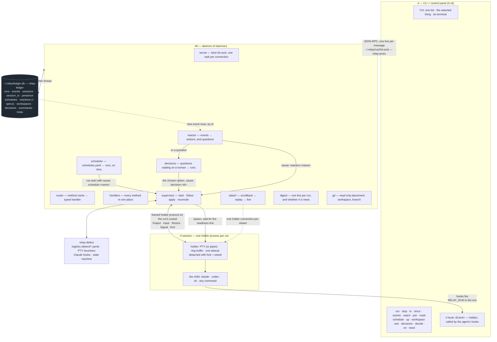
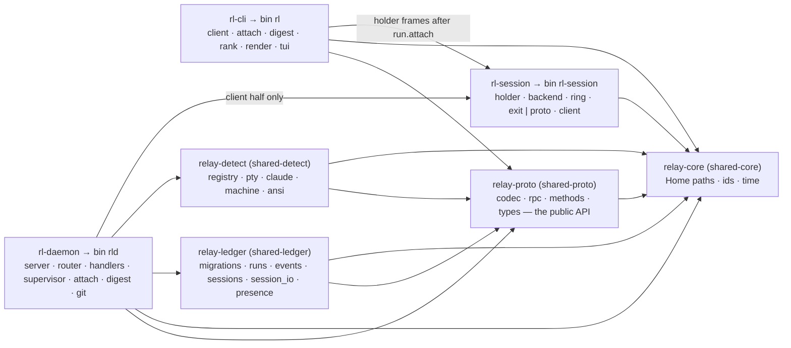
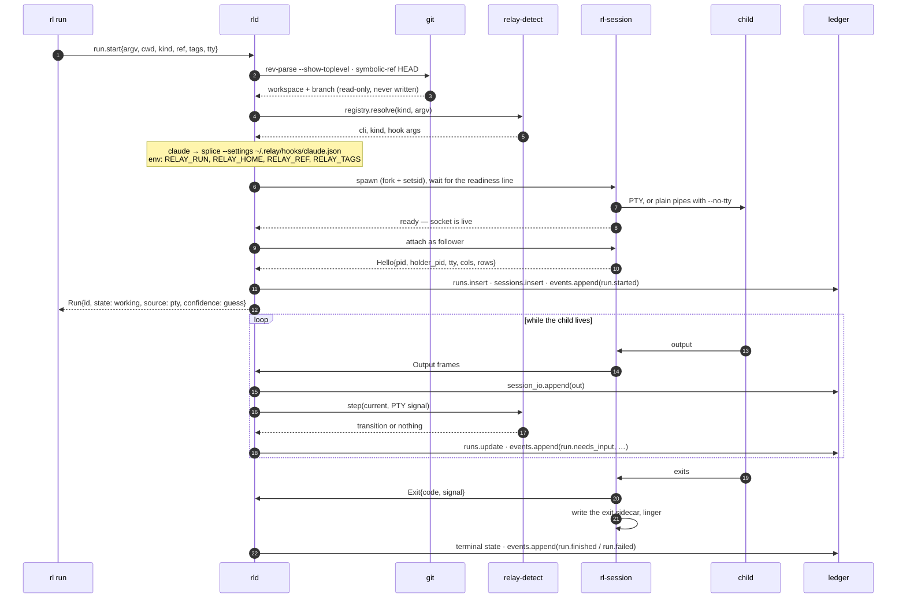
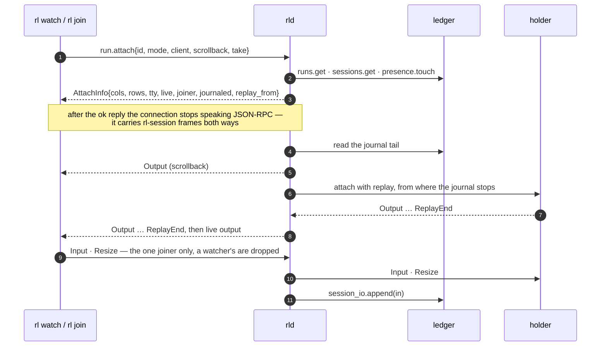
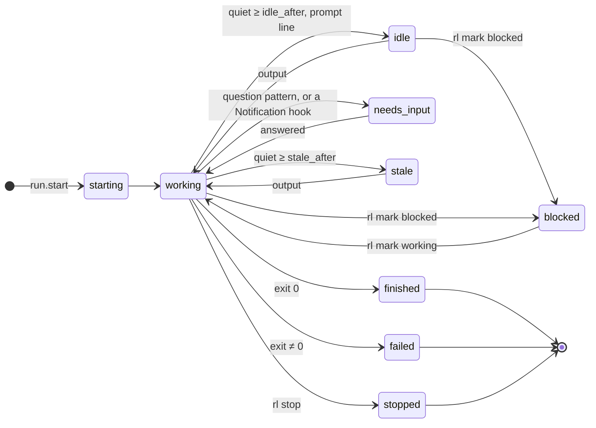

# Relay — architecture

**Status:** as built · **Date:** 2026-09-09 · **Tree:** `reactions` branch

[PRODUCT.md](PRODUCT.md) says what Relay is for and where it is going. This file says how the
tree that exists is wired: which processes there are, who owns what, and what crosses which
boundary. Every diagram describes code under `code/`; what is not built yet is listed at the
end and marked in the diagrams with dashes.

---

## 1. Processes

Three kinds of process and two socket protocols. Nothing else talks to anything.



What the picture is enforcing:

- **`rld` never owns a child.** Every run lives under its own `rl-session`; the daemon is only a
  client of that holder. A daemon crash, restart or upgrade therefore costs no sessions —
  `Supervisor::reconcile` finds the open sessions in the ledger and resumes the journal exactly
  where it stopped.
- **The holder depends on nothing else in Relay.** Its protocol is deliberately not JSON-RPC and
  not shared with `relay-proto`: a session must stay reachable with only that one binary alive.
- **`rl` speaks only `relay-proto`.** No client reads the ledger, and `--json` is the same data
  the TUI draws.
- **The ledger is one SQLite file behind one writer thread.** Every access ships a closure to
  that thread, so a call that returns has been applied.

---

## 2. Crates



`rl-session` splits in two on purpose: the library half (`proto`, `client`, `exit`) is what `rld`
links, the binary half (`holder`, `backend`) is the process itself.

---

## 3. Starting a run



After a daemon restart, `reconcile` walks `sessions` where `closed_at IS NULL`: re-attach where
the holder still answers (resuming the journal, with a `note` line if bytes were lost while the
daemon was down), otherwise close the run from its exit sidecar — or as lost.

Starting the daemon is nobody's job. Every `rl` command that needs it goes through
`daemon::ensure`: `rld` is spawned when the socket is not there (one line on stderr, `rld
started`), and the running one is compared with this `rl` — the same release, nothing to say;
another release with the same wire protocol, `rl` offers `rl daemon restart` on a terminal and
only notes it otherwise; another protocol, `rl` refuses, since messages could be misread. A
restart costs nothing running, which is what makes the offer cheap. `rl daemon start|stop|
status|restart` remain for saying it explicitly; a hook from inside a run (`rl hook`) never
starts a daemon.

---

## 4. Watching and joining



Several watchers, one joiner; a second `join` is refused unless `take` turns the previous joiner
into a watcher. Each viewer gets its own holder connection, and the supervisor's follow
connection journals regardless — so a viewer leaving costs nothing and the run never notices.

The panel (`rl` with no command, `rl-cli/src/tui`) is the same two calls behind one screen. It
is one list, the width of the screen, built from `digest.get` (`tui/rows.rs`): questions first,
then runs by attention, grouped by the folder they belong to, and named — a workspace by the
name it was registered under, a cause as "schedule nightly" or "rule tests-failed", never an id.
A row is a mark (`✱` needs you, `·` going, `•` ended, `▸` a job), the title, the state as a word,
the summary to the edge, and the ref and the age at the right. Colour carries the state — a
saturated accent per state, on the terminal's own foreground so it reads on either theme
(`tui/theme.rs`). The panel sits in a gutter of air, with a rule between its sections — under the
header, above the line, above the footer — and the list and its detail pane split by a vertical
bar; the full-screen terminal drops all of it for the cells. A group's header is its name, then the folder it lives in, then the rules that
live there — `↻ nightly 4h · ⚡ tests-failed`, accented and amber when one waits for a yes, with a
`+N` when more than fit — and, at the right edge, the tally of how many jobs and reactions the
folder holds; the global rules — the ones in the Relay home, which apply in every folder — get a project row of
their own, `global`, shown with that home (`~/.relay`) where a folder row shows its folder — always,
rules or none: it leads the list when one waits for a yes, otherwise it trails with the idle
projects, and either way the cursor stops on it, `enter` (or `^o`) shows its schedules and
reactions in the pane, and `/rules` opens them. Runs a schedule or a rule
started fold, once ended, into one line per job — name, cadence, how many went well, the last
outcome — so a job firing every thirty seconds is a row, not a screen; a run still going or
waiting on you is never folded, and `enter` on a job opens it to its last twenty. When the list
is taller than the screen, its first and last lines say how much is above and below. A group's
header says which folder it is in, and the cursor stops on it like any other row: `enter` (or
`^o`) turns the pane into the project's own — the folder, how its runs stand (needs-you /
going / done), when it last stirred, and the schedules and reactions that live there. `/rules`
from a header drops into the rules view filtered to that folder; `^r` (or `/rename`) renames
whatever the cursor is on in place — a folder over `workspace.rename`, which updates the
registered name and keeps the registration, a run (a shell is one) over `run.rename`, and a job
through the form of the rule it comes from. A folder you
`rl up`'d is always on the list, even before anything has run there: its header sits below every
group with activity, under every lens — a lens narrows what shows inside projects, never which
projects there are — so you can select
it, read its stats, edit its rules or open its shell (`^t`) from the first. `/up <path>` registers a
folder from the line — the panel's `rl up`, over `workspace.up` — and lands the cursor on its new
row. Moving the cursor onto a row is looking at it;
`/archive` on an ended run (or a job) is being done with it — `run.archive` sets `runs.archived_at`,
the digest leaves it out, `rl ls --all` and the ledger keep it — and `/archive seen` does it for
everything ended that has been looked at, except what is pinned. `^p` (or `/pin`) pins the run under
the cursor — `run.pin` sets `runs.pinned_at` — and it stands above every project, in the order
pinned, named with its folder (`relay › deploy shell`), under every lens and however long ago it
ended; `^p` again lets it go back, and archiving it by name unpins it. `ctrl-x` is the one keystroke for it, whatever the row,
and it asks first: the first press arms it and says what a second would do — remove an ended run
or a job, stop one still going, dismiss a question — and the second press does it, while any other
key disarms it, so nothing goes on a single slip (the way an agent view confirms a delete). `ctrl-c`
is the same for leaving: once to ask, again to quit. A run still going is stopped, and a `ctrl-x`
once it has ended removes it. Nothing is destroyed by any of this; that is retention's alone. Ended runs also leave on their own after a day;
`/archive` is for the impatient. On the line: `rl archive <id>…`, `rl archive --all`. Nothing is ever deleted here; that is
retention (§7). `enter` on a run opens its terminal, watching: a re-render of the run's output
through a `vt100` screen (`tui/term.rs`), shown as a tile beside the list — the list stays, the
line at the foot stays yours, arrows still walk the list, and `esc` closes the tile. It stays
pinned to its run while you browse; another run's `enter` moves it. `/pane full` pops the tile to the
whole screen. That re-render is right for a glance, but to *drive* a run you want the actual
terminal — native scrolling, the mouse, the true size, no chrome. So `enter` again on the tile's
run (or `/join`) hands it over: the panel steps out of ratatui and pipes the run straight to the
real terminal, tmux-attach style — stdin is the run's input, its output is ours, `SIGWINCH` is a
resize, and `ctrl-\` lets go, back to the list. This is the same passthrough `rl join <id>` uses
(`rl-cli/src/attach.rs`), so it is also a standalone command: `tmux split-window 'rl join <id>'`
puts a live pane wherever you like. Watching is only a re-render; joining is the run's own
terminal. Stepping back from watching does not throw the view away — the watch connection stays
open and goes on reading, so `enter` on that run again returns to it at once, where it was left,
with nothing replayed. `pgup` and `pgdn` read back through what scrolled off — the screen keeps
ten thousand rows above itself — and the footer says how far back you are. New output never yanks
the view to the bottom. An ended run keeps what it printed after its holder has gone,
to be read the same way. `^o` (or `/pane`) opens a pane of
facts beside the list (`tui/pane.rs`): a run's facts and recent events, a job's tally, a question
with its options numbered; `enter` on a question opens that pane and takes the question out of
the list, where the number answers it, which is `decision.take`, and the run it starts becomes
the selection. `/summarise` on an ended run asks
`assistants.summarise` what it did (§6): the asking is a run in the list, and the answer lands in
the pane under the facts as `claude said, 2m ago`, always marked as the assistant's; asking again
asks anew. 

**Typing is what the panel rests in.** One line sits at the foot and always takes what you type
(`tui/line.rs`), so there is nothing to open and nothing to close. What a finished line means is
read locally first: a first word naming an agent the registry knows (`agent.list`, never a
hardcoded list) is that agent with the rest as its prompt; a first word this machine can actually
run — a binary on `PATH`, a target in the folder, or a name your own shell knows (its aliases and
functions, read from `$SHELL` once at startup and again on `/reload shell`) — is a shell line, and a
leading `!` forces one. An agent is `run.start` in the folder of the row the cursor is on, sized to
this screen; a fresh
agent is one you mean to drive, so its terminal is handed to you at once (the raw passthrough
above). A shell line does not start a run of its own: it goes to the folder's **warm shell** — one
persistent `$SHELL -i` per project (`run.start`, tagged `shell`, spawned the first time a folder
needs one and kept), so its rc is read once and its aliases and functions are there. The line is
written to that shell's stdin (`run.input`, which feeds a live run's terminal over the daemon's own
holder connection, no join, journaled as input) and the shell's tile comes up so you watch it run.
Which shell: the one under the cursor when it is a shell, else the project's. Anything else is plain words, and those go to `assistants.interpret`
(§6) as a run of its own — it is in the list like any other, `/stop` there stops it — while the
panel stays yours. What comes back fills the form (`tui/form.rs`), and your `enter` is what does
it; the assistant never starts anything. The line says which of the three `enter` will do at its
right edge — a glyph and a colour, accented when it will run something here, dim when the words
are only asked (`❯ runs in api`, `✦ claude here`, `… asks the assistant`) — before you commit, so a
call that leaves the machine is never sprung on you. A longer thought needs more than one line:
`shift-enter` (or `alt-enter`) drops a newline in rather than sending, and the band grows a row
per line up to eight before it windows around the caret, so `enter` still means send. The
modifier is only there to catch where the terminal speaks the kitty keyboard protocol
(Ghostty, WezTerm, recent iTerm2), which the panel asks for on the way in and gives back on the
way out; where it does not (Terminal.app), plain `enter` sends as always.

A shell you entered through Relay is still your own shell, so it is easy to lose track of being in
one. Nothing of Relay's is ever drawn over a run's screen — the window title carries the status and
the screen itself is left alone — so the mark is one Relay hands over rather than paints: every run
carries `RELAY_RUN` in its environment (with `RELAY_HOME`, and `RELAY_REF`/`RELAY_TAGS` when the run
has them), which a prompt can read for itself. In zsh, `RPROMPT='${RELAY_RUN:+●}'` puts a dot at the
right edge while you are in a Relay shell and nothing at all when you are not; bash appends the same
to `PS1`. A dot the prompt draws survives whatever the run paints next, which one Relay put in the
corner itself would not.

The same hand-over carries facts the other way. A prompt that emits OSC 133 marks — `A` where it is
drawn, `B` where what you type begins, `C` where the command starts running, `D` with the exit code
when it ends — tells Relay one command from the next, and each becomes a `shell.command` event with
what was typed, how it came out and how long it took; the newest is the shell's row. Many prompts
(starship, powerlevel10k, the shell integrations of iTerm2, WezTerm and kitty) already emit them, so
there is nothing to do; `rl shell-init zsh` prints a snippet for prompts that do not. Relay reads
the marks and never writes your rc. Without them nothing is guessed: no events, and the shell's row
says nothing where a run says what it last did.

`tab` completes the word being typed (`tui/complete.rs`), rooted in that same folder: the first
word against the agents the registry knows, the folder's `Makefile` targets and `package.json`
scripts, and the binaries on `PATH`; after `every` a duration, after `on` an event kind; anywhere
else the files and directories of the folder. What every candidate shares goes in first, and
`tab` again walks the rest. When a list is on offer — those `tab` words, or the `/` commands a
`/` line names — the arrows walk it too: `↑`/`↓` light a candidate with a caret, `tab` or `enter`
takes the lit one (a command is filled in with its name for you to finish, never run on the
spot), and typing anything clears the highlight so `enter` submits the line as before.

Because letters go into the line, everything that is not typing is a `/` command
(`tui/palette.rs`), offered as you type it: `/stop`, `/archive [seen]`, `/mark`, `/join`,
`/shell`, `/rename`, `/pin`, `/pane [full]`, `/rules`, `/graph`, `/reload [rules|shell]`, `/approve` and `/pause`,
`/new`, `/edit [file|schedule|reaction]`, `/summarise`, `/ask`, `/filter`, `/lens`, `/prune`,
`/up`, `/help`, `/quit`. One name per act: a variant of an act is an argument to it rather than a
command of its own, and no word means two things — `done` is only ever what `/mark` says. `enter` on an empty line
is the row under the cursor instead — a job opens, a schedule offers to fire, a question comes
out of the list to be answered by number, a run's terminal opens. Arrows, `home`/`end` and `esc`
belong to the list; `esc` with something typed clears the line first, and `ctrl-c` leaves.
The few keys that are not the list's or the line's each stand for a command, and the command
list shows them beside it: `^x` stops or archives, `^r` renames, `^p` pins, `^g` opens the graph, `^o` shows or hides the pane,
`^t` opens another shell in the folder. The line keeps `^a`, `^e`, `^u`, `^k` and `^w` for
editing, as a shell does, so none of those is ever taken for anything else.

At the right of the header is the lens — `all · agents · jobs · reactions`, the one in force
accented — and the list shows
only that slice: agents by what a run is, jobs and reactions by what started it (so a scheduled
agent is in both `agents` and `jobs`, since the lens is a question, not a partition). Questions
ignore it; they are what needs you, whatever slice you are in. `tab` on an empty line steps the
lens along (shift-`tab` back), and `/lens all|agents|jobs|reactions` jumps straight to one;
it composes with `/filter`. One-off shell commands live in `all` while they run and are recent.

`/new` is the form for a rule written by hand: `in` (a folder, or `global`), `name`, `when`
(`every 30m`, a cron line, or `on run.failed` — which decides between `schedules.yaml` and
`reactions.yaml`), `run`, `title`, `tags`, `cwd`. `enter` writes the block into the file
(`rulefile.rs`: the block of that name replaced in place or added at the end of the mapping,
comments and the other rules untouched, the result checked to parse), reloads, and approves it —
your keystroke is the yes; a folder new to Relay is registered on the way. `/edit` on a rule, or
on a job row, is the same form filled in; saving rewrites only that block and keeps what the form
does not show (`env`, `where`, `ask`), and a rename or a move takes the old block out. `/edit file`
opens the file in `$EDITOR` at the rule's line and reloads on return — an edit made there is a
file change, so it waits for `/approve` like any other.

Nothing is remembered between openings except presence: leaving the panel is what `rl since`
counts from.

---

## 5. How a run's state is decided

Every source produces a `Signal{state, source, confidence}`; `relay_detect::step` is the only
place a `(current, signal)` pair becomes a transition, and it decides against the ledger row.

| Source | Confidence | Wired today | Where from |
|---|---|---|---|
| `hook` | exact | yes | Claude Code hooks → `rl hook <Event>` → `run.hook` |
| `manual` | exact | yes | `rl mark done \| blocked \| working` |
| `pty` | guess / likely | yes | output-idle timers + prompt/question patterns over the byte stream |
| `transcript` | exact | not yet | `~/.claude` transcripts |
| `git` | exact | placement only | commits landed, branch done |

The rules, in order: terminal states never change here; `stale` only ever replaces
`working`/`starting`; a PTY guess never overrides an exact state from another source; the same
state again upgrades source/confidence at most; anything else is a transition, journaled as an
event.



`needs_input`, `blocked` and `failed` are the attention states: they sort to the top of the
panel's list and are what `rl since` leads with. Confidence rides along in the UI, always visible.

Grouping is derived, never a table: `group_key = ref → branch → workspace`, materialised onto
each event row at write time so the digest groups without a join.

---

## 6. What starts a run

Every run says why it is there. `Run.cause` is one string — `manual`, `schedule:<name>`,
`decision:<id>`, `reaction:<name>`, `assistant:<job>`, and later `workflow:<name>/<step>` — and `Run.flow` is
the chain it belongs to: its own id when it starts one, the flow it was handed otherwise. A
nightly schedule that asks a question whose answer opens a pull request is three rows and one
flow.


**Actions.** A schedule's entry and a decision's option are the same shape, and one function
turns that shape into a `RunSpec`. Adding workflow steps later adds no third dialect. What runs
is written under one key, in whichever of the three forms fits:

```yaml
run: "date +%T >> pulse.log"     # a string goes through sh -c
run: [grep, -c, ERROR, app.log]  # a list is argv, no shell
run:                             # a map is an agent, run headless:
  agent: claude                  #   the profile's headless args, then args, then the prompt
  prompt_file: standup.md
  args: [--model, opus]
cwd: ~/work/api                  # and these decorate it, whichever form
env: { CI: "1" }
tags: [nightly]
ref: gh:1
title: nightly checks
no_tty: false
```

The parser for those three forms is hand-written, so a mistake says which form it could not
read rather than that nothing matched.

**Decisions** are the human node, and they never block. `rl ask` writes the question and
returns; the run that asked can finish, and the question waits in the ledger with its options.
Answering is the only thing that starts the follow-up runs, and the row moves to `taken` before
they start, so two `rl decide` racing cannot both fire. A `group` key is unique among open
questions: asking the same thing again restates the open one, keeping its id, so a nightly job
leaves one line rather than thirty. An `expires` either takes the option marked `default` or
moves the question to `expired`; the sweeper sleeps until the earliest deadline and does
nothing when there is none.

**Reactions** are the other direction: every event the ledger records is offered to the rules in
`reactions.yaml`, and a rule either runs something or asks a question. A rule says which kinds
it wants (`run.failed`, `run.*`, `*`), may narrow by `where` (the run's tag, cause, cli, or the
event's group), and fills `{summary}`, `{title}`, `{run}`, `{data.x}` and the rest into whatever
it runs. The whole event is in the child's environment as `RELAY_EVENT`.

**Emitting events.** A run's own output is not the only thing that lands in the events table:
`rl emit <kind> [--data k=v]… [--json-data -]` puts one there itself, and the reactor picks it up like
any built-in event (`event.emit`, appended by `rl-daemon/src/handlers.rs`). Inside a run it needs
no arguments beyond the kind — it reads `RELAY_RUN` from the environment, the same way `rl ask`
does, so the event is filed under that run's folder and joins its flow; outside a run, `--in
<folder>` (or the cwd) says where it belongs. The kind is the caller's own dotted name
(`log.issue`); the daemon's own families (`run.*`, `decision.*`, `schedule.*`, …) are refused, so
an emit cannot forge a `run.failed` the digest would read as real. The payload rides in `data`,
reachable in a reaction as `{data.severity}` and matchable with `where: { data: { severity:
[ERROR, WARNING] } }`. This is all a "source" needs: a schedule runs a probe on a cadence (with
`RELAY_LAST_RUN` in its environment, the previous firing, so it can ask "what is new since then"
without keeping its own clock), the probe `rl emit`s what it finds, and a reaction fans out to an
agent that works it and `rl ask`s. A plugin, for now, is just such a command; a lightweight JS/TS
SDK over the same `rl emit` / `rl ask` / `rl run` contract is on the roadmap.

Three things keep a rule from running away with itself. A run it starts carries `cause:
reaction:<name>` and a question it asks remembers the same, so no rule ever answers its own
doing. A throttle, ten seconds by default, collapses a burst. And the loop reads the event table
by id from a cursor kept in `meta`, ignoring anything older than five minutes, so a daemon that
was down does not come back and fire a day of history.

`rl on run.failed -- notify "{summary}"` appends a rule to your own file and reloads; the file
stays yours, comments and all. `rl react test <event>` replays one real event through every rule
and prints what each would do, and why it would not. `rl every 30m -- make test` (a cron line in quotes works too; `--agent claude -- <prompt>`,
`--in <folder>`, `--global`, `--cwd`, `--title`, `--tag`, `--name`, `--replace`) writes a schedule into
this folder's `.relay/schedules.yaml` — or yours with `--global` — through `rulefile.rs`, registers
a folder new to Relay, reloads and approves it: the command line is the yes. A name already
there is refused unless `--replace`.

**Rules** is how both are shown: `rule.list` returns every schedule and reaction as one
`Rule` (`relay-proto/src/rule.rs`, a tagged enum over the two rows with one set of accessors —
`when()`, `does()`, `status()`), and `rule.approve` says yes to one of them by name, which the
per-folder `rl up --yes` never allowed. `rl rules` is the table; `rl rules approve|pause|resume|run
<name>` act on one, finding its kind by name (`--kind` when a schedule and a reaction share it,
`--in` when two folders do). In the panel, `r` flips the list to rules — grouped by whose file,
what needs a yes on top, narrowed to the folder of the row it was pressed on until `esc` — and
`y` approves, `p` pauses, `enter` fires a schedule now. The two YAML
files, the two ledger tables and `rl schedule` / `rl react` are unchanged underneath.

**Your defaults, and the agents Relay itself uses.** `~/.relay/config.yaml` is the one place for
defaults (`relay_proto::config`, read by `rld` at start, on `config.get` and on a rules reload —
`rl-daemon/src/config.rs`). Absent means all defaults; a key it does not know is refused with the
line, so a typo cannot silently do nothing, and a file that does not parse is reported by
`rl config` (exit 1) while the daemon runs on defaults. Keys arrive one at a time, when a need
does. The first is `assistants`: the agents Relay hands its own jobs to, keyed by job, each a
name or a map:

```yaml
assistants:
  interpret: claude     # what you type at a / rl interpret "…" in plain words → a draft for your enter
  summarise: claude     # what an ended run did, in three sentences (s, rl summarise)
  # interpret: { agent: claude, model: claude-haiku-4-5-20251001, args: ["--max-turns", "1"] }
```

Which CLIs are agents is not configured: the detection registry says (`detect/*.yaml`,
`kind: agent`, `bins`, `headless`, and now `model_flag`, the flag that names a model), and `rld`
looks for each on `PATH` when asked — `agent.list`, `rl agents`. An assistant resolves to an
argv: the binary, the headless arguments, the model through the profile's flag, the extra
arguments; the prompt goes last. Unset, it is the first available agent; a name the registry
does not know, or a `model` for a profile without `model_flag`, is an error, never a guess.
`rl config` prints each resolved assistant and where it came from; `rl config edit` opens the
file, and `rld` seeds it, all comments, when there is none. Later assistants (`triage`,
`answer`) will be keys in the same map. The second key is `retention` (§7).

**What an assistant is told** is the context pack (`rl-cli/src/context.rs`, `rl context
[--in <folder>]`), built from the code so it cannot drift: the words (run, folder, `global`,
rule, job, question, agent, `when`), one line per event kind in `event_kind::ALL` (a kind
without words fails a test), the fields of a schedule and a reaction (every serde field of
the specs must be explained, or a test fails), the placeholders a reaction can use, `rl
--help` plus the help of `run`, `every`, `on` and `ask`, what is here (the folder and its
name, the folders Relay knows, this folder's and the person's rules, the agents on this
machine), and the answer contract: exactly one YAML document, `kind: run | schedule |
reaction` then the form's fields.

**The interpreter** is that pack, the typed words and an ordinary run. The panel's line (§4) and
`rl interpret <words…> [--in <folder>] [--go]` build the pack on the client (it needs clap's
help, which only `rl` has) and call `assistant.run`; `rld` resolves `assistants.interpret`,
starts the agent headless with the prompt as its last argument (`rl-daemon/src/assistant.rs`:
`cause: assistant:interpret`, tag `relay:assistant`, cwd the folder asked about, no tty), waits
for it to end — 60 s, then it is stopped and the caller told so — and returns the run's id and
what it wrote. The client reads the last `kind:` block out of that by hand (`rl-cli/src/
interpret.rs`: fences and prose around it dropped, `key: value` lines, block and flow lists; not
a YAML parser, because an agent writes `run: claude fix it: now` and means it) and fills the
form. In the panel that is the same form `/new` and `/edit` open, with the assistant's answer in
it and a line saying who drafted it; `rl interpret` prints the draft with `# by <agent> · run <id>` and does
nothing, or with `--go` starts the run or writes the rule on the line, `cause: manual`, since the
go was yours. When the words are typed with a rule under the cursor in the rules view, the
prompt carries that rule as it stands and asks for the whole rule as it should be. An answer without a `kind:`
is an error that quotes what the agent said. Interpretation is a run, so it is in the list, in
`rl ls --all`, in the journal, and under retention like everything else; nothing about it is
special except its cause.

**The summariser** is the same machinery pointed at an ended run. `/summarise` in the panel and
`rl summarise <id> [--again]` call `summary.make`; `rld` (`rl-daemon/src/summarise.rs`) puts
together what it knows — the run's row (title, command, folder, cause, when, how long, exit),
its events, the last 64 KB of its output — asks for three sentences of prose, and runs
`assistants.summarise` as an assistant run (`cause: assistant:summarise`, titled `summarise:
<the run's title>`). The answer is kept in `summaries`, one per run with the agent, the time
and the assistant run that wrote it, and said as a `run.summarised` event; `summary.get` reads
it without asking, and `summary.make` returns the kept one unless `again`. Facts come first
and the narrative is always marked as the agent's, in the pane and on the line (`# by claude ·
2m ago`). No git or transcript facts go in yet: that is the facts collector (§8). Two things
are never summarised: a run still going, and an assistant's own run — so a rule like

```yaml
summarise-what-ends:
  on: run.finished
  run: rl summarise {run}
```

summarises every run that ends well and cannot feed itself. Nothing seeds that rule; on demand
is the default.

Relay still talks to no one itself. A question surfaces in `rl decisions`, in `rl since` and at
the top of the panel, where a number key answers it; getting it to Slack or mail is a reaction on
`decision.raised` running your own command.

**The wiring graph** is all of this as one network. A reaction hears events from every folder,
whatever file it is written in, so there is one graph, not one per project. `graph.get
{since}` (default: the last 7 days; `rl-daemon/src/graph.rs`, pure over rows from
`rl-ledger/src/graph.rs`) returns nodes and edges. The nodes are:

- schedules (`schedule:<scope>/<name>`) and reactions (`reaction:<scope>/<name>`);
- what a rule runs (`run:<rule>`, a shell or an agent), and a reaction's question (`ask:<rule>`,
  with the ids still waiting) plus what each answer runs (`run:ask:<rule>/<key>`);
- runs you started, one node per folder and kind (`runs:shells:<folder>`), drawn only once
  they set something off;
- events raised outside any run, per folder (`outside:<folder>`);
- an event kind a reaction listens for that nothing raised in the window (`event:<pattern>`),
  so every reaction has a way in.

Each node carries its folder as a fact rather than a box, its rule's status, and how its runs
went in the window. The edges are of two kinds:

- **Declared**, from the files: a rule to what it runs or asks, a question to each answer's
  run, and the kinds a schedule or reaction says it `emits:`.
- **Observed**, from the ledger: which runs raised which event kinds, and so which reactions
  heard them, labelled with the kinds and counted. A run maps to its node by its cause. An
  event with no run but a `data.decision` belongs to the question it is about. A reaction's
  own runs and questions never reach it.

`emits: [logs.error]` on a schedule or reaction is only for the graph: it wires a command
before it has ever raised anything.

In the panel, `/graph` (or `^g`) swaps the list for the graph, and `^g` or `esc` goes back to
wherever it was opened from; each view keeps its own selection. `tui/graph.rs` lays it out and
draws it, pure from a `Graph` to a grid of styled cells:

- **Layered, by connection.** A node's column is one past the furthest thing that feeds it,
  so a schedule is at the left because nothing feeds it, not because it is a schedule. Edges
  that close a loop are set aside for ranking and routed back along the bottom.
- **Ordered within columns.** Nodes are sorted by where their neighbours sit, a few sweeps
  each way, and each is placed level with what feeds it where there is room, so a chain is a
  straight line.
- **Edges run right-angled.** Each leaves its source on a row of its own, turns in a lane of
  its own in the gap before the target, and enters on a row of its own, with the event kinds
  and count written past every lane in that gap. Lines that meet join into the box-drawing
  character they make.
- **Kind by glyph and colour.** `◷` schedule (blue), `↯` reaction (yellow), `◇` question
  (amber, bright while someone is waiting), `❯` shell (teal), `✦` agent (magenta), `◆` an event
  nothing raised yet. Every glyph is one column wide, so borders stay in line. The border turns
  red when the last run failed and dims when the rule is paused. `!` marks a rule waiting for
  approval.
- **Moving.** `←` and `→` follow the wiring, to what feeds the selected node or what it feeds,
  taking the nearest in height. `↑` and `↓` stay in the column, and reach the nearest box above
  or below when the column has none. The window pans to keep the selection in view, and its
  edges are lit. `/filter` keeps what matches (name, folder, when) plus everything upstream and
  downstream of it.
- **Acting on a node.** A node stands for its rule, or for what its rule runs or asks, so
  `/approve`, `/pause` and `/edit` work on it as in the rules view. `enter` on a question with
  someone waiting takes it out to be answered by number in the pane, the same as in the list,
  and the cursor goes on to what the answer ran. `enter` on a schedule, or on its command,
  offers to run it now. Anywhere else, `enter` (or `^o`) shows the node in the pane: what it
  is, its rule as the rules view shows it, how its runs went, and what it is wired to on
  either side.

---

## 7. On disk

**Retention is the one delete, and only when told.** Relay is a memory: runs and events are
never removed, `rl archive` only puts a run away. What does grow without bound is the journal — a
run's terminal bytes in `session_io`, its `log/<run>.log` and `run/<run>.exit|.env` sidecars —
and `retention: 30d` in `config.yaml` (or `retention: { journal: 30d }`) lets that go for runs
ended longer ago than that (`rl-daemon/src/gc.rs`, `gc.run`). The run and its events stay, and
a `run.journal_dropped` event on the run says how many bytes went; attaching to such a run shows
nothing, honestly. `rl prune` does it now (`--older-than 12h` for once, `--dry-run` to count; `/prune` in the panel), `rld`
does it once a day when the key is set (`meta.gc.last_at`); unset, nothing is ever deleted.
Facts (`retention.runs`) are deliberately not a key yet.


```text
~/.relay/                     ($RELAY_HOME overrides; tests and scripts/live point it elsewhere)
  ledger.db                   SQLite: runs, events, sessions, session_io, presence, schedules,
                              workspaces, decisions, summaries
  schedules.yaml              user-level schedules; the file is the interface, the ledger keeps
                              versions (by sha256), pause state, last/next firing
  config.yaml                 your defaults (`assistants:`, `retention:`); absent means defaults,
                              unknown keys refused
  reactions.yaml              user-level rules: events → actions, or questions; same file-first
                              deal, same versioning (`rl on` appends to it)
  run/                        0700 — rld.sock, rld.pid, <run>.sock, <run>.exit
  log/                        rld.log, <run>.log
  hooks/claude.json           written at daemon start; passed to claude as --settings
  detect/*.yaml               user overrides, merged field by field over the built-ins
  plugins/                    (empty — see below)

<workspace>/.relay/           per folder registered with `rl up` — the trust boundary
  schedules.yaml              versioned with the folder; a version fires only once approved
                              (approved_hash == hash); an edit asks again
  reactions.yaml              the same, for rules; `rl up` loads and approves both

detect/*.yaml                 in-tree, compiled in: generic, claude, codex, cursor, sh
scripts/{rl,rld,relay-dev}    dev shims: build if needed, run the debug binaries
scripts/ci                    the CI checks, on Linux, in a container: the same three commands
                              ci.yml runs (fmt, clippy -D warnings, the suites), against its own
                              target/ and cargo registry so macOS artifacts never mix in
scripts/live                  a live Relay to poke at: its home is live/home, seeded from
                              live/seed by `scripts/live reset`; `scripts/live <rl args>` talks
                              to it, and the recorded claude player is first on its PATH
live/seed/                    what reset copies: global schedules.yaml + reactions.yaml and a
                              ws/ workspace (everything else under live/ is throwaway)
```

Sockets normally live in `run/`; a long `$RELAY_HOME` would blow the ~104-byte `sockaddr_un`
limit, so both sides fall back to the same short hashed directory under the temp dir.

---

## 8. Not built yet

Named here so the diagrams above are not read as the whole plan — see §7 of the brief for
phasing.

- **Workflows** — `workflows/<name>.yaml`, steps with `after`/`when` and decision steps, as
  declarative sugar over the engine that reactions and decisions already are. `Run.cause` and
  `Run.flow` carry `manual`, `schedule:<name>`, `decision:<id>`, `reaction:<name>` and `assistant:<job>` today;
  `workflow:` is reserved. `rl up` loads a folder's `schedules.yaml` and `reactions.yaml`;
  `workflows/` is not read yet.
- **Plugins** — `rl-plugin-host` (Bun), the broker, `relay.d.ts`, the manifest/approval flow,
  action keys and the detail tab. `~/.relay/plugins/` exists, unused.
- **Facts** — the collector, transcript ingestion, cost: commits and diffs on the branch,
  commands with exit codes, tokens. No `facts` table yet; `Run.cost` is carried but never set.
  The summariser (§6) works from the run's row, events and output until then.
- **Worktrees and ref rules** — `--worktree`, branch-naming, `.relay/config.yaml` ref derivation.
  `Run.worktree` and `Run.parent_run` are carried, never set.
- **Notifications** — the notify reference plugins.
