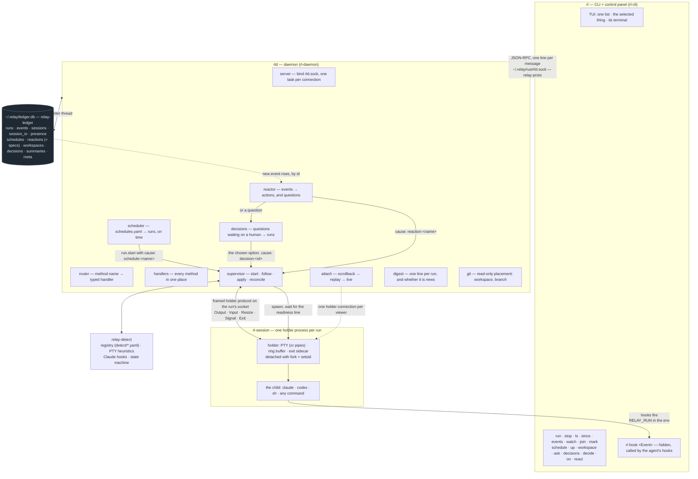
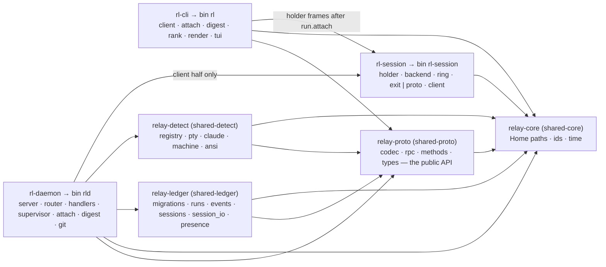
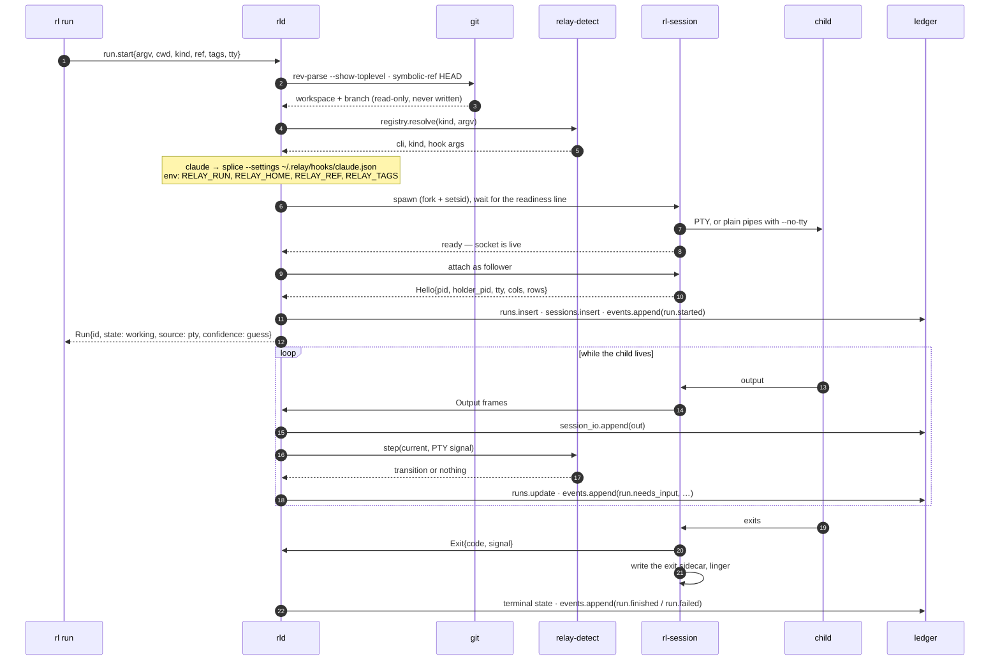
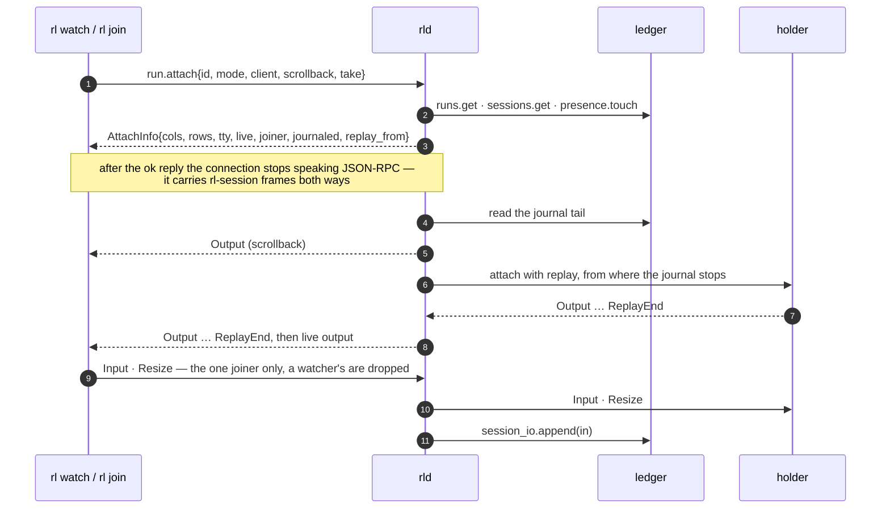
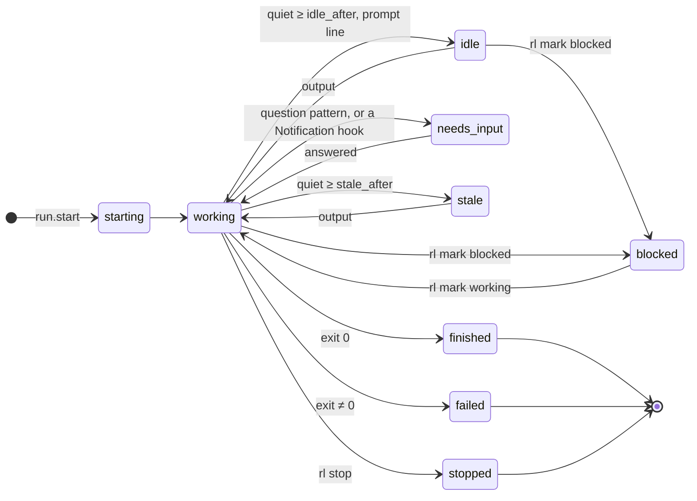

# Relay — architecture

**Status:** as built · **Date:** 2026-09-09 · **Tree:** `reactions` branch

[PRODUCT.md](PRODUCT.md) says what Relay is for and where it is going. This file says how the
tree that exists is wired: which processes there are, who owns what, and what crosses which
boundary. Every diagram describes code under `code/`; what is not built yet is listed at the
end and marked in the diagrams with dashes.

---

## 1. Processes

Three kinds of process and two socket protocols. Nothing else talks to anything.



What the picture is enforcing:

- **`rld` never owns a child.** Every run lives under its own `rl-session`; the daemon is only a
  client of that holder. A daemon crash, restart or upgrade therefore costs no sessions —
  `Supervisor::reconcile` finds the open sessions in the ledger and resumes the journal exactly
  where it stopped.
- **The holder depends on nothing else in Relay.** Its protocol is deliberately not JSON-RPC and
  not shared with `relay-proto`: a session must stay reachable with only that one binary alive.
- **`rl` speaks only `relay-proto`.** No client reads the ledger, and `--json` is the same data
  the TUI draws.
- **The ledger is one SQLite file behind one writer thread.** Every access ships a closure to
  that thread, so a call that returns has been applied.

---

## 2. Crates



`rl-session` splits in two on purpose: the library half (`proto`, `client`, `exit`) is what `rld`
links, the binary half (`holder`, `backend`) is the process itself.

---

## 3. Starting a run



After a daemon restart, `reconcile` walks `sessions` where `closed_at IS NULL`: re-attach where
the holder still answers (resuming the journal, with a `note` line if bytes were lost while the
daemon was down), otherwise close the run from its exit sidecar — or as lost.

A holder waits for that. After its child exits it lingers (a day by default) with the tail and
the exit, and goes on `Close` — which the daemon sends once it has journaled the end — or when
the linger runs out with nobody attached. Its socket is the only way anyone reaches it, so when
the socket file is removed from under it (it looks once a minute) (the Relay home deleted, a test's temporary home cleaned
up) no daemon can come back for the run: the holder hangs up a child still going and leaves. It
does the same when nobody at all has been attached for `runs.reap_after` (default `6h`): `rld`
holds a connection for as long as it lives, so that only comes about when Relay itself is gone
for good — a throwaway home, a daemon that never returns — and while it is gone nothing journals
the run anyway.

Reading its child is the one thing a holder does constantly, so it does it on one thread: a
worker per core only bought a cross-thread wake-up and a trip through a work-stealing scheduler
for every chunk, which cost more than relaying the bytes did. The reader also waits `runs.settle`
(default `5ms`, `off` to read flat out) once it has caught up, before reading again. Nothing is
held back — what was read is already on its way — but the next read finds a whole burst rather
than the few bytes one `printf` wrote. That is also the backpressure a terminal gives a program:
without it the holder empties the pty the instant anything lands, so a child that redraws in a
loop spins at full speed against a reader that may have no viewers at all.

Starting the daemon is nobody's job. Every `rl` command that needs it goes through
`daemon::ensure`: `rld` is spawned when the socket is not there (one line on stderr, `rld
started`), and the running one is compared with this `rl` — the same release, nothing to say;
another release with the same wire protocol, `rl` offers `rl daemon restart` on a terminal and
only notes it otherwise; another protocol, `rl` refuses, since messages could be misread. A
restart costs nothing running, which is what makes the offer cheap. `rl daemon start|stop|
status|restart` remain for saying it explicitly; a hook from inside a run (`rl hook`) never
starts a daemon.

---

## 4. Watching and joining



What is replayed is a tail of bytes, not a screen: an app that redraws only what changed (Claude
Code, and most that diff their own buffer) leaves its box and status line out until it repaints.
It repaints when its size changes, and an app that redraws everything then (Claude Code redraws
its whole conversation) should do that once, not twice. So letting go of a run leaves it a row
short, where nobody sees it redraw, and the next join — at the size it had, or any other — is one
real change and one repaint. A joiner's first `Resize` says which: a new size needs nothing more.
Only a joiner at the very size the run has (or one that says none within `JOIN_SIZE_WAIT`), and a
watcher while nobody is joined, gets the nudge: rld gives the pty a row less, holds that for a
fifth of a second, and gives the size back (`NUDGE_HOLD`, `rl-daemon/src/attach.rs`). Held,
because two resizes sent back to back land together, the app reads the size it already had, and a
runtime that only reports a change (Node, Bun) never repaints. A row rather than a column, as tmux
does, so what the run printed is not wrapped twice. One nudge per run at a time: while it holds,
the run keeps its own size on record, a viewer arriving meanwhile starts from that, and the one in
flight repaints for it too.

A run just started is the hard case: a Node or Bun agent listens for a resize only half a second or
so in, and one that lands before is lost — it draws for the rows it started with. So the panel
starts a run at the whole terminal, the size its join will hand it (`spawn_size`, `tui/mod.rs`),
and there is no resize to lose; and a run joined younger than `YOUNG` (three seconds) is nudged
once more at that age, in case its first one went unheard.

Every one of those frames is read through `FrameReader`, never a bare `read_frame`. Each hop
reads inside a `select!` — the viewer against stdin and a ticker, `rld` against the holder and
its own shutdown — and a plain read holds the bytes it has gathered on the future's stack, so
losing the race throws them away. The next read then starts in the middle of a payload and takes
the child's own output for a header: a scrollback replay of a few hundred kilobytes is the frame
most likely to lose, and the run's text decodes into a length of some billions, which ends the
connection. `FrameReader` keeps the partial header and payload in the reader itself, so a
dropped future costs nothing and the next call carries on where it stopped.

A holder outlives `rld` on purpose — stopping the daemon is not stopping the work — but while no
daemon is attached nothing journals the run or knows its state, and a throwaway home's holders
would otherwise sit there for good. So a holder with nobody attached at all (no daemon, no
viewer) for `runs.reap_after` (default `6h`, `never` to keep them) hangs up its child and leaves,
as it already does when its socket is deleted. `rl daemon stop --with-runs` is the deliberate
version: every live run stopped, each holder asked to go, then the daemon. Asked, and then waited
for: the `Close` is only heard if the connection outlives the holder's own handshake writes, so
`rl` stays on the socket until the holder hangs up on it. Sending `Close` and dropping in the
same breath breaks those writes, the holder's client task ends on the write error, the frame is
never read, and the holder sits there for the rest of its linger.

A stream can also end without an exit — the holder killed, the machine gone. That is not a run
ending, and it is never told as one: `rl watch`/`rl join` ask rld what became of the run (giving
it a moment to notice, or `rl ls` would disagree a second later), say it — "run ab12 failed · the
session holder went away", or "lost touch with run ab12 · it may still be going" — and exit with
the run's own code, or 1 when there is none. Only leaving on purpose exits 0. The panel keeps the
terminal it was showing, marked `lost`: the last thing the run said is worth most at exactly the
moment the connection breaks, and it used to be thrown away.

What went wrong around a run without ending it is a `run.trouble` event: output lost while no
daemon was there, a holder that went without reporting an exit. A `warn!` is for whoever reads
the log; the event is for whoever has the run in front of them, and the pane keeps the latest as
a `trouble` fact rather than letting `lately` push it out of sight.

A restart takes every holder with it, and nothing records an exit. When rld comes back, reconcile
finds each such run's holder gone, closes it as failed and marks it `run.lost`. The runs still on
the list that a restart took are the digest's `lost`, and the headline says so in amber: "3 lost
in a restart · /resume all". `/resume` (`rl resume <id>…`) picks an ended run back up as a new run
in its folder, under its title and in its chain, tagged `resumes:<id>`, and archives the one it
picks up, so the list shows the run that carries it on (`tui`'s `/resume`, `rl-daemon/src/resume.rs`).
What that means depends on the kind of run. An agent's conversation comes back through its own CLI
— `claude --resume <session>`, `codex resume <session>` — with the session named by the transcript
a hook reported, or else the one found by folder and start time; a conversation reopened waits for
you, and nothing is sent to it. A shell has nothing to resume but its place, so it comes back as a
fresh shell. A command runs again. `/resume all` (`rl resume --lost`) brings back what was lost,
except plain commands: running one again can do what it did twice, so those come back only when
asked, with `/resume all commands` (`--commands`). Nothing is resumed on its own.

Several watchers, one joiner; a second `join` is refused unless `take` turns the previous joiner
into a watcher. The joiner is a seat — `user@host` and which of their terminals (`terminal`, the
attaching process) — so a second terminal of the same person is refused too, told it is "you in
another terminal", rather than silently sharing the keyboard. The panel asks before it takes:
`/join` on a held run says who has it, and `y` takes it over. Each viewer gets its own holder connection, and the supervisor's follow
connection journals regardless — so a viewer leaving costs nothing and the run never notices.

The panel (`rl` with no command, `rl-cli/src/tui`) is the same two calls behind one screen. It
is one list, the width of the screen, built from `digest.get` (`tui/rows.rs`): the questions
waiting on you first, from every project and each naming its own (`rlux › deploy tonight?`),
oldest first, so what needs you never hides under a project's name; then pinned runs; then
grouped by the folder they belong to, the folders in order of name so each keeps its place, and
inside one runs by attention — until you put a project in your own order: shift-`↑`/`↓` on a run
or a job moves it one place up or down inside its project (holding goes on moving it, the cursor
stays on it), and from then on that project keeps your order rather than sorting itself. What is
new there enters at its top; what needs you — asking, blocked or failed — floats to its top
whatever the order, and drops back to where you put it once dealt with. A row never moves out of
its project, past what floats, or into the questions or the pinned runs; on a header, a question,
in the graph or `/events` the keys say why and do nothing. `digest.order` keeps a project's whole
order — its header's key (`g:<folder>`, `g:everywhere`) and its rows' (`r:<id>`, `j:…`), in the
ledger's `row_order` table — and the digest carries it; each move sends the whole of it again,
built from the list with no search or lens narrowing it, so what a search hides keeps its place
and what has left the list drops out. `/sort` on a project (its header, or any row in it) lets go
of the order: it sorts itself again. Shift and an arrow arrive as `CSI 1;2A`/`B` in iTerm2,
Terminal.app and tmux 3.2 or later; a terminal that does not report shift sends the plain arrow,
which just moves the cursor. And named — a workspace by the
name it was registered under, a cause as "schedule nightly" or "rule tests-failed", never an id.
A row is an icon for what it is — `✦` an agent, `❯` a shell (in the prompt's green), `▸` a
command, `↻` a job, `?` a question (amber) — one quiet glyph, one column wide in every font, so
every title starts in the same column, and dim once the run has ended — then the title, the state as a word in its colour (`needs you` and `blocked` amber,
`failed` red, `done` and `stopped` dim; a shell at rest says nothing there, its icon says it),
the summary to the edge, and the ref and the age at the right — with `⎇ feat` there too when the
run started on another branch than the one its folder is on now. A run that ended well and raised
something itself (`rl emit`) says the last of it in its own words — `5 feedback rows to process`,
not `exit 0`, which for a probe is the whole point; one that failed keeps its exit, the one worth
reading. A Claude or Codex run that is waiting — idle, needing you, blocked, or ended — says
its agent's latest recap there instead (§6: `Search fixed; nothing committed. Next: say
commit.`), the first line of it, which `digest.get` carries on the item (`recap`) from one query
over `summaries` for the whole list, never a session file read; at work it says what it is
doing, as ever. Other agents and shells say what they always have. A search finds what the row
says. What it raised, by kind, is in the pane under `signals`
(`flint.product.new-feedback ×5`). The daemon's own event families are left out of that, since
the state already says them (`events::emitted_for_run`, carried on the digest's item). Colour carries the state — a
saturated accent per state, on the terminal's own foreground so it reads on either theme
(`tui/theme.rs`). The panel runs to the screen's edges, with a rule between its sections — under
the header, above the line, above the footer. The project rows and the `❯` line start at the edge,
and the header and footer text level with what is typed after the `❯`; a project's runs, shells and agents sit one column in, under it. The list and its
detail pane are split by a vertical bar — the list takes two thirds beside the details pane, half beside a terminal, which needs the
width; the full-screen terminal drops all of it for the cells. The header wears Relay's mark — a
radio tower sending signals, drawn from one pixel grid in `tui/mark.rs` and in the accent: under a row of air, five
rows of half-blocks at the left edge, and beside its middle
three rows the header's words — `relay` and its version (and the Relay home, `~` for home, when it
is not the usual `~/.relay`, so a panel on a test ledger says so) with the lens and who you are at
the right; then the tally (or the graph's or the events' own headline); then the notes — what a
restart took and the global rules, each in its tone. The full-screen terminal keeps the header to
one line, all of it after the tally, and so does a screen under 24 rows or 80 columns
(`head_h`); everything under the header — the list's rows for the mouse, a terminal's size in the
pane — is measured from where `areas` put it. With nothing running at all, the empty list shows the
mark full size in its middle, over its words, and the setup guide has it above its title, each
where it fits. A group is a folder (or a ref), never a branch: its header is its path, with `~` for home, the
folders above dim and its own bold, and ` · name` after it when it goes by a name that is not its
folder's (a ref, or a folder registered or renamed under another); a path too long for the title
column loses its start to `…`, never its last folder. From the state column on — level with the
runs' state words, whatever the path's length — comes its git checkout as it stands — `⎇ main · PR
#95 · 3 worktrees`, the branch or a detached commit, the badges, and on a main checkout the linked
worktrees whose folders are still there (`rld` reads `.git` directly on each digest, no `git`
started; a worktree registered on its own is a project of its own, with its branch and no count) —
and, at the right edge, the tally of how many jobs and reactions the folder holds, with any rule
that waits for a yes named just before it in amber (`! deploy`), and before that a red `! rules`
while one of the folder's rules files did not load (see **Rules**). The rest of its rules are the
graph's and the project pane's to show. The global rules — the ones in the Relay home, which apply in every folder — have no
row of their own: a row that is always there, rules or none, kept the empty list from ever saying
`nothing running · rl run -- <command>`. The header says them instead, when there are any, on its
line of notes — `↻ 2 ⚡ 1 everywhere` (on one line, `relay · 3 working · ↻ 2 ⚡ 1 everywhere`),
schedules and reactions counted as a folder's header counts them — and in
amber when one waits for a yes, saying so and where to give it (`⚡ 1 everywhere needs a yes ·
/graph`, `rows::everywhere`), and in red beside them while one of the home's files did not load
(`↻ 2 ⚡ 1 everywhere · rules broken`, or `global rules broken` when none of them loaded;
`rows::global_parts`). A global rule's run in a registered project folds under that
project; one that ran anywhere else — a schedule's `cwd: ~`, a reaction to an event outside every
project — goes under one group headed `everywhere`, after the projects, rather than under `~` or
whatever folder that was (`rows::everywhere_run`: a schedule or reaction started it, its folder is
no registered project, and no rule of that name lives in that folder; a run filed under a ref keeps
the ref). It is read off the run, not the rules loaded now, so a global rule taken out of its file
leaves its runs under `everywhere` until they are archived, not back under `~`. That header is
not a project: `enter` puts the global rules and how those runs stand in the pane, `/new` there
writes a global rule, `/edit` opens the home's schedules, and `^x`, `^r` and `/shell` say
`everywhere is not a project` and do nothing; `in:everywhere` finds it. `^g` (or `/graph`) from anywhere, an empty list too, shows them wired
with everything else, and `/edit` where nothing names a folder, or `/edit schedules global`
from anywhere, opens the home's file. Runs a schedule or a rule
started fold, once ended, into one line per job — `↻`, the name, how the last few went in the
state column (`··×·`, oldest first, a failure red) and what the last firing came to in its own
words — so a job firing every thirty seconds is a row,
not a screen, and it never grows into one: `enter` (or `^o`) puts its firings in the pane, as on
a project header. A run still going or waiting on you is never folded. The pane holds the
cadence — a cron line read back in words where it can be (`hourly 08:00–18:00, Mon–Fri`), left as
written where it cannot — the tally, the marks, what the last firing raised under `signals`, and
the last ten firings, each in its own words. When the list
is taller than the screen, its first and last lines say how much is above and below. A group's
header says which folder it is in, and the cursor stops on it like any other row: `enter` (or
`^o`) turns the pane into the project's own — the folder, how its runs stand (needs-you /
going / done), when it last stirred, and the schedules and reactions that live there. `^g`
from a header opens the graph on that folder's first rule, and from a job on the job's own;
`^r` (or `/rename`) renames
whatever the cursor is on in place. On a run (a shell is one) or a project's header the name
turns into a field in its own cell, the whole of it selected and the caret at its start, drawn the
way the line draws its own: typing or a paste replaces it, `backspace` or `delete` clears it, and
any other key lets the selection go and does what it does from the start. The keys are the line's
own, from the same code (`line::Field` wraps `tui/line.rs`'s editor), one line only, and a name
wider than its cell scrolls sideways to keep the caret in view. `enter` saves — a folder over
`workspace.rename`, which updates the registered name and keeps the registration, a run over
`run.rename` — and `esc`, or anything that takes the cursor off the row (the arrows, `^j`/`^k`, a
click elsewhere, the wheel, `tab` to another lens), lets it go unsaved; meanwhile the footer says
`enter saves · esc cancels`, and the line below waits, quiet and without its caret. An empty name
gives a project its folder's own back, and a run the name Relay gave it — what it started as, or
what its first prompt named it, kept beside the title (`runs.relay_title`); a run from before
Relay kept one says so, and the field stays up. The `everywhere` header has no name to change. A
job is renamed through the form of the rule it comes from. An agent nobody named — no title from the form,
`--title` or whatever started it — is named once for what it was first asked, from Claude's
`UserPromptSubmit` hook: `claude: add a recipe import`, the prompt's first line cut to the title's
length, a slash command skipped. The ledger keeps whether a title is still Relay's own
(`runs.title_auto`), so a later prompt never renames it and a rename by hand always wins — until an
empty one takes it back, after which the first prompt still names a run not yet asked anything. A folder you
`rl up`'d is always on the list, even before anything has run there: its header sits in its
place by name, under every lens — a lens narrows what shows inside projects, never which
projects there are — so you can select
it, read its stats, edit its rules or open its shell (`/shell`) from the first. `/up <path>` registers a
folder from the line — the panel's `rl up`, over `workspace.up` — and lands the cursor on its new
row. Moving the cursor onto a row is looking at it;
`/archive` on an ended run (or a job) is being done with it — `run.archive` sets `runs.archived_at`,
the digest leaves it out, `rl ls --all` and the ledger keep it — and `/archive seen` does it for
everything ended that has been looked at, except what is pinned. `^t` (or `/pin`) pins the run under
the cursor — `run.pin` sets `runs.pinned_at` — and it stands above every project, in the order
pinned, named with its folder (`relay › deploy shell`), under every lens and however long ago it
ended; `^t` again lets it go back, and archiving it by name unpins it. `/hide` takes whatever the
cursor is on off the list without stopping or removing anything — a run, going or ended (`run.hide`
sets `runs.hidden_at`); a job, its firings to come too; a project's header and everything in it,
registered or not (`digest.hide` keeps the row's key, `g:<folder>` or `j:<kind>:<name>@<group>`, in
the ledger's `hidden` table, and the digest carries them). A question is never hidden: it needs you.
What is hidden shows only in the `hidden` lens, where `/hide` brings it back (a header that is not
hidden itself brings back what was hidden under it) — unless it comes to need you after it was
hidden: a run that asks, blocks or fails since then comes through to the top of the list, after
the questions, named with its folder and marked `hidden` before its summary. `/hide` on it again
moves the time on and it goes back. Archiving and pruning are as before; `rl hide <id>…` and `rl
hide --project <dir>` (`rl unhide` the same) do it from a shell. `ctrl-x` is the one keystroke for it, whatever the row,
and it asks first: the first press arms it and says what a second would do — remove an ended run
or a job, stop one still going, dismiss a question, remove a project — and the second press does it, while any other
key disarms it, so nothing goes on a single slip (the way an agent view confirms a delete). `ctrl-c`
is the same for leaving: once to ask, again to quit. A run still going is stopped, and a `ctrl-x`
once it has ended removes it. On a project's header the first press counts what would go
(`press ^x again to remove relay · stops 2 · archives 7 ended runs`), and the second removes the
project over `workspace.remove` — unregistered, every run still going there stopped (a shell hung up
on, anything else sent `SIGTERM`, whatever is left after a few seconds killed), its ended runs
archived, which is what takes its header off the list, its open questions dismissed and the yes
given to its rules forgotten, so registering it again asks again. When its `.relay` holds rule
files that can move, the second press asks first, in the footer — `also move relay/.relay (2
schedules · 1 reaction) to ~/.relay/removed? y moves · n keeps · any other key cancels` — and
nothing happens until `y` or `n`; any other key leaves everything as it was. Moved means into
`<home>/removed/<name>-<when>/`, never deleted: only `schedules.yaml` and `reactions.yaml` go, and
the folder with them only when nothing else is in it. A `.relay` that is a symlink, or that is the
Relay home itself (someone registered `~`), is never moved. The removal runs on its own connection,
so the panel keeps drawing while the runs stop, and the flash says what came of it (`removed relay
· stopped 2 · 9 runs archived · .relay kept`). On the line: `rl workspace rm <dir>`
unregisters, with `--stop`, `--archive` and `--move-rules` (which asks, or wants `--yes`) for the
rest. A folder gone from disk is still removed by the path it was registered under.
Nothing is destroyed by any of this; that is retention's alone. Ended runs also leave on their own after a day;
`/archive` is for the impatient. On the line: `rl archive <id>…`, `rl archive --all`. Nothing is ever deleted here; that is
retention (§7). `enter` on a run still going is the run itself: the panel steps out of ratatui and
pipes the run straight to the real terminal, tmux-attach style — stdin is the run's input, its
output is ours, `SIGWINCH` is a resize — with native scrolling, the mouse, the true size and no
chrome. `ctrl-\` lets go, back to the list as it was, the cursor on the run and no pane beside it.
`/join` does the same. This is the passthrough `rl join <id>` uses (`rl-cli/src/attach.rs`), so it
is also a standalone command: `tmux split-window 'rl join <id>'` puts a live pane wherever you like.
There is no watching a run from the side without taking its keyboard; a glance is the list row's
last line. `enter` on an ended run reads what it printed, kept after its holder has gone: a
re-render through a `vt100` screen (`tui/term.rs`) in a tile beside the list — the list stays, the
line at the foot stays yours, `esc` closes the tile, and `/pane full` pops it to the whole screen.
`pgup` and `pgdn` read back through what scrolled off — the screen keeps ten thousand rows above
itself — and the footer says how far back you are. `^o` (or `/pane`) opens a pane of
facts beside the list (`tui/pane.rs`): a run's facts and recent events, a job's tally, a question
and what can be done about it. A question stays one line on the list; selecting it opens the pane
on it by itself (and moving off closes the pane again, unless it was open already), since a
question is only worth its details. The pane lists its choices a row each: the options, with what
each runs; `answer` with what is picked, where it takes several; `attach` to the run that asked,
when one did; and `dismiss`. `enter` on the question puts a caret on the first choice, the arrows
walk them, `enter` takes one (space picks where several are taken), the number takes an option
straight away, and a click on a choice's row takes it too. The pane is laid out to its width row
for row, so the click lands on what it shows. Answering is `decision.take`, and the run it starts
becomes the selection; `attach` selects the asking run and joins it, as `enter` on it would.
The line answers too: on a question, a line that starts with an option — its number or its key,
several joined by commas where it takes several — answers with that option and the rest of the
line as the note (`1 only the checkout path`), and the line's hint says so before you send it.
Typed text before `^x` goes with a dismissal as its reason. `/summary [since]` recaps the run
under the cursor, live or ended (§6), and the recap lands in the pane under the facts, aligned
with them: `recap    claude's own · 2m ago · last 2h`, the words under it in the value column,
and `· moved on since` once the run has gone on. Asked over a terminal being watched, the pane
turns to the details, where the recap is; the terminal stays open, and `enter` on the run is
back in it. An assistant is only ever asked when you ask; Claude's and Codex's own recaps are
there already, kept as they write them (§6).

**Typing is what the panel rests in.** One line sits at the foot and always takes what you type
(`tui/line.rs`), so there is nothing to open and nothing to close. What a finished line means is
read locally first: a first word naming an agent the registry knows (`agent.list`, never a
hardcoded list) is that agent with the rest as its prompt; a first word this machine can actually
run — a binary on `PATH`, a target in the folder, or a name your own shell knows (its aliases and
functions, read from `$SHELL` once at startup and again on `/reload shell`) — is a shell line, and a
leading `!` forces one. An agent is `run.start` in the folder of the row the cursor is on, sized to
this screen; a fresh
agent is selected on the list, and `enter` hands you its terminal (the raw passthrough above). A shell line does not start a run of its own: it goes to the folder's **warm shell** — one
persistent `$SHELL -i` per project (`run.start`, tagged `shell`, spawned the first time a folder
needs one and kept), so its rc is read once and its aliases and functions are there. The line is
written to that shell's stdin (`run.input`, which feeds a live run's terminal over the daemon's own
holder connection, no join, journaled as input), and the cursor goes to the shell's row. What it
prints stays the shell's: `enter` there joins the shell to read it, or to go on in it.
Which shell: the one under the cursor when it is a shell, else the project's. Anything else is plain words, and those go to `assistants.interpret`
(§6) as a run of its own — it is in the list like any other, `/stop` there stops it — while the
panel stays yours. What comes back fills the form (`tui/form.rs`), and your `enter` is what does
it; the assistant never starts anything. The line says which of the three `enter` will do at its
right edge — a glyph and a colour, accented when it will run something here, dim when the words
are only asked (`❯ runs in api`, `✦ claude here`, `… asks the assistant`) — before you commit, so a
call that leaves the machine is never sprung on you. A longer thought needs more than one line:
`shift-enter` (or `alt-enter`) drops a newline in rather than sending, and the band grows a row
per line up to eight before it windows around the caret, so `enter` still means send. The
modifier is only there to catch where the terminal speaks the kitty keyboard protocol
(Ghostty, WezTerm, recent iTerm2), which the panel asks for on the way in and gives back on the
way out; where it does not (Terminal.app), plain `enter` sends as always.

Taking the terminal back from a run also means taking back its input. A run asks the terminal
things — which modes it speaks, whether it synchronises output — and the answers arrive as input;
one that lands after the hand-over is ours to read. So coming back drops whatever the terminal
has queued (`tui/input.rs`), and the key reader is patched for the answers that arrive later still:
crossterm 0.29 waited on after a `CSI ?` reply for a `u` or a `c`, and took every key after it into
that one sequence, so the panel drew on and heard nothing until someone happened to type a `c`.
`vendor/crossterm` is that release with the sequence ending at its final byte, patched in over
crates.io from the workspace manifest until a release carries it.

A shell you entered through Relay is still your own shell, so it is easy to lose track of being in
one. Nothing of Relay's is ever drawn over a run's screen — the window title carries the status and
the screen itself is left alone — so the mark is one Relay hands over rather than paints: every run
carries `RELAY_RUN` in its environment (with `RELAY_HOME`, and `RELAY_REF`/`RELAY_TAGS` when the run
has them), which a prompt can read for itself. In zsh, `RPROMPT='${RELAY_RUN:+●}'` puts a dot at the
right edge while you are in a Relay shell and nothing at all when you are not; bash appends the same
to `PS1`. A dot the prompt draws survives whatever the run paints next, which one Relay put in the
corner itself would not.

The same hand-over carries facts the other way. A prompt that emits OSC 133 marks — `A` where it is
drawn, `B` where what you type begins, `C` where the command starts running, `D` with the exit code
when it ends — tells Relay one command from the next, and each becomes a `shell.command` event with
what was typed, how it came out and how long it took; the newest is the shell's row. Many prompts
(starship, powerlevel10k, the shell integrations of iTerm2, WezTerm and kitty) already emit them, so
there is nothing to do; `rl shell-init zsh` prints a snippet for prompts that do not. Relay reads
the marks and never writes your rc. Without them nothing is guessed: no events, and the shell's row
says nothing where a run says what it last did. A prompt that also reports its folder — OSC 7,
`ESC ] 7 ; file://host/path BEL` with the path percent-encoded, which the `rl shell-init` snippets
send at every prompt and many terminals' integrations already do — tells Relay where the shell is.
`rl-detect` reads it out of the stream (the host is ignored), the follow task keeps the latest on
the live run in memory, as the filesystem resolves it, and `digest.get` carries it on the item
(`cwd`, left out when unknown, so older panels read the digest as before). The shell's row then
says where it is in its summary column: `app/src` inside its project, nothing at the project's own
folder, the whole path with `~` for home anywhere else. A daemon restart forgets it until the next
prompt says it again.

`tab` completes the word being typed (`tui/complete.rs`), rooted where the line will run: the
warm shell's own folder when the line goes to that shell and its prompt has said where it is (a
shell that has `cd`'d into `app/src` completes there), else the folder of the row the cursor is
on (`complete::line_folder`; an agent starts in the project, so its line completes there). The
first word completes against the agents the registry knows, the folder's `Makefile` targets and
`package.json` scripts, and the binaries on `PATH` — or, when it starts like a path (`./`, `../`,
`~`, or `/` after the `!` that forces a shell line), as a path, and a path to something runnable is
then a shell line. After `every` a duration, after `on` an event kind. A few common tools know
their own words, built in rather than borrowed from a shell's completion: `git` its common
subcommands, and after `checkout`, `switch`, `merge`, `rebase`, `diff`, `log` or `branch -d` the
branches, local then remote-tracking (asked of `git for-each-ref` in that folder, given half a
second); `make` its targets and `just` its `justfile` recipes; `npm`/`pnpm`/`yarn`/`bun run` the
`package.json` scripts (`yarn` and `pnpm` without `run` too); `cargo` its common subcommands.
Anywhere else, or where a tool has nothing that fits, the files and directories: a folder ends in
`/` so the next `tab` goes into it, dotfiles show once the dot is typed, and `~` is looked up as
home but stays `~` on the line. A `/` line completes its name, then its arguments: the words each
command takes (`palette.rs`, the same ones its hint shows — `/edit` `schedules` `reactions` then
`global`, `/reload` `rules` `shell`, `/resume` `all` then `commands`, `/lens` its lenses, `/mark`
its marks), `/filter`'s search tokens and their values, `/up`'s folders. What every candidate
shares goes in first, and `tab` again walks the rest. When a list is on offer — those `tab` words, or the `/` commands a
`/` line names — the arrows walk it too: `↑`/`↓` light a candidate with a caret, `tab` or `enter`
takes the lit one (a command is filled in with its name for you to finish, never run on the
spot), and typing anything clears the highlight so `enter` submits the line as before.

Because letters go into the line, everything that is not typing is a `/` command
(`tui/palette.rs`), offered as you type it: `/stop`, `/archive [seen]`, `/mark`, `/join`,
`/shell`, `/rename`, `/pin`, `/hide`, `/sort`, `/pane [full]`, `/graph`, `/events`, `/reload [rules|shell]`, `/approve` and `/pause`,
`/new`, `/edit [schedules|reactions [global]]`, `/summary`, `/ask`, `/filter`, `/lens`, `/prune`,
`/up`, `/help`, `/quit`. One name per act: a variant of an act is an argument to it rather than a
command of its own, and no word means two things — `done` is only ever what `/mark` says. `enter` on an empty line
is the row under the cursor instead — a job opens, a question comes
out of the list to be answered by number, a run's terminal opens. Arrows, `home`/`end` and `esc`
belong to the list, and so do `^j`/`^k` while nothing is typed (down and up, as vi's `j` and `k`), and shift-`↑`/`↓`, which move the row itself inside its project (`/sort` undoes it); `esc` with something typed clears the line first, and `ctrl-c` leaves.
The few keys that are not the list's or the line's each stand for a command, and the command
list shows them beside it: `^x` stops, archives or removes, `^r` renames, `^t` pins, `^g` opens the graph, `^o` shows or hides the pane,
`^f` searches.
`?` on an empty line shows the keys for where you are in a quiet line under it (`tui/shortcuts.rs`)
— the list's, the `hidden` lens's, a question's and its choices', a watched terminal's, the
graph's, `/events`', a name being changed's — one table per place, a command's key read from the same table the command
list shows; `/help` shows it too, beside the commands in the footer. It wraps between keys onto
more rows on a narrow terminal rather than cut one off, and the foot of the panel grows to hold
it. `?` again or `esc` puts it away — `esc` does that first, before it closes the pane, clears a
filter or leaves a view — and so does typing, so it never takes room while you work. With
anything on the line `?` is just a character, and so it is in a search; the footer ends in a
dim `? shortcuts` where it has room and `?` would work.
A shell is a command like any other — `/shell` — and has no key of its own. The line keeps `^a`, `^e`, `^u`, `^k` and `^w` for
editing, as a shell does, so none of those is taken for anything else once something is typed —
`^k` moving up on an empty line cuts nothing, and `^j` there adds no line. It moves and cuts by
word too — alt or ctrl with `←`/`→`, `alt-b`/`alt-f`, `alt-backspace`, `alt-delete`/`alt-d` —
where a word is letters and digits, so `~/Projects/flint` stops at its slashes; the form's fields
take the same keys. A terminal only sends alt when it is set to (iTerm2: the option key as
`Esc+`); the ctrl arrows arrive either way.

At the right of the header is the lens — `all · agents · jobs · reactions · hidden`, the one in
force accented — and the list shows
only that slice: agents by what a run is, jobs and reactions by what started it (so a scheduled
agent is in both `agents` and `jobs`, since the lens is a question, not a partition). `hidden` is
the one partition: what you `/hide`, laid out as the list is, and nothing else — the other lenses
never show it, except what comes through because it needs you. Questions
ignore it; they are what needs you, whatever slice you are in. `tab` on an empty line steps the
lens along (shift-`tab` back), and `/lens all|agents|jobs|reactions|hidden` jumps straight to one;
it composes with `/filter`. One-off shell commands live in `all` while they run and are recent.

Searching is `^f` (or `/filter` alone): the line turns from `❯` to `⌕`, and the list — or the
graph — narrows with every key. The list keeps its order; the cursor goes to the best match:
a project whose name the words say, at its header, else the closest row — the title before the
project's name before the summary, and within each, the words exactly, then at the start, then
as a whole word, then anywhere, ties in list order. With only tokens typed it stays put, or
falls to the first row. `tab` with nothing to complete goes on to the next match in that order,
round, and shift-`tab` back. `enter` keeps the search and gives the line back, `esc` puts
back the search from before, the arrows still move through what is left, and the header shows
`⌕ …` while one is in force; `esc` on the list clears it. `/filter <search>` sets one outright.
A search (`tui/query.rs`) is words and tokens. Every word must match somewhere — a title, a
project's name or folder, a CLI, a summary — and is lit up where it shows. The tokens pick by
what a thing is: `in:` a project, `is:failed|going|done|stopped|needs|pinned|new`,
`kind:agent|shell|command|job|reaction|question`, `by:` the schedule or reaction behind it,
`on:` a git branch — the one a run started on, the one a folder is on. Values match by prefix
(names anywhere), and `tab` completes names and values. A project stays while anything under it
matches; a project with nothing under it answers only to words, `in:` and `on:`. The events
view has a search of its own, kept while the list is up and back when it returns: there `kind:`
is an event's kind (`kind:run.failed`, `kind:run.` the family; `tab` offers the kinds), `by:`
the rule behind an event's run or the one it set off, `in:` its project, and words match its
kind, its run's title and what it said.

`/new` is the form for a rule written by hand: `in` (a folder, or `global`), `name`, `when`
(`every 30m`, a cron line, or `on run.failed` — which decides between `schedules.yaml` and
`reactions.yaml`), `run`, `title`, `tags`, `cwd`. A `cwd` left empty is left out: a folder's rule
runs in the folder, a global reaction where its event happens, and only a global schedule, which
has no event to follow, takes the folder the form was opened from (an edited one, opened from no
folder, must say). `enter` writes the block into the file
(`rulefile.rs`: the block of that name replaced in place or added at the end of the mapping,
comments and the other rules untouched, the result checked to parse), reloads, and approves it —
your keystroke is the yes; a folder new to Relay is registered on the way. `^r` on a rule — a job
row, or its node in the graph — is the same form filled in; saving rewrites only that block and
keeps what the form does not show (`env`, `where`, `ask`), and a rename or a move takes the old
block out. `/edit` never opens the form: it opens a rule file in `$EDITOR` and reloads on return —
an edit made there is a file change, so it waits for `/approve` like any other
(`rulefile::edit_target`). Bare, on a rule, it is that rule's own file at the rule's line;
anywhere else the folder's file that did not load, at the line it broke on, when one did not;
else the schedules of the folder the cursor is in — a run's, a job's, a header's, a graph
node's — and the Relay home's where nothing names a folder (the `everywhere` header, an empty
list). `/edit reactions` opens the reactions instead (`schedule` and `reaction` still read), and
`global` after either opens the home's from anywhere; a file named so that did not load opens at
its line too.

Nothing is remembered between openings except presence: leaving the panel is what `rl since`
counts from.

---

## 5. How a run's state is decided

Every source produces a `Signal{state, source, confidence}`; `relay_detect::step` is the only
place a `(current, signal)` pair becomes a transition, and it decides against the ledger row.

| Source | Confidence | Wired today | Where from |
|---|---|---|---|
| `hook` | exact | yes | Claude Code hooks → `rl hook <Event>` → `run.hook` |
| `manual` | exact | yes | `rl mark done \| blocked \| working` |
| `pty` | guess / likely | yes | output-idle timers + prompt/question patterns over the byte stream |
| `transcript` | exact | not yet | `~/.claude` transcripts |
| `git` | exact | placement only | commits landed, branch done |

The rules, in order: terminal states never change here; `stale` only ever replaces
`working`/`starting`; a PTY guess never overrides an exact state from another source; the same
state again upgrades source/confidence at most; anything else is a transition, journaled as an
event.



`needs_input`, `blocked` and `failed` are the attention states: they sort to the top of the
panel's list — of a project in your own order too — and are what `rl since` leads with. Confidence rides along in the UI, always visible.

Grouping is derived, never a table: `group_key = ref → branch → workspace`, materialised onto
each event row at write time so the digest groups without a join; it is what a reaction's
`group` matches and what keeps one open question per group. The list files a run by
`place_key = ref → workspace` instead, so a folder is one project whichever branch it is on.

---

## 6. What starts a run

Every run says why it is there. `Run.cause` is one string — `manual`, `schedule:<name>`,
`decision:<id>`, `reaction:<name>`, `assistant:<job>`, and later `workflow:<name>/<step>` — and `Run.flow` is
the chain it belongs to: its own id when it starts one, the flow it was handed otherwise. A
nightly schedule that asks a question whose answer opens a pull request is three rows and one
flow.


**Actions.** A schedule's entry and a decision's option are the same shape, and one function
turns that shape into a `RunSpec`. Adding workflow steps later adds no third dialect. What runs
is written under one key, in whichever of the three forms fits:

```yaml
run: "date +%T >> pulse.log"     # a string goes through sh -c
run: [grep, -c, ERROR, app.log]  # a list is argv, no shell
run:                             # a map is an agent, run headless:
  agent: claude                  #   the profile's headless args, then args, then the prompt
  prompt_file: standup.md
  args: [--model, opus]
cwd: ~/work/api                  # and these decorate it, whichever form
env: { CI: "1" }
tags: [nightly]
ref: gh:1
title: nightly checks
no_tty: false
```

The parser for those three forms is hand-written, so a mistake says which form it could not
read rather than that nothing matched.

**Decisions** are the human node, and they never block. `rl ask` writes the question and
returns; the run that asked can finish, and the question waits in the ledger with its options.
Answering is the only thing that starts the follow-up runs, and the row moves to `taken` before
they start, so two `rl decide` racing cannot both fire. Each run an answer starts has the answer
in its environment: `RELAY_DECISION` (the question), `RELAY_CHOICE` (the option) and
`RELAY_NOTE` (what was said with it, or empty), so a note can steer what runs. A `group` key is unique among open
questions: asking the same thing again restates the open one, keeping its id, so a nightly job
leaves one line rather than thirty. An `expires` either takes the option marked `default` or
moves the question to `expired`; the sweeper sleeps until the earliest deadline and does
nothing when there is none.

**Reactions** are the other direction: every event the ledger records is offered to the rules in
`reactions.yaml`, and a rule either runs something or asks a question. A rule says which kinds
it wants (`run.failed`, `run.*`, `*`), may narrow by `where` (the run's tag, cause, cli, or the
event's group), and fills `{summary}`, `{title}`, `{run}`, `{cwd}` (the folder the event's run ran
in), `{data.x}` and the rest into whatever it runs, and into its `cwd`. The whole event is in the
child's environment as `RELAY_EVENT`, its id as `RELAY_EVENT_ID`; the run's `run.started` names it
too (`data.event`), as a question's `decision.raised` names the rule and the event
(`data.reaction`, `data.event`). Where it runs (`reactions::run_dir`): a workspace's rule in
its folder; a global rule where its `cwd` says, and with none where the event happened — the
folder the event's run ran in while that is still there, else the event's workspace, else the
Relay home. A relative `cwd` is under that same folder (the workspace's, or the event's), joined
once. So a global reaction needs no `cwd`, and one written without runs inside the project it
answers; a global schedule still needs one, since nothing happened for it to follow.

**Emitting events.** A run's own output is not the only thing that lands in the events table:
`rl emit <kind> [--data k=v]… [--json-data -]` puts one there itself, and the reactor picks it up like
any built-in event (`event.emit`, appended by `rl-daemon/src/handlers.rs`). Inside a run it needs
no arguments beyond the kind — it reads `RELAY_RUN` from the environment, the same way `rl ask`
does, so the event is filed under that run's folder and joins its flow; outside a run, `--in
<folder>` (or the cwd) says where it belongs. The kind is the caller's own dotted name
(`log.issue`); the daemon's own families (`run.*`, `decision.*`, `schedule.*`, …) are refused, so
an emit cannot forge a `run.failed` the digest would read as real. The payload rides in `data`,
reachable in a reaction as `{data.severity}` and matchable with `where: { data: { severity:
[ERROR, WARNING] } }`. This is all a "source" needs: a schedule runs a probe on a cadence (with
`RELAY_LAST_RUN` in its environment, the previous firing, so it can ask "what is new since then"
without keeping its own clock), the probe `rl emit`s what it finds, and a reaction fans out to an
agent that works it and `rl ask`s. A plugin, for now, is just such a command; a lightweight JS/TS
SDK over the same `rl emit` / `rl ask` / `rl run` contract is on the roadmap.

Three things keep a rule from running away with itself. A run it starts carries `cause:
reaction:<name>` and a question it asks remembers the same, so no rule ever answers its own
doing. A throttle, ten seconds by default, collapses a burst. And the loop reads the event table
by id from a cursor kept in `meta`, ignoring anything older than five minutes, so a daemon that
was down does not come back and fire a day of history.

`rl on run.failed -- notify "{summary}"` appends a rule to your own file and reloads; the file
stays yours, comments and all. It writes no `cwd` unless `--cwd` gives one (a plain relative path
taken from where `rl` was run), so the rule runs where each event happens. `rl react test <event>` replays one real event through every rule
and prints what each would do, and why it would not. `rl every 30m -- make test` (a cron line in quotes works too; `--agent claude -- <prompt>`,
`--in <folder>`, `--global`, `--cwd`, `--title`, `--tag`, `--name`, `--replace`) writes a schedule into
this folder's `.relay/schedules.yaml` — or yours with `--global` — through `rulefile.rs`, registers
a folder new to Relay, reloads and approves it: the command line is the yes. A name already
there is refused unless `--replace`.

**Rules** is how both are shown: `rule.list` returns every schedule and reaction as one
`Rule` (`relay-proto/src/rule.rs`, a tagged enum over the two rows with one set of accessors —
`when()`, `does()`, `status()`), and `rule.approve` says yes to one of them by name, which the
per-folder `rl up --yes` never allowed. `rl rules` is the table; `rl rules approve|pause|resume|run
<name>` act on one, finding its kind by name (`--kind` when a schedule and a reaction share it,
`--in` when two folders do). In the panel, `r` flips the list to rules — grouped by whose file,
what needs a yes on top, narrowed to the folder of the row it was pressed on until `esc` — and
`y` approves, `p` pauses, `enter` fires a schedule now. The two YAML
files, the two ledger tables and `rl schedule` / `rl react` are unchanged underneath.

**Reloading, and what did not load.** A reload (`schedule.reload`, `reaction.reload`; `rl rules
reload`, the panel's `/reload`, and `rld`'s own load at start) reads the home's file, then each
registered folder's, one scope at a time (`rulestore::RuleStore::reload`). A rule that does not
check out (``bad: needs `cwd` ``) is left out and the rest of its file loads; a file that cannot be
read or does not parse changes nothing in the ledger, so its rules stay as they last loaded — the
home's the same as a folder's, and the folders after it load all the same. Neither is an RPC
error: the report says each in `not_loaded` (`relay_proto::rule::NotLoaded`: the scope, what it is
called — `global`, or the name the folder is registered under — the file, the rule when it was
one, and the line and column, a YAML error's own taken out of its words so it is not said twice),
and `errors` carries the same as lines — `global · schedules.yaml:4:3: did not find expected key`,
``relay · reactions.yaml:7 · bad: needs `cwd` `` — which is what `rl schedule reload`, `rl rules
reload` and `rl up` print after `not loaded:`. Only the ledger failing fails a reload. `rld` keeps
the last load's `not_loaded` of each scope in memory, replaced by the scope's next load and dropped
when its folder is unregistered, and `rule.errors` returns them all, so a broken file stays said
until it is fixed, not only in the reload's flash. The panel asks for them beside `rule.list` and
shows them where the rules are: a red `! rules` on the folder's header (on `everywhere` for the
home's), the headline's `rules broken`, the pane on that header listing each with its file and
line, and `/edit` there opening the file at that line. `/reload` says in its flash how many of each
loaded and what did not — ``reloaded · 2 schedules · 1 reaction · 1 not loaded: bad needs `cwd` `` —
and when more than one did not, `· 3 not loaded`, with the pane listing them all, whose each is,
until the next key. Bare, it re-reads the shell first, so the flash that stays is the rules'.
`not_loaded` and `rule.errors` are additions an older client ignores, so the protocol version
stays.

**Your defaults, and the agents Relay itself uses.** `~/.relay/config.yaml` is the one place for
defaults (`relay_proto::config`, read by `rld` at start, on `config.get` and on a rules reload —
`rl-daemon/src/config.rs`). Absent means all defaults; a key it does not know is refused with the
line, so a typo cannot silently do nothing, and a file that does not parse is reported by
`rl config` (exit 1) while the daemon runs on defaults. Keys arrive one at a time, when a need
does. The first is `assistants`: the agents Relay hands its own jobs to, keyed by job, each a
name or a map:

```yaml
assistants:
  interpret: claude     # what you type at a / rl interpret "…" in plain words → a draft for your enter
  summary: claude       # a recap where the agent keeps none (/summary, rl summary)
  # interpret: { agent: claude, model: claude-haiku-4-5-20251001, args: ["--max-turns", "1"] }
```

Which CLIs are agents is not configured: the detection registry says (`detect/*.yaml`,
`kind: agent`, `bins`, `headless`, `model_flag`, the flag that names a model, and
`small_model`, the quick one setup suggests), and `rld` looks for each on `PATH` when asked —
`agent.list`, `rl agents`. Which of them the panel *offers* is the `agents` key
(`agents: [claude, codex]`; unset, all of those here). An assistant resolves to an argv: the
binary, the headless arguments, the model through the profile's flag, the extra arguments; the
prompt goes last, or in place of `{prompt}` when the CLI takes it as a flag's value
(`gemini -p {prompt}`). Unset, it is the first available agent; a name the registry
does not know, or a `model` for a profile without `model_flag`, is an error, never a guess.
`rl config` prints each resolved assistant and where it came from; `rl config edit` opens the
file, and `rld` seeds it, all comments, when there is none. Later assistants (`triage`,
`answer`) will be keys in the same map. The second key is `retention` (§7).

**Setup.** The first start shows a guide before the list (`rl-cli/src/tui/setup.rs`), one
question a screen with the answer already picked: which agents to offer, and who does
summaries — the first of claude, codex, gemini that is here, on its `small_model`. Enter takes
it, esc leaves that part of the file as it is. `rld` writes what was settled (`setup.save`,
`rl-daemon/src/setup.rs`) by replacing only those keys' blocks, so comments and every other key
stay. How far the guide got is `setup.seen` in the ledger's `meta`, not the file: a release that
adds a step raises `SETUP_STEPS` and the guide shows again — only the steps it added. `rl setup`
goes through all of it.

**Claude's own sessions** (`rl-daemon/src/import.rs`) are the guide's third step. `claude --bg`
sessions are Claude's to supervise; `import.list` asks `claude agents --json` (no model call) and
says which Relay carries on already — a run tagged `claude-session:<id>`. `import.move` stops
Claude's background process (`claude stop <id>`; the conversation stays in its transcript),
registers the folder's checkout as a workspace, and starts `claude --resume <id>` as an ordinary
run in that folder, hooks and all. A session open in a terminal is listed but not moved: that
terminal has it. `/import` and `rl import` are the same step on its own, and the panel says once
per session when Claude has one that is not here.

Alone among the steps, this one picks nothing for you: it acts on something outside Relay — it
stops a live agent — and going back does not undo it. So every box starts empty (`a` fills them
all, for a real migration), enter on an untouched list leaves them with Claude, and enter on a
picked one asks once more, naming what it is about to stop. Two deliberate answers, or nothing
happens; holding enter through the guide moves nothing at all, which is a test.

**What an assistant is told** is the context pack (`rl-cli/src/context.rs`, `rl context
[--in <folder>]`), built from the code so it cannot drift: the words (run, folder, `global`,
rule, job, question, agent, `when`), one line per event kind in `event_kind::ALL` (a kind
without words fails a test), the fields of a schedule and a reaction (every serde field of
the specs must be explained, or a test fails), the placeholders a reaction can use, `rl
--help` plus the help of `run`, `every`, `on` and `ask`, what is here (the folder and its
name, the folders Relay knows, this folder's and the person's rules, the agents on this
machine), and the answer contract: exactly one YAML document, `kind: run | schedule |
reaction` then the form's fields.

**The interpreter** is that pack, the typed words and an ordinary run. The panel's line (§4) and
`rl interpret <words…> [--in <folder>] [--go]` build the pack on the client (it needs clap's
help, which only `rl` has) and call `assistant.run`; `rld` resolves `assistants.interpret`,
starts the agent headless with the prompt as its last argument (`rl-daemon/src/assistant.rs`:
`cause: assistant:interpret`, tag `relay:assistant`, cwd the folder asked about, no tty and no
input — `claude -p` would otherwise wait on an input that never ends, and say so into the
answer), waits
for it to end — 60 s, then it is stopped and the caller told so — and returns the run's id and
what it wrote. The client reads the last `kind:` block out of that by hand (`rl-cli/src/
interpret.rs`: fences and prose around it dropped, `key: value` lines, block and flow lists; not
a YAML parser, because an agent writes `run: claude fix it: now` and means it) and fills the
form. In the panel that is the same form `/new` and `^r` open, with the assistant's answer in
it and a line saying who drafted it; `rl interpret` prints the draft with `# by <agent> · run <id>` and does
nothing, or with `--go` starts the run or writes the rule on the line, `cause: manual`, since the
go was yours. When the words are typed with a rule's node under the cursor in the graph, the
prompt carries that rule as it stands and asks for the whole rule as it should be. An answer without a `kind:`
is an error that quotes what the agent said. Interpretation is a run, so it is in the list, in
`rl ls --all`, in the journal, and under retention like everything else; nothing about it is
special except its cause.

**The summariser** recaps a run, live or ended, over the whole of it or a stretch back from now.
`/summary [since]` in the panel and `rl summary <id> [since] [--again]` call `summary.make`
(`since` a duration, `2h`); `rld` (`rl-daemon/src/summary.rs`) takes the cheapest source that
has one, and never asks an agent on its own:

- **The agent's own recap.** Claude writes one into its transcript
  (`~/.claude/projects/<folder>/<session>.jsonl`, a `system` entry of subtype `away_summary`)
  — the recap it shows when you come back to a session. The latest in the stretch is taken as it
  stands, less the hint Claude ends it with for its own screen (`(disable recaps in /config)`);
  one written before the stretch does not count.
- **The agent's turns.** Codex keeps no recap, but its rollout
  (`~/.codex/sessions/YYYY/MM/DD/rollout-*.jsonl`) ends every turn in a `task_complete` with its
  last message, the commands and patches in between. Those are the recap as facts (`Fixed the
  parser. (2 turns, 3 commands, 1 patch)`) — or, with `assistants.summary` set, what the
  assistant reads.
- **An assistant reading the stretch.** For anything else, and Claude with no recap in the
  stretch: the run's row, its events in the stretch, and what was said (Claude's messages,
  without tool traffic) or the last 64 KB of its output, handed to `assistants.summary` as an
  assistant run (`cause: assistant:summary`). A stretch with nothing in it says so without
  asking anyone. The assistant's input is `/dev/null` (`rl-session --no-input`), so `claude -p`
  sees its end at once rather than waiting 3s and warning; should that warning ever come, it is
  left out of the answer.

**The agent's own recap is kept as it is written**, no one asked (`rl-daemon/src/recap.rs`):
Claude's latest `away_summary`, and Codex's last turn that said something (its `task_complete`
message). `rld` looks when a Claude hook says a turn is over or it waits on you (`Stop`,
`Notification`), and every 5s over the Claude and Codex runs that wait on you or ended in the
last 10 minutes — Claude writes its recap a while after the turn, a minute or more, and Codex
has no hooks. Each look reads the session file on from where the last stopped (`read_to` in
`transcripts`, back to 0 when the run names another file), whole lines only and only those that
mention the entry it wants, so a transcript of many MB is read once. One written before the run
started is about another session and does not count. It is kept in `summaries` as any recap is
(source `claude recap` or `codex turn`, `reach` the file's length), so `/summary`, the pane and
the row see the same one — but never over a newer one: a recap asked for after the agent wrote
its own stays until the agent writes another (`summaries::put_newer`, by the time each was
written). It is said in no event — one a turn would bury the run's own news.

`rld` learns the session file from Claude's hooks, which carry `transcript_path` (kept in
`transcripts`), or finds it by the run's folder and start time. The recap is kept in
`summaries`, one per run — the latest — with its stretch, where it came from, and how far the run
had got (the session file's length, or the output's last chunk); said as a `run.summarised`
event. `summary.make` gives the kept one back while the run has not moved on and the stretch is
the same, unless `again`; `summary.get` reads it and marks it stale once the run has gone on. The
narrative is always marked as whose it is, in the pane and on the line (`# claude's own · 2m
ago`). An assistant's own run is never summarised — so a rule like

```yaml
summary-what-ends:
  on: run.finished
  run: rl summary {run}
```

summarises every run that ends well and cannot feed itself. Nothing seeds that rule; on demand
is the default.

Relay still talks to no one itself. A question surfaces in `rl decisions`, in `rl since` and at
the top of the panel, where a number key answers it; getting it to Slack or mail is a reaction on
`decision.raised` running your own command.

**The wiring graph** is all of this as one network. A reaction hears events from every folder,
whatever file it is written in, so there is one graph, not one per project. `graph.get
{since}` (default: the last 7 days; `rl-daemon/src/graph.rs`, pure over rows from
`rl-ledger/src/graph.rs`) returns nodes and edges. The nodes are:

- schedules (`schedule:<scope>/<name>`) and reactions (`reaction:<scope>/<name>`);
- what a rule runs (`run:<rule>`, a shell or an agent), and a reaction's question (`ask:<rule>`,
  with the ids still waiting) plus what each answer runs (`run:ask:<rule>/<key>`);
- runs you started, one node per folder and kind (`runs:shells:<folder>`), drawn only once
  they set something off;
- events raised outside any run, per folder (`outside:<folder>`);
- an event kind a reaction listens for that nothing raised in the window (`event:<pattern>`),
  so every reaction has a way in.

Each node carries its folder as a fact rather than a box, its rule's status, and how its runs
went in the window. The edges are of two kinds:

- **Declared**, from the files: a rule to what it runs or asks, a question to each answer's
  run, and the kinds a schedule or reaction says it `emits:`.
- **Observed**, from the ledger: which runs raised which event kinds, and so which reactions
  heard them, labelled with the kinds and counted. A run maps to its node by its cause. An
  event with no run but a `data.decision` belongs to the question it is about. A reaction's
  own runs and questions never reach it.

`emits: [logs.error]` on a schedule or reaction is only for the graph: it wires a command
before it has ever raised anything.

In the panel, `/graph` (or `^g`) swaps the list for the graph, and `^g` or `esc` goes back;
each keeps its own selection. The graph is where rules are seen: there is no separate rules
list any more, and a project header's tally is the list's glimpse of them. `tui/graph.rs` lays it out and
draws it, pure from a `Graph` to a grid of styled cells:

- **Layered, by connection.** A node's column is one past the furthest thing that feeds it,
  so a schedule is at the left because nothing feeds it, not because it is a schedule. Edges
  that close a loop are set aside for ranking and routed back along the bottom.
- **Ordered within columns.** Nodes are sorted by where their neighbours sit, a few sweeps
  each way, and each is placed level with what feeds it where there is room, so a chain is a
  straight line.
- **Edges run right-angled.** Each leaves its source on a row of its own, turns in a lane of
  its own in the gap before the target, and enters on a row of its own, with the event kinds
  and count written past every lane in that gap. Lines that meet join into the box-drawing
  character they make.
- **Kind by glyph and colour.** `◷` schedule (blue), `↯` reaction (yellow), `◇` question
  (amber, bright while someone is waiting), `❯` shell (teal), `✦` agent (magenta), `◆` an event
  nothing raised yet. Every glyph is one column wide, so borders stay in line. The border turns
  red when the last run failed and dims when the rule is paused. `!` marks a rule waiting for
  approval.
- **Moving.** `←` and `→` follow the wiring, to what feeds the selected node or what it feeds,
  taking the nearest in height. `↑` and `↓` stay in the column, and reach the nearest box above
  or below when the column has none. The window pans to keep the selection in view, and its
  edges are lit. A search (`^f`) keeps the nodes it hits — by name, detail and folder, and by
  the same tokens, a schedule being a `job` and an ask a `question` — plus everything upstream
  and downstream of them.
- **Acting on a node.** A node stands for its rule, or for what its rule runs or asks, so
  `/approve`, `/pause` and `/edit` work on it. `enter` on a question with
  someone waiting takes it out to be answered by number in the pane, the same as in the list —
  and as there, a line starting with an option answers with the rest as its note — and the
  cursor goes on to what the answer ran. `enter` on a schedule, or on its command,
  offers to run it now. Anywhere else, `enter` (or `^o`) shows the node in the pane: what it
  is, its rule in words (when, what, where, which version you approved), how its runs went, and what it is wired to on
  either side.

**The events view** is what happened, where the graph is how things are wired. `/events` swaps
the list for every event in the ledger, newest first, one line each: how long ago, its kind
(red for what went wrong, amber for what waits on you), its project as a header names it (the
folder, the last part bold, and the name it goes by), its run's title, and what it said. `esc`
(or `/events` again) goes back, and like the graph it keeps its own selection. It reads the
newest 500 through `event.list {newest_first, limit}` when it opens, what came since
(`{after: <newest id>}`) on the panel's tick, and the 500 before the oldest
(`{before: <oldest id>}`) once the cursor reaches the end — never because the cursor moved.
Newest first goes by id, the order the events were written, so a page ends where the next
begins. The runs and questions they name come from the list where it has them, the rest from
`run.list {archived}` and `run.get`/`decision.get`, once each (`tui/events.rs`, pure; the
fetching is the panel's).

Under an event, indented, is what it set off — each read from what the ledger keeps:

- `↳ ↻ nightly → started 'make'`: a `schedule.fired` is about the run it started;
- `↳ ▶ the answer started '…'`: a `decision.taken` (or `expired`) names the runs its options
  started (`data.runs`);
- `↳ ⚡ notify → started '…'`: a reaction's run carries its rule (`cause: reaction:<name>`), and
  its `run.started` names the event it fired on (`data.event`);
- `↳ ? ask-me asked '…'`: a reaction's question names its rule and the event it fired on
  (`decision.raised`'s `data.reaction` and `data.event`).

Those two are exact for what reactions do now. Runs and questions from before reactions kept
their event have no `data.event`, and theirs is read back from what was kept then — so, for
those only, two matching events close together can be told apart wrongly. A reaction's run joined
the chain the event's run was in (`flow`, its own id when the event had no run), and its event is
the newest one before it, in that chain, of a kind the rule listens for (`on:`), within the five
minutes the reactor still acts on — or the newest with no run, when the chain is its own. A
reaction's question was grouped `reaction:<name>` and named the event's run; its event is the
newest of that run the rule listens for, before it, and one from a rule that named its own
`group:` cannot be told from a run's own, so it stands on its own `decision.raised` line.
`parent_run` is never set. `enter` on an event with a run goes to the list with
the cursor on it (on its job's row when it folded into one; the search and the lens give way
when they hide it; an archived run, or one gone from the list, is said so and the view stays).
`enter` on a line a rule set off opens the graph on that rule, as `^g` there does, and `esc`
comes back. `^o` shows the event whole in the pane: when, where, its run, all it said and its
`data`.

---

## 7. On disk

**Retention is the one delete.** Relay is a memory: runs and events are never removed, `rl
archive` only puts a run away. What would otherwise grow without bound is the journal — a run's
terminal bytes in `session_io`, its `log/<run>.log` and `run/<run>.exit|.env` sidecars. A run
that redraws while it works writes megabytes an hour of it, and a finished run has no reason to
keep them for good, so **`retention` defaults to `30d`**: the journal of a run that ended longer
ago than that goes (`rl-daemon/src/gc.rs`, `gc.run`). `retention: 30d` in `config.yaml` (or
`retention: { journal: 30d }`) sets another span; `retention: never` keeps every byte, and then
`rl prune` refuses rather than guessing. The run and its events stay, and a `run.journal_dropped`
event on the run says how many bytes went; attaching to such a run shows nothing, honestly. `rl
prune` does it now (`--older-than 12h` for once, `--dry-run` to count; `/prune` in the panel),
`rld` does it once a day (`meta.gc.last_at`). `gc.run` reports where the span came from —
`asked`, `config` or `default` — so nobody has to guess which applied. Facts (`retention.runs`)
are deliberately not a key yet.


```text
~/.relay/                     ($RELAY_HOME overrides; tests and scripts/live point it elsewhere)
  ledger.db                   SQLite: runs, events, sessions, session_io, presence, schedules,
                              workspaces, decisions, summaries, hidden (projects and jobs off
                              the panel's list), row_order (projects put in your order)
  schedules.yaml              user-level schedules; the file is the interface, the ledger keeps
                              versions (by sha256), pause state, last/next firing
  config.yaml                 your defaults (`agents:`, `assistants:`, `retention:`, `workspaces:`); absent means defaults,
                              unknown keys refused
  reactions.yaml              user-level rules: events → actions, or questions; same file-first
                              deal, same versioning (`rl on` appends to it)
  run/                        0700 — rld.sock, rld.pid, <run>.sock, <run>.exit
  log/                        rld.log, <run>.log
  hooks/claude.json           written at daemon start; passed to claude as --settings
  detect/*.yaml               user overrides, merged field by field over the built-ins
  plugins/                    badge commands, first on their PATH; `gh-pr` written when missing
  removed/<name>-<when>/      a removed project's rule files, when you said to move them; kept, not
                              read

<workspace>/.relay/           per folder registered with `rl up` — the trust boundary
  schedules.yaml              versioned with the folder; a version fires only once approved
                              (approved_hash == hash); an edit asks again
  reactions.yaml              the same, for rules; `rl up` loads and approves both. Removing the
                              project (`workspace.remove`) forgets every approval in it, and can
                              move these two files to ~/.relay/removed/; anything else stays

detect/*.yaml                 in-tree, compiled in: generic, claude, codex, cursor, gemini, opencode, sh
scripts/{rl,rld,relay-dev}    dev shims: build if needed, run the debug binaries
scripts/ci                    the CI checks, on Linux, in a container: the same three commands
                              ci.yml runs (fmt, clippy -D warnings, the suites), against its own
                              target/ and cargo registry so macOS artifacts never mix in
scripts/live                  a live Relay to poke at: its home is live/home, seeded from
                              live/seed by `scripts/live reset`; `scripts/live <rl args>` talks
                              to it, and the recorded claude player is first on its PATH
live/seed/                    what reset copies: global schedules.yaml + reactions.yaml and a
                              ws/ workspace (everything else under live/ is throwaway)
```

Sockets normally live in `run/`; a long `$RELAY_HOME` would blow the ~104-byte `sockaddr_un`
limit, so both sides fall back to the same short hashed directory under the temp dir.

---

## 8. Not built yet

Named here so the diagrams above are not read as the whole plan — see §7 of the brief for
phasing.

- **Workflows** — `workflows/<name>.yaml`, steps with `after`/`when` and decision steps, as
  declarative sugar over the engine that reactions and decisions already are. `Run.cause` and
  `Run.flow` carry `manual`, `schedule:<name>`, `decision:<id>`, `reaction:<name>` and `assistant:<job>` today;
  `workflow:` is reserved. `rl up` loads a folder's `schedules.yaml` and `reactions.yaml`;
  `workflows/` is not read yet.
- **Plugins** — `rl-plugin-host` (Bun), the broker, `relay.d.ts`, the manifest/approval flow,
  action keys and the detail tab. Until then, one provisional contract stands in for a piece of
  it — **workspace badges** (`rl-daemon/src/badges.rs`): `workspaces.badges` in `config.yaml`
  names commands, each run through `sh -c` in a git folder with `RELAY_WORKSPACE` and
  `RELAY_BRANCH` set and `~/.relay/plugins/` first on the PATH, whose first line (40 characters
  at most) goes on the folder's header after its branch. `digest.get` answers from memory and
  asks in the background: a folder and branch not asked yet, or not for five minutes, and never
  twice at once — so nothing runs unless something shows the list, and a switched branch is
  asked at once. A failure, silence, ten seconds, or a detached HEAD: no badge. `rld` writes
  `plugins/gh-pr` when it is missing (the open PR by `gh pr view`, `PR #95` or `PR #95 draft`)
  and never over yours. The plugin host takes the contract over: a command in, a line out.
- **Facts** — the collector, transcript ingestion, cost: commits and diffs on the branch,
  commands with exit codes, tokens. No `facts` table yet; `Run.cost` is carried but never set.
  The summariser (§6) reads Claude's and Codex's session files for its recaps, and otherwise the
  run's row, events and output.
- **Worktrees and ref rules** — `--worktree`, branch-naming, `.relay/config.yaml` ref derivation.
  `Run.worktree` and `Run.parent_run` are carried, never set.
- **Notifications** — the notify reference plugins.
