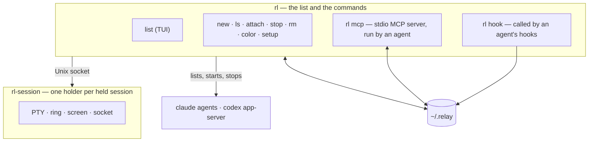

# Relay — architecture

**Status:** as built · **Date:** 2026-11-11 · **Tree:** `codex-daemon`

[PRODUCT.md](PRODUCT.md) says what Relay is for. This file says how the tree under `code/` is
wired. It names the code to read rather than repeating it; the keys are in `rl/src/tui/help.rs`
(one table: the `ctrl+h` grid and the footer's hints) and the commands in `rl/src/tui/slash.rs`.

---

## 1. Processes

There is no daemon. Two kinds of process, one file tree.

- `rl` is started by you. The list reads the files, asks each harness for its own sessions, and
  redraws on a tick.
- `rl-session` is started by `rl new`, forks away and owns one terminal. It outlives `rl`. It is
  found next to the `rl` binary.
- `rl hook` and `rl mcp` are `rl` run by someone else: an agent's hook, an agent's MCP client.
  A hook writes a file and exits 0, always, within a short time, and prints nothing but Claude's
  news of relay mail (see Ping).

State is files, not a database. Folders are the truth; a session's liveness is read from its files
and its socket.

## 2. Crates

| crate | binary | holds |
| --- | --- | --- |
| `rl-core` | | home paths (`Home`), `atomic` writes, state words, time |
| `rl-session` | `rl-session` | holder, PTY backend, ring and screen, the socket protocol and client, exit sidecar, state detection from the screen (`detect/`) |
| `rl-detect` | | the registry of harness profiles, hook settings files, the `Harness` trait and its implementations (`claude_native`, `codex_native`, `harness::Held`), MCP entries (`mcp_entry`) |
| `rl` | `rl` | commands, list, rows, hooks, MCP, setup, stores |

`rl` depends on the other three; `rl-detect` on `rl-core` and `rl-session`; `rl-session` on
`rl-core`. Every file write goes through `rl_core::atomic`.

## 3. Files

`~/.relay` (`RELAY_HOME` moves it; `Home` in `rl-core` names every path):

| path | written by | holds |
| --- | --- | --- |
| `sessions/<name>/meta.json` | `rl new` | name, harness, kind, cwd, start |
| `sessions/<name>/state.json` | holder | state read from the screen |
| `sessions/<name>/hook.json` | `rl hook` | what the agent's own hooks last said |
| `sessions/<name>/exit`, `stopped`, `sock` | holder, `rl stop` | how it ended, that it was stopped, its socket |
| `state/<agent>/<session_id>.json` | `rl hook` | a session Relay does not hold; removed on `ended` |
| `mail/<key>/<ns>-<pid>-<n>-<from>.json` | `rl mcp` | a waiting message; deleted when read |
| `mail/<key>/.told` | `rl hook` | when the newest mail a Claude `Stop` hook told of was sent |
| `config.json` | `rl setup`, the list | harnesses, badges, list preferences (grouping, toggles, order, hidden, pins, names, colours by row key; `ctrl+g` cycles a row's own colour). `names` also holds a Relay-side name for a native or hooked row, which the harness never learns of; the list draws it with the harness's own beside it. Strict. |
| `hooks/` | `rl new` | per-run settings passed to a harness |
| `detect/*.yaml` | you | profile overrides |
| `plugins/gh-pr` | `rl` | the badge script |

A session socket path over the OS limit (about 100 bytes) lives in `$TMPDIR/rl-<uid>-<fnv1a(home)>/`.
Folders are 0700.

## 4. How each moment works

- **New.** `rl new` makes the folder, writes `meta.json`, and runs `rl-session` with the command.
  For a harness with `hooks`, it writes a settings file under `hooks/` and passes it with the
  profile's `hooks.args`. The holder detaches, binds the socket and tells `rl` it is ready.
  The list's command line (`tui/cmdline.rs`) starts the same way: a first word a profile claims
  (`words`) starts that agent with the rest as its prompt (placed by the profile's `prompt`;
  its harness's `start` says where: Claude's `claude --bg`, Codex's a thread on its daemon, or
  bare `codex` run here when there is no prompt; any other, held by Relay); any other line runs held as
  `$SHELL -ic '<line>` and `exec $SHELL'`, a session of kind shell. Completion reads `PATH` once
  per list. A line starting with `/` is a command instead (`tui/slash.rs`): each names a key's
  action (`/pin` is `ctrl+t`, `/stop` is `ctrl+x` on a live row without the second press) and runs it on
  the row under the cursor through the same code.
- **List.** Held sessions come from `sessions/`. Hooked-only ones come from `state/`. Claude's and
  Codex's own come from asking them (`sessions.list` in the profile), each with its own timeout;
  one that fails is skipped. `rows/` merges them and groups them, each under its project: a
  folder you named, else its git checkout (`git::project`, read from the files: a linked
  worktree's `.git` file is followed through its `commondir` to the main checkout; a submodule's,
  which has none, is a project of its own). State comes from, in order, the
  agent's hooks, the harness's own listing, then regexes over the screen.
  `rl ls` prints the same rows once (`cmd::listing`), each harness asked on a thread of its own
  for at most 5s; one that fails or is slow is left out and named on stderr.
- **Codex.** Never held (`Harness::never_held`). A start opens the daemon through `codex
  app-server proxy` (or first `codex app-server daemon start`), introduces itself as `relay`, sends
  `thread/start {cwd}`, `thread/name/set` if named, `turn/start` with the prompt, and lets go; the
  daemon runs the turn with no client, and an approval it needs leaves the thread `active` with
  `waitingOnApproval` until `codex resume` answers it. With no prompt, `Started::Here`: the list
  hands the terminal to `codex` in the folder (`To::Here`), `rl new` runs it in the foreground.
  `rl new --harness codex` (or `rl new -- codex …`) takes the same path and prints the thread id.
  The listing adds Relay's own threads the daemon has unloaded (`thread/list`, originator
  `relay`, status `notLoaded`) as `resting` rows. A hooked Codex conversation at rest attaches with
  `codex resume`, never held. Stop is `turn/interrupt` on the running turn.
- **Attach.** A held session: `rl` connects to its socket, gets the screen, then live bytes.
  `ctrl+\` detaches. A native one: `rl` runs the profile's `attach` (`claude attach <id>`,
  `codex resume <id>`) in this terminal.
- **Stop and remove.** A held session gets a `stopped` mark, then the holder is asked to close. A
  native one through its harness (`Harness::stops`, `Harness::stop`): Claude's is `claude stop
  <id>`, Codex's interrupts a running turn. `rm` removes the folder of one not running. `rl` never
  runs `claude rm`.
- **Hook.** `rl hook <agent> <Event>` reads the hook JSON on stdin and the profile's
  `sessions.hooks.events` and writes `hook.json` (under a held session, `RL_SESSION` set) or
  `state/<agent>/<id>.json`. Claude's user-level hook says `--user` after the event; under a held
  session only the session's own hook is heard, so a call counts once.
- **Send.** `send` resolves `to` to a session and writes a file under `mail/<key>/`, the key being
  what the session keeps while it lives: a held session's name, else its conversation id. `inbox`
  takes from every key the caller has (its name or ids, and its address), oldest first; each file is
  claimed by a rename before it is read, so two inboxes never get the same message, and deleted
  once it parses. Keys are encoded one to one (`[a-z0-9-]` kept, every other byte `%xx`), so none
  escapes `mail/` and none shares a folder with another, whatever the file system's case.
- **Ping.** After the file is left, `send` tells a recipient whose harness can be told from
  outside: its harness's `ping_argv` (the profile's `sessions.ping`; Codex's `codex queue --thread
  <id> --message <text> --resume`), run through `harness::run` with `RELAY_ASKING` set so the
  harness's own hooks let it go, within `PING_WAIT`. The id is a native row's (a Codex thread's),
  else what a held session's `hook.json` says (its conversation id). No id, no ping; a failed ping is reported in `send`'s text, never as a failure.
  Claude has no such way in (`Harness::mail_by_hooks`), so its hooks carry the news: `rl hook claude UserPromptSubmit` prints
  `hookSpecificOutput.additionalContext` while mail waits in the session's own folders
  (`mcp::own_keys`: the held session's name and ids, else the payload's `session_id`, read from the
  files alone), and `rl hook claude Stop` prints `{"decision":"block","reason":…}` for mail newer
  than `mail/<key>/.told` (then records it), never when the payload's `stop_hook_active` is true.
  Only the copy of the hook that is heard (the session's own under a held session, `--user`
  outside) prints, so an event tells once. These two are the only output `rl hook` ever writes.
  From a Claude caller to one of Claude's background sessions (a native Claude row), `send`'s text
  also advises waking it with `SendMessage` (`Harness::wake_advice`), by the row's name: the name
  `claude agents` shows, which `ListAgents`/`SendMessage` address. Advice only; Relay calls nothing.

## 5. Harnesses

A harness is `detect/<name>.yaml`. `rl-detect/src/registry.rs` compiles the built-ins in and merges
`$RELAY_HOME/detect/*.yaml` over them field by field. `generic` is the floor every profile extends.

The format is strict. Every struct is `deny_unknown_fields`: a key it does not know is an error
when the profile loads. Keys:

- top level: `kind`, `bins`, `words`, `prompt`, `interactive_only`, `hooks`, `resume`, `icon`,
  `color`, `patterns`, `timing`, `sessions`, `mcp`
- `hooks`: `dialect`, `args`
- `patterns`: `needs_input`, `idle`; `timing`: `idle_after`, `stale_after`
- `sessions`: `hooks`, `list`, `attach`, `start`, `name`, `stop`, `ping`
- `sessions.hooks`: `file`, `timeout`, `unit`, `async`, `marker`, `after_install`, `from_env`,
  `events`, `settings`
- `sessions.list`: `args`, `reader`
- `mcp`: `file`, `cli`, `note`

`headless`, `model_flag`, `small_model` and `says` are gone and fail to load.

Everything Relay does with a harness is one trait, `Harness` (`rl-detect/src/harness.rs`), one
implementation per kind; `harness::of(profile, found_bin)` picks it by the profile's
`sessions.list.reader`, and `harness::harnesses(registry, find)` gives every profile's (the list's
`sources::harnesses`, made once). Nothing outside the implementations asks a harness's name. The
trait covers:

- identity: `profile`, `name`, `kind`, `bin`, `found`;
- its own sessions: `lists`, `list`/`list_within`, `start` (what it began: `Started::Id` in its
  background, `Started::Here` an argv to run in this terminal, `Started::Held` arguments for Relay
  to hold), `never_held`, `held_argv` (what a held session runs, with the per-run hooks its
  profile's `hooks` names), `attach_argv`, `carry_on` (`CarryOn::Background`, `Held` or `Attach`)
  and `carry_on_there`, `stops`/`stop`, `ping_argv`;
- setup: `user_hooks` (its profile's `sessions.hooks`), `has_mcp`, `mcp` (an `mcp_entry::Place`:
  where Relay's server goes and how);
- `rl mcp` and mail: `caller_id_var`, `mail_by_hooks`, `wake_advice`.

The kinds:

- `claude_native::Claude` (reader `claude-agents`): its own background. Lists with `claude agents
  --json --all` plus each session's job file; starts with `claude --bg` and takes the id it printed
  once the listing has it (`claude_native::begin`); carries a conversation on with `claude --resume
  <id> --bg`; stops with `claude stop`. Its MCP entry goes through `claude mcp --scope user`; its
  callers set `CLAUDE_CODE_SESSION_ID`; mail reaches its sessions through its hooks.
- `codex_native::Codex` (reader `codex-threads`): its daemon. JSON-RPC to `codex app-server proxy`
  (`codex_native::connect`, one WebSocket client for listing, starting and stopping:
  `thread/loaded/list`, `thread/read`, `thread/list`, `thread/start`, `turn/start`,
  `turn/interrupt`); never held; a conversation carries on with its own attach (`codex resume`).
  Its MCP entry is TOML in `config.toml` with `env_vars`.
- `harness::Held`: every other profile (Gemini, Antigravity, cursor, opencode, the shells,
  `generic`). No background: `start` is `Started::Held` with the profile's `prompt`, `carry_on` the
  profile's `resume`, held. Its MCP entry is the profile's `mcp`: `mcpServers.relay` written into
  `mcp.file` (Gemini), or through the harness's own `mcp.cli` words where it owns the file (`agy
  mcp add|remove`).

Where profile data plugs in, for every kind: `bins` (which binary, `found`), `prompt`, `resume`,
`hooks` (`held_argv`), `sessions.hooks` (`user_hooks`), `sessions.attach|start|name|stop` (Claude's
and Codex's argv), `sessions.ping` (`ping_argv`, Codex's `codex queue`), and `mcp.file`, `mcp.cli`,
`mcp.note` (`mcp`). What is the same for all is code: the hook settings file format (`user_hooks`),
`rl hook`, the MCP entry formats (`mcp_entry`).

## 6. MCP

`rl mcp` is JSON-RPC 2.0, one message per line on stdio, written by hand, no SDK. It answers
`initialize`, `ping`, `tools/list` and `tools/call`; stdout carries only protocol, logs go to stderr.
Tools: `who`, `send(to, text, from?)`, `inbox(as?)`. A tool failure is an `isError` result.

The caller's address, in order:

1. `RL_SESSION`, set by `rl new` on sessions Relay holds: the session's name, taken only when
   `RL_SESSION_AGENT` is the harness the server was started for (`rl mcp --harness <h>`).
2. The harness's own conversation id variable (`Harness::caller_id_var`; Claude's
   `CLAUDE_CODE_SESSION_ID`), matched against the session ids on the list.
3. Otherwise `send` needs `from` and `inbox` needs `as`.

A known caller wins over a passed `from`/`as`. Codex sets no id Relay knows, so it takes step 3.
Addresses: a held session is its name; a hooked-only one its full session id; a native one its
name, or the harness id when the name is empty or repeats. `send` also takes the row's `ctrl+r` title
or a conversation id. A `send` to a held name asks no harness for its list.

`rl setup` iterates the harnesses and registers `rl mcp --harness <h>` where each says
(`Harness::mcp`): Claude through `claude mcp add --scope user` (run with a timeout in a process
group of its own; `~/.claude.json` is only read, to compare and to confirm), Codex as
`[mcp_servers.relay]` in `config.toml` with `env_vars` for `RELAY_HOME`, `RL_SESSION` and
`RL_SESSION_AGENT`, Gemini as `mcpServers.relay` in `settings.json`, Antigravity through `agy mcp
add`. Where
the Relay home is not the default, each entry carries `RELAY_HOME`. Hook
files are edited in place keeping key order, comments (TOML) and file mode. A file that does not
parse is left alone and reported.

Each part (hooks, `user_hooks::install_needed`; each server entry, `mcp_entry::Place::need`) first answers
"would a run change this?" from its files alone, missing or stale; a run writes only what that
names, and `rl setup --check` (`setup::check`) stops there, so it writes nothing and runs neither
`claude mcp` nor `agy mcp` (their entries are read from `~/.claude.json` and agy's
`mcp_config.json`). The list runs the check off its UI thread as it starts and leads the footer's
hints with `setup needed: … · /setup` while anything does; `/setup` runs `setup::run` in the
list's background work and checks again. The list's first start, with no `config.json` yet, on a
terminal and outside a held session, asks once (`setup::first_run`) before taking the screen and
writes `config.json` whatever the answer.

## 7. Not verified live

Taken from the task reports; none is exercised by the tests.

- What `claude --bg` prints (the first 8-hex word is taken as the id).
- `claude stop <id>` on a live session.
- `turn/interrupt` on a live thread, and `codex app-server daemon start`.
- The Gemini MCP entry format.
- Whether `claude --bg` sessions run user-level hooks (why the list asks `claude agents`).
- Checked live on codex 0.167: a thread started over the proxy runs its turn with no client; an
  idle one with no client is unloaded after about two minutes (hence the `resting` rows); a turn
  that needs an approval with no client connected waits (`active`, `waitingOnApproval`), and
  `codex resume <id>` shows the approval prompt; such a thread's `source` is `vscode` and its
  `originator` the `clientInfo.name` Relay gave (`relay`).
- Antigravity's screen (`agy`): its profile has no patterns or hooks of its own; only `agy --help`
  was read (`-i` is `--prompt-interactive`).

Live tests against real CLIs are `#[ignore]`. Codex's daemon in the tests is a stand-in
(`fixtures/stand-in-codex-daemon`, Python 3) that speaks the WebSocket and the JSON-RPC; the
list's tests copy it to `target/debug/deps/stand-ins/<pid>/`, and each test run sweeps away the
folders of runs that have finished. Tests never touch the real `~/.relay`, `~/.claude`,
`~/.codex` or `~/.gemini`; they use `RELAY_HOME`, `HOME`, `CLAUDE_CONFIG_DIR`, `CODEX_HOME`.

## 8. Gates

CI runs `cargo fmt --all --check`, `cargo clippy --workspace --all-targets -- -D warnings` and
`cargo test --workspace`.
