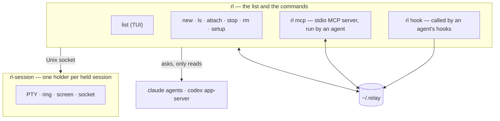

# Relay — architecture

**Status:** as built · **Date:** 2026-11-08 · **Tree:** `slim-step-1`

[PRODUCT.md](PRODUCT.md) says what Relay is for. This file says how the tree under `code/` is
wired. It names the code to read rather than repeating it; the keys are in `rl/src/tui/shortcuts.rs`
and `^h`.

---

## 1. Processes

There is no daemon. Two kinds of process, one file tree.

- `rl` is started by you. The list reads the files, asks each harness for its own sessions, and
  redraws on a tick.
- `rl-session` is started by `rl new`, forks away and owns one terminal. It outlives `rl`. It is
  found next to the `rl` binary.
- `rl hook` and `rl mcp` are `rl` run by someone else: an agent's hook, an agent's MCP client.
  A hook writes a file and exits 0, always, within a short time, and prints nothing.

State is files, not a database. Folders are the truth; a session's liveness is read from its files
and its socket.

## 2. Crates

| crate | binary | holds |
| --- | --- | --- |
| `rl-core` | | home paths (`Home`), `atomic` writes, state words, time |
| `rl-session` | `rl-session` | holder, PTY backend, ring and screen, the socket protocol and client, exit sidecar, state detection from the screen (`detect/`) |
| `rl-detect` | | the registry of harness profiles, hook settings files, own-session adapters (`claude_native`, `codex_native`) |
| `rl` | `rl` | commands, list, rows, hooks, MCP, setup, stores |

`rl` depends on the other three; `rl-detect` on `rl-core` and `rl-session`; `rl-session` on
`rl-core`. Every file write goes through `rl_core::atomic`.

## 3. Files

`~/.relay` (`RELAY_HOME` moves it; `Home` in `rl-core` names every path):

| path | written by | holds |
| --- | --- | --- |
| `sessions/<name>/meta.json` | `rl new` | name, harness, kind, cwd, start |
| `sessions/<name>/state.json` | holder | state read from the screen |
| `sessions/<name>/hook.json` | `rl hook` | what the agent's own hooks last said |
| `sessions/<name>/exit`, `stopped`, `sock` | holder, `rl stop` | how it ended, that it was stopped, its socket |
| `state/<agent>/<session_id>.json` | `rl hook` | a session Relay does not hold; removed on `ended` |
| `mail/<address>/<ns>-<n>-<from>.json` | `rl mcp` | a waiting message; deleted when read |
| `config.json` | `rl setup`, the list | harnesses, badges, list preferences. Strict. |
| `hooks/` | `rl new` | per-run settings passed to a harness |
| `detect/*.yaml` | you | profile overrides |
| `plugins/gh-pr` | `rl` | the badge script |

A session socket path over the OS limit (about 100 bytes) lives in `$TMPDIR/rl-<uid>-<fnv1a(home)>/`.
Folders are 0700.

## 4. How each moment works

- **New.** `rl new` makes the folder, writes `meta.json`, and runs `rl-session` with the command.
  For a harness with `hooks`, it writes a settings file under `hooks/` and passes it with the
  profile's `hooks.args`. The holder detaches, binds the socket and tells `rl` it is ready.
- **List.** Held sessions come from `sessions/`. Hooked-only ones come from `state/`. Claude's and
  Codex's own come from asking them (`sessions.list` in the profile), each with its own timeout;
  one that fails is skipped. `rows/` merges them and groups them. State comes from, in order, the
  agent's hooks, the harness's own listing, then regexes over the screen.
- **Attach.** A held session: `rl` connects to its socket, gets the screen, then live bytes.
  `ctrl-\` detaches. A native one: `rl` runs the profile's `attach` (`claude attach <id>`,
  `codex resume <id>`) in this terminal.
- **Stop and remove.** A held session gets a `stopped` mark, then the holder is asked to close. A
  native Claude one is `claude stop <id>`. `rm` removes the folder of one not running. `rl` never
  runs `claude rm`.
- **Hook.** `rl hook <agent> <Event>` reads the hook JSON on stdin and the profile's
  `sessions.hooks.events` and writes `hook.json` (under a held session, `RELAY_SESSION` set) or
  `state/<agent>/<id>.json`. Claude's user-level hook says `--user` after the event; under a held
  session only the session's own hook is heard, so a call counts once.
- **Send.** `send` writes a file under `mail/<to>/`. `inbox` reads them oldest first and deletes
  them. Addresses are cut to one path component, so none escapes `mail/`.

## 5. Adapters

A harness is `detect/<name>.yaml`. `rl-detect/src/registry.rs` compiles the built-ins in and merges
`$RELAY_HOME/detect/*.yaml` over them field by field. `generic` is the floor every profile extends.

The format is strict. Every struct is `deny_unknown_fields`: a key it does not know is an error
when the profile loads. Keys:

- top level: `kind`, `bins`, `interactive_only`, `hooks`, `resume`, `icon`, `color`, `patterns`,
  `timing`, `sessions`
- `hooks`: `dialect`, `args`
- `patterns`: `needs_input`, `idle`; `timing`: `idle_after`, `stale_after`
- `sessions`: `hooks`, `list`, `attach`, `start`, `name`, `stop`
- `sessions.hooks`: `file`, `timeout`, `unit`, `async`, `marker`, `after_install`, `from_env`,
  `events`, `settings`
- `sessions.list`: `args`, `reader`

`headless`, `model_flag`, `small_model` and `says` are gone and fail to load.

The facts per harness are in its YAML. What is the same for all is code: the hook settings file
format (`user_hooks`), `rl hook`, and the two readers named by `list.reader`. A reader parses one
harness's own listing: `claude-agents` runs `claude agents --json --all`; `codex-threads` talks
JSON-RPC to `codex app-server proxy` and only reads (`thread/loaded/list`, `thread/read`).

## 6. MCP

`rl mcp` is JSON-RPC 2.0, one message per line on stdio, written by hand, no SDK. It answers
`initialize`, `ping`, `tools/list` and `tools/call`; stdout carries only protocol, logs go to stderr.
Tools: `who`, `send(to, text, from?)`, `inbox(as?)`. A tool failure is an `isError` result.

The caller's address, in order:

1. `RELAY_SESSION`, set by `rl new` on sessions Relay holds: the session's name.
2. `CLAUDE_CODE_SESSION_ID`, matched against the session ids on the list.
3. Otherwise `send` needs `from` and `inbox` needs `as`.

A known caller wins over a passed `from`/`as`. Codex sets no id Relay knows, so it takes step 3.
Addresses: a held session is its name; a hooked-only one its full session id; a native one its
name, or the harness id when the name is empty or repeats.

`rl setup` registers it: Claude as `mcpServers.relay` in `~/.claude.json`, Codex as
`[mcp_servers.relay]` in `config.toml`, Gemini as `mcpServers.relay` in `settings.json`. Hook
files are edited in place keeping key order, comments (TOML) and file mode. A file that does not
parse is left alone and reported.

## 7. Not verified live

Taken from the task reports; none is exercised by the tests.

- What `claude --bg` prints (the first 8-hex word is taken as the id).
- `claude stop <id>` on a live session.
- That `codex resume <id>` attaches to a thread the app-server has loaded, and when a thread stays loaded.
- The Gemini MCP entry format; `.claude.json` under `CLAUDE_CONFIG_DIR`.
- Whether `claude --bg` sessions run user-level hooks (why the list asks `claude agents`).

Live tests against real CLIs are `#[ignore]`. Tests never touch the real `~/.relay`, `~/.claude`,
`~/.codex` or `~/.gemini`; they use `RELAY_HOME`, `HOME`, `CLAUDE_CONFIG_DIR`, `CODEX_HOME`.

## 8. Gates

CI runs `cargo fmt --all --check`, `cargo clippy --workspace --all-targets -- -D warnings` and
`cargo test --workspace`.
