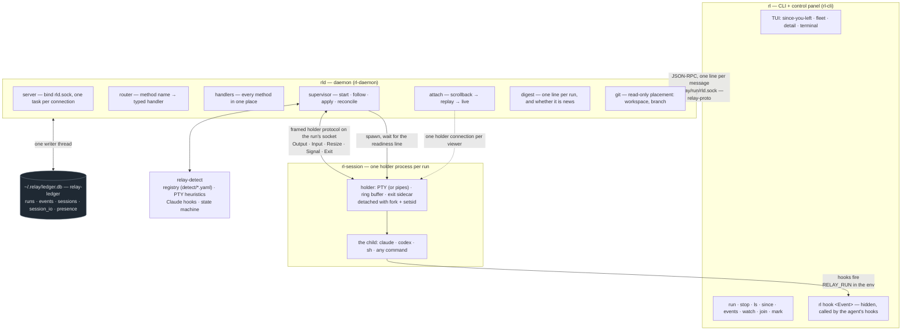
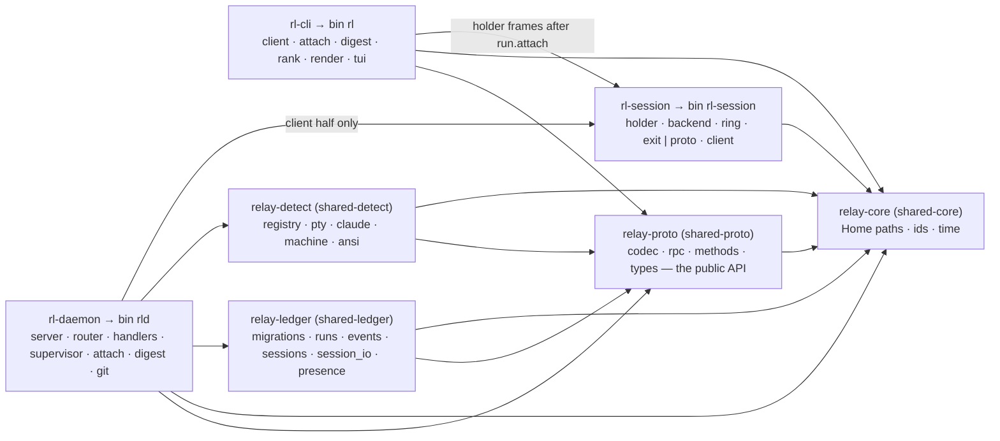
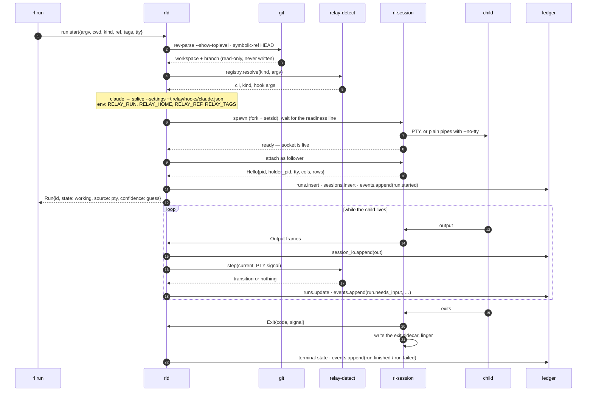
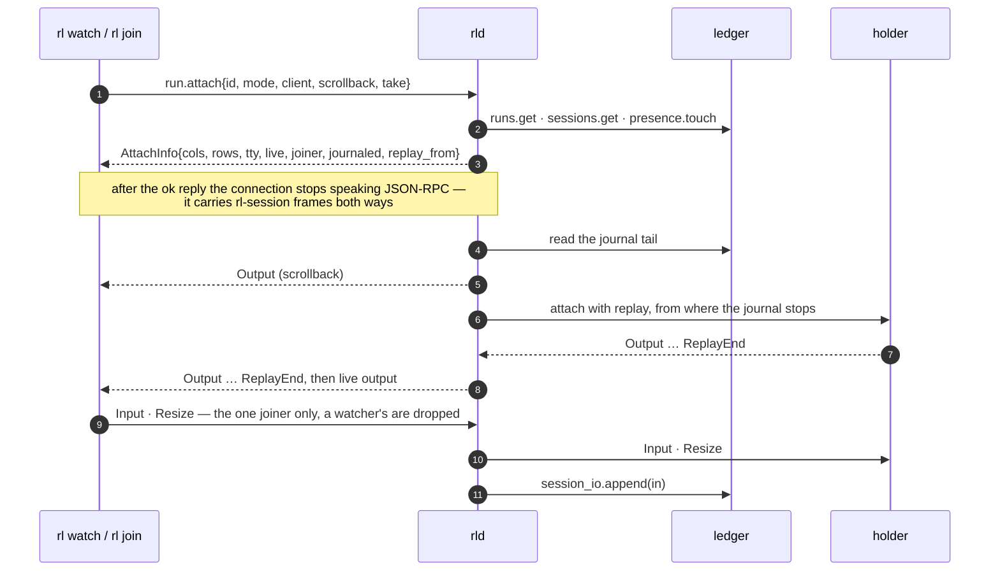
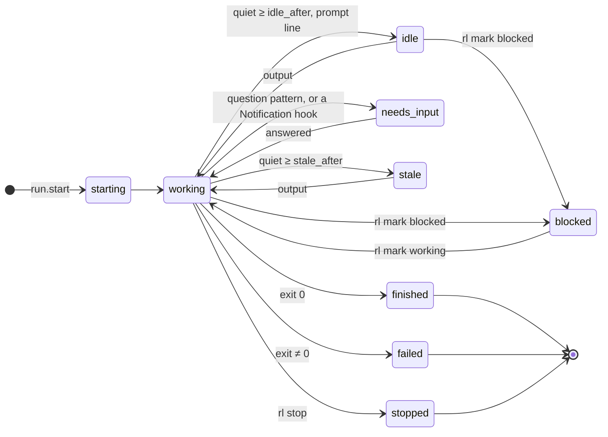

# Relay — architecture

**Status:** as built · **Date:** 2026-09-09 · **Tree:** `0610d31`

[PRODUCT.md](PRODUCT.md) says what Relay is for and where it is going. This file says how the
tree that exists is wired: which processes there are, who owns what, and what crosses which
boundary. Every diagram describes code under `code/`; what is not built yet is listed at the
end and marked in the diagrams with dashes.

---

## 1. Processes

Three kinds of process and two socket protocols. Nothing else talks to anything.



What the picture is enforcing:

- **`rld` never owns a child.** Every run lives under its own `rl-session`; the daemon is only a
  client of that holder. A daemon crash, restart or upgrade therefore costs no sessions —
  `Supervisor::reconcile` finds the open sessions in the ledger and resumes the journal exactly
  where it stopped.
- **The holder depends on nothing else in Relay.** Its protocol is deliberately not JSON-RPC and
  not shared with `relay-proto`: a session must stay reachable with only that one binary alive.
- **`rl` speaks only `relay-proto`.** No client reads the ledger, and `--json` is the same data
  the TUI draws.
- **The ledger is one SQLite file behind one writer thread.** Every access ships a closure to
  that thread, so a call that returns has been applied.

---

## 2. Crates



`rl-session` splits in two on purpose: the library half (`proto`, `client`, `exit`) is what `rld`
links, the binary half (`holder`, `backend`) is the process itself.

---

## 3. Starting a run



After a daemon restart, `reconcile` walks `sessions` where `closed_at IS NULL`: re-attach where
the holder still answers (resuming the journal, with a `note` line if bytes were lost while the
daemon was down), otherwise close the run from its exit sidecar — or as lost.

---

## 4. Watching and joining



Several watchers, one joiner; a second `join` is refused unless `take` turns the previous joiner
into a watcher. Each viewer gets its own holder connection, and the supervisor's follow
connection journals regardless — so a viewer leaving costs nothing and the run never notices.

---

## 5. How a run's state is decided

Every source produces a `Signal{state, source, confidence}`; `relay_detect::step` is the only
place a `(current, signal)` pair becomes a transition, and it decides against the ledger row.

| Source | Confidence | Wired today | Where from |
|---|---|---|---|
| `hook` | exact | yes | Claude Code hooks → `rl hook <Event>` → `run.hook` |
| `manual` | exact | yes | `rl mark done \| blocked \| working` |
| `pty` | guess / likely | yes | output-idle timers + prompt/question patterns over the byte stream |
| `transcript` | exact | not yet | `~/.claude` transcripts |
| `git` | exact | placement only | commits landed, branch done |

The rules, in order: terminal states never change here; `stale` only ever replaces
`working`/`starting`; a PTY guess never overrides an exact state from another source; the same
state again upgrades source/confidence at most; anything else is a transition, journaled as an
event.



`needs_input`, `blocked` and `failed` are the attention states: they sort to the top of the
fleet and are what `rl since` leads with. Confidence rides along in the UI, always visible.

Grouping is derived, never a table: `group_key = ref → branch → workspace`, materialised onto
each event row at write time so the digest groups without a join.

---

## 6. On disk

```text
~/.relay/                     ($RELAY_HOME overrides; tests point it elsewhere)
  ledger.db                   SQLite: runs, events, sessions, session_io, presence
  run/                        0700 — rld.sock, rld.pid, <run>.sock, <run>.exit
  log/                        rld.log, <run>.log
  hooks/claude.json           written at daemon start; passed to claude as --settings
  detect/*.yaml               user overrides, merged field by field over the built-ins
  plugins/                    (empty — see below)

detect/*.yaml                 in-tree, compiled in: generic, claude, codex, cursor, sh
scripts/{rl,rld,relay-dev}    dev shims: build if needed, run the debug binaries
```

Sockets normally live in `run/`; a long `$RELAY_HOME` would blow the ~104-byte `sockaddr_un`
limit, so both sides fall back to the same short hashed directory under the temp dir.

---

## 7. Not built yet

Named here so the diagrams above are not read as the whole plan — see §7 of the brief for
phasing.

- **Scheduler** — `schedules`, `schedule_runs`, cron → run spec. `Run.schedule_run` exists, unused.
- **Plugins** — `rl-plugin-host` (Bun), the broker, `relay.d.ts`, the manifest/approval flow,
  action keys and the detail tab. `Run.plugin` and `~/.relay/plugins/` exist, unused.
- **Facts and summaries** — the collector, transcript ingestion, cached narrative, cost. No
  `facts` or `summaries` tables yet; `Run.cost` is carried but never set.
- **Worktrees and ref rules** — `--worktree`, branch-naming, `.relay/config.yaml` ref derivation.
  `Run.worktree` and `Run.parent_run` are carried, never set.
- **Notifications** — the notify reference plugins.
