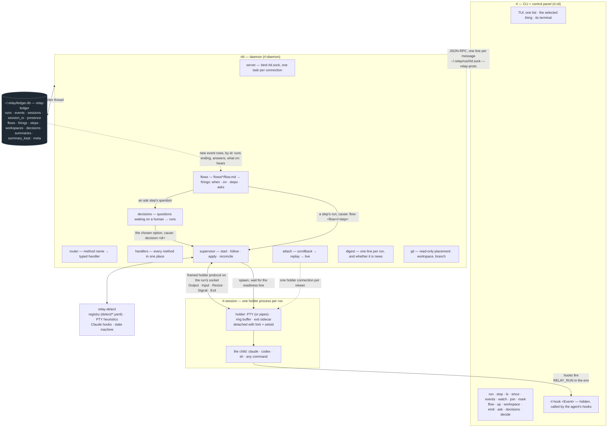
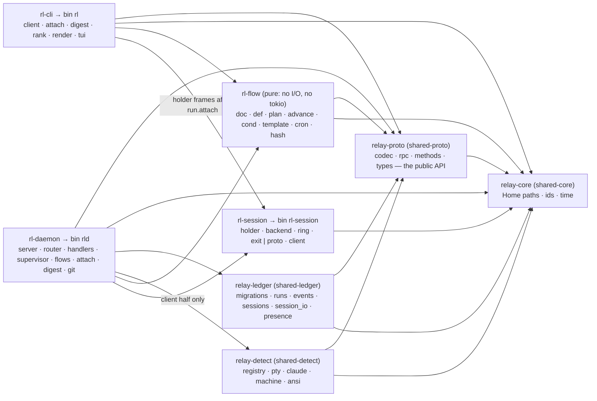
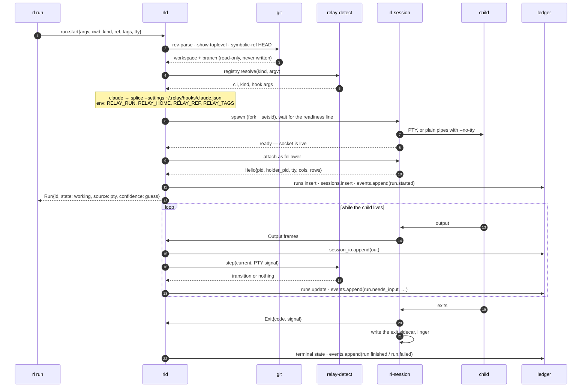
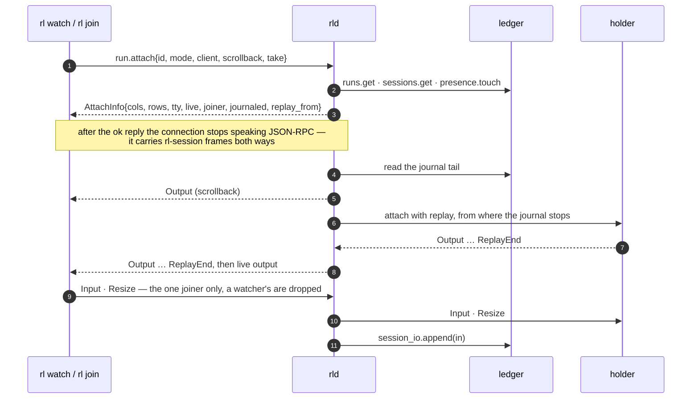
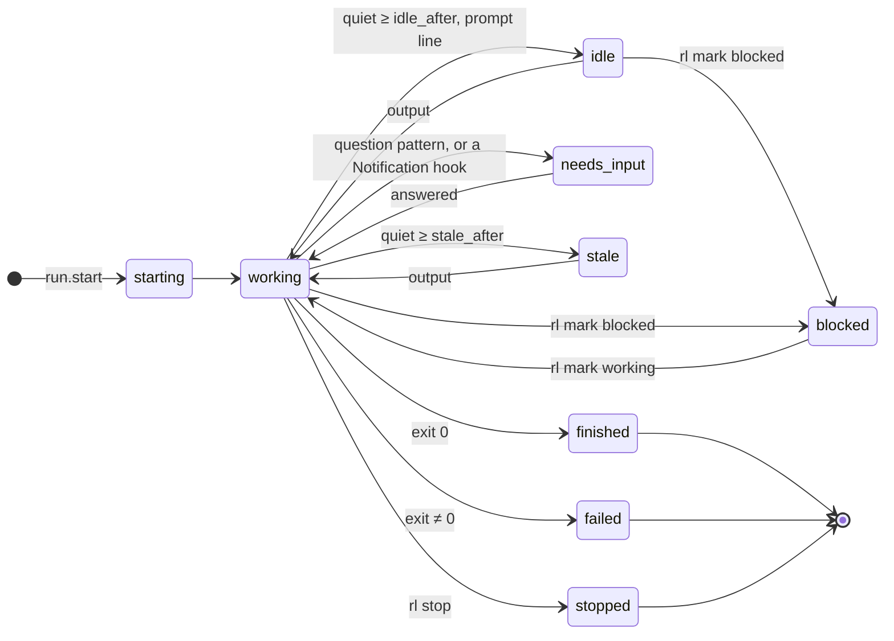
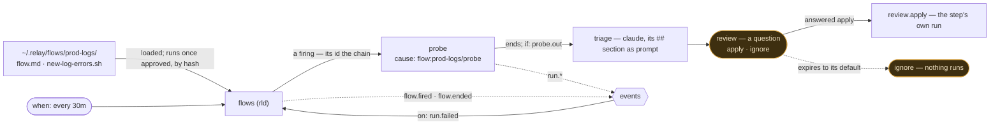

# Relay — architecture

**Status:** as built · **Date:** 2026-10-08 · **Tree:** `flows-spec` branch

[PRODUCT.md](PRODUCT.md) says what Relay is for and where it is going. This file says how the
tree that exists is wired: which processes there are, who owns what, and what crosses which
boundary. Every diagram describes code under `code/`; what is not built yet is listed at the
end and marked in the diagrams with dashes.

---

## 1. Processes

Three kinds of process and two socket protocols. Nothing else talks to anything.



What the picture is enforcing:

- **`rld` never owns a child.** Every run lives under its own `rl-session`; the daemon is only a
  client of that holder. A daemon crash, restart or upgrade therefore costs no sessions —
  `Supervisor::reconcile` finds the open sessions in the ledger and resumes the journal exactly
  where it stopped.
- **The holder depends on nothing else in Relay.** Its protocol is deliberately not JSON-RPC and
  not shared with `relay-proto`: a session must stay reachable with only that one binary alive.
- **`rl` speaks only `relay-proto`.** No client reads the ledger, and `--json` is the same data
  the TUI draws.
- **The ledger is one SQLite file behind one writer thread.** Every access ships a closure to
  that thread, so a call that returns has been applied.

---

## 2. Crates



`rl-session` splits in two on purpose: the library half (`proto`, `client`, `exit`) is what `rld`
links, the binary half (`holder`, `backend`) is the process itself.

`rl-flow` is all the deciding about a flow (§6), and none of the doing: `flow.md` read and
checked, the steps' order, what a firing does next, `if:`, the placeholders, what a step may leave (`state.rs`: a value's key, a file's name, the caps, `$RELAY_OUT`'s lines), the cron line and the
folder's hash, each a function of what it is handed. `rld` carries its answers out; `rl` reads a
flow's definition with it to draw the row and the pane.

---

## 3. Starting a run



After a daemon restart, `reconcile` walks `sessions` where `closed_at IS NULL`: re-attach where
the holder still answers (resuming the journal, with a `note` line if bytes were lost while the
daemon was down), otherwise close the run from its exit sidecar — or as lost.

A holder waits for that. After its child exits it lingers (a day by default) with the tail and
the exit, and goes on `Close` — which the daemon sends once it has journaled the end — or when
the linger runs out with nobody attached. Its socket is the only way anyone reaches it, so when
the socket file is removed from under it (it looks once a minute) (the Relay home deleted, a test's temporary home cleaned
up) no daemon can come back for the run: the holder hangs up a child still going and leaves. It
does the same when nobody at all has been attached for `runs.reap_after` (default `6h`): `rld`
holds a connection for as long as it lives, so that only comes about when Relay itself is gone
for good — a throwaway home, a daemon that never returns — and while it is gone nothing journals
the run anyway.

Reading its child is the one thing a holder does constantly, so it does it on one thread: a
worker per core only bought a cross-thread wake-up and a trip through a work-stealing scheduler
for every chunk, which cost more than relaying the bytes did. The reader also waits `runs.settle`
(default `5ms`, `off` to read flat out) once it has caught up, before reading again. Nothing is
held back — what was read is already on its way — but the next read finds a whole burst rather
than the few bytes one `printf` wrote. That is also the backpressure a terminal gives a program:
without it the holder empties the pty the instant anything lands, so a child that redraws in a
loop spins at full speed against a reader that may have no viewers at all.

Starting the daemon is nobody's job. Every `rl` command that needs it goes through
`daemon::ensure`: `rld` is spawned when the socket is not there (one line on stderr, `rld
started`), and the running one is compared with this `rl` — the same release, nothing to say;
another release with the same wire protocol, `rl` offers `rl daemon restart` on a terminal and
only notes it otherwise; another protocol, `rl` refuses, since messages could be misread. A
restart costs nothing running, which is what makes the offer cheap. `rl daemon start|stop|
status|restart` remain for saying it explicitly; a hook from inside a run (`rl hook`) never
starts a daemon.

---

## 4. Watching and joining



What is replayed is a tail of bytes, not a screen: an app that redraws only what changed (Claude
Code, and most that diff their own buffer) leaves its box and status line out until it repaints.
It repaints when its size changes, and an app that redraws everything then (Claude Code redraws
its whole conversation) should do that once, not twice. So letting go of a run leaves it a row
short, where nobody sees it redraw, and the next join — at the size it had, or any other — is one
real change and one repaint. A joiner's first `Resize` says which: a new size needs nothing more.
Only a joiner at the very size the run has (or one that says none within `JOIN_SIZE_WAIT`), and a
watcher while nobody is joined, gets the nudge: rld gives the pty a row less, holds that for a
fifth of a second, and gives the size back (`NUDGE_HOLD`, `rl-daemon/src/attach.rs`). Held,
because two resizes sent back to back land together, the app reads the size it already had, and a
runtime that only reports a change (Node, Bun) never repaints. A row rather than a column, as tmux
does, so what the run printed is not wrapped twice. One nudge per run at a time: while it holds,
the run keeps its own size on record, a viewer arriving meanwhile starts from that, and the one in
flight repaints for it too.

A run just started is the hard case: a Node or Bun agent listens for a resize only half a second or
so in, and one that lands before is lost — it draws for the rows it started with. So the panel
starts a run at the whole terminal, the size its join will hand it (`spawn_size`, `tui/mod.rs`),
and there is no resize to lose; and a run joined younger than `YOUNG` (three seconds) is nudged
once more at that age, in case its first one went unheard.

Every one of those frames is read through `FrameReader`, never a bare `read_frame`. Each hop
reads inside a `select!` — the viewer against stdin and a ticker, `rld` against the holder and
its own shutdown — and a plain read holds the bytes it has gathered on the future's stack, so
losing the race throws them away. The next read then starts in the middle of a payload and takes
the child's own output for a header: a scrollback replay of a few hundred kilobytes is the frame
most likely to lose, and the run's text decodes into a length of some billions, which ends the
connection. `FrameReader` keeps the partial header and payload in the reader itself, so a
dropped future costs nothing and the next call carries on where it stopped.

A holder outlives `rld` on purpose — stopping the daemon is not stopping the work — but while no
daemon is attached nothing journals the run or knows its state, and a throwaway home's holders
would otherwise sit there for good. So a holder with nobody attached at all (no daemon, no
viewer) for `runs.reap_after` (default `6h`, `never` to keep them) hangs up its child and leaves,
as it already does when its socket is deleted. `rl daemon stop --with-runs` is the deliberate
version: every live run stopped, each holder asked to go, then the daemon. Asked, and then waited
for: the `Close` is only heard if the connection outlives the holder's own handshake writes, so
`rl` stays on the socket until the holder hangs up on it. Sending `Close` and dropping in the
same breath breaks those writes, the holder's client task ends on the write error, the frame is
never read, and the holder sits there for the rest of its linger.

A stream can also end without an exit — the holder killed, the machine gone. That is not a run
ending, and it is never told as one: `rl watch`/`rl join` ask rld what became of the run (giving
it a moment to notice, or `rl ls` would disagree a second later), say it — "run ab12 failed · the
session holder went away", or "lost touch with run ab12 · it may still be going" — and exit with
the run's own code, or 1 when there is none. Only leaving on purpose exits 0. The panel keeps the
terminal it was showing, marked `lost`: the last thing the run said is worth most at exactly the
moment the connection breaks, and it used to be thrown away.

What went wrong around a run without ending it is a `run.trouble` event: output lost while no
daemon was there, a holder that went without reporting an exit. A `warn!` is for whoever reads
the log; the event is for whoever has the run in front of them, and the pane keeps the latest as
a `trouble` fact rather than letting `lately` push it out of sight.

A restart takes every holder with it, and nothing records an exit. When rld comes back, reconcile
finds each such run's holder gone, closes it as failed and marks it `run.lost`. The runs still on
the list that a restart took are the digest's `lost`, and the headline says so in amber: "3 lost
in a restart · /resume all". `/resume` (`rl resume <id>…`) picks an ended run back up as a new run
in its folder, under its title and in its chain, tagged `resumes:<id>`, and archives the one it
picks up, so the list shows the run that carries it on (`tui`'s `/resume`, `rl-daemon/src/resume.rs`).
What that means depends on the kind of run. An agent's conversation comes back through its own CLI
— `claude --resume <session>`, `codex resume <session>` — with the session named by the transcript
a hook reported, or else the one found by folder and start time; a conversation reopened waits for
you, and nothing is sent to it. A shell has nothing to resume but its place, so it comes back as a
fresh shell. A command runs again. `/resume all` (`rl resume --lost`) brings back what was lost,
except plain commands: running one again can do what it did twice, so those come back only when
asked, with `/resume all commands` (`--commands`). Nothing is resumed on its own.

Several watchers, one joiner; a second `join` is refused unless `take` turns the previous joiner
into a watcher. The joiner is a seat — `user@host` and which of their terminals (`terminal`, the
attaching process) — so a second terminal of the same person is refused too, told it is "you in
another terminal", rather than silently sharing the keyboard. The panel asks before it takes:
`/join` on a held run says who has it, and `y` takes it over. Each viewer gets its own holder connection, and the supervisor's follow
connection journals regardless — so a viewer leaving costs nothing and the run never notices.

The panel (`rl` with no command, `rl-cli/src/tui`) is the same two calls behind one screen. It
is one list, the width of the screen, built from `digest.get` (`tui/rows.rs`): the questions
waiting on you first, from every project and each naming its own (`rlux › deploy tonight?`),
oldest first, so what needs you never hides under a project's name; then pinned runs; then
grouped by the folder they belong to, the folders in order of name so each keeps its place, and
inside one runs by attention — until you put a project in your own order: shift-`↑`/`↓` on a run
or a flow moves it one place up or down inside its project (holding goes on moving it, the cursor
stays on it), and from then on that project keeps your order rather than sorting itself. What is
new there enters at its top; what needs you — asking, blocked or failed — floats to its top
whatever the order, and drops back to where you put it once dealt with. A row never moves out of
its project, past what floats, or into the questions or the pinned runs; on a header, a question,
in the graph or `/events` the keys say why and do nothing. `digest.order` keeps a project's whole
order — its header's key (`g:<folder>`, `g:everywhere`) and its rows' (`r:<id>`, `f:<name>`), in the
ledger's `row_order` table — and the digest carries it; each move sends the whole of it again,
built from the list with no search or lens narrowing it, so what a search hides keeps its place
and what has left the list drops out. `/sort` on a project (its header, or any row in it) lets go
of the order: it sorts itself again. Shift and an arrow arrive as `CSI 1;2A`/`B` in iTerm2,
Terminal.app and tmux 3.2 or later; a terminal that does not report shift sends the plain arrow,
which just moves the cursor. And named — a workspace by the
name it was registered under, a cause as "flow nightly · probe" or "your answer", never an id.
A row is an icon for what it is — an agent in its CLI's glyph and colour (`✻` claude in its clay, `⬡` codex, `✧` gemini in blue, `❖` cursor, `⊡` opencode, `✦` any other), `❯` a shell (in the prompt's green), `▸` a
command, `↻` a flow, `?` a question (amber) — one quiet glyph, one column wide in every font, so
every title starts in the same column, and dim once the run has ended — then the title, the state as a word in its colour (`needs you` and `blocked` amber,
`failed` red, `done` and `stopped` dim; a shell at rest says nothing there, its icon says it),
the summary to the edge, and the ref and the age at the right — with `⎇ feat` there too when the
run started on another branch than the one its folder is on now. A run that ended well and raised
something itself (`rl emit`) says the last of it in its own words — `5 feedback rows to process`,
not `exit 0`, which for a probe is the whole point; one that failed keeps its exit, the one worth
reading. A Claude or Codex run that is waiting — idle, needing you, blocked, or ended — says
its agent's latest recap there instead (§6: `Search fixed; nothing committed. Next: say
commit.`), the first line of it, which `digest.get` carries on the item (`recap`) from one query
over `summaries` for the whole list, never a session file read; at work it says what it is
doing, as ever. Other agents and shells say what they always have. A search finds what the row
says. What it raised, by kind, is in the pane under `signals`
(`flint.product.new-feedback ×5`). The daemon's own event families are left out of that, since
the state already says them (`events::emitted_for_run`, carried on the digest's item). Colour carries the state — a
saturated accent per state, on the terminal's own foreground so it reads on either theme
(`tui/theme.rs`). The panel runs to the screen's edges, with a separator between its sections —
under the header, above the line, above the footer. The project rows and the `❯` line start at the edge,
and the header and footer text level with what is typed after the `❯`; a project's runs, shells and agents sit one column in, under it. The list and its
detail pane are split by a vertical bar — the list takes two thirds beside the details pane, half beside a terminal, which needs the
width; the full-screen terminal drops all of it for the cells. The header wears Relay's mark — a
radio tower sending signals, drawn from one pixel grid in `tui/mark.rs` and in the accent: under a row of air, five
rows of half-blocks at the left edge, and beside its middle
three rows the header's words — `relay` and its version (and the Relay home, `~` for home, when it
is not the usual `~/.relay`, so a panel on a test ledger says so) with the lens and who you are at
the right; then the tally (or the graph's or the events' own headline); then the notes — what a
restart took and the flows that are in no project, each in its tone. The full-screen terminal keeps the header to
one line, all of it after the tally, and so does a screen under 24 rows or 80 columns
(`head_h`); everything under the header — the list's rows for the mouse, a terminal's size in the
pane — is measured from where `areas` put it. With nothing running at all, the empty list shows the
mark full size in its middle, over its words, and the setup guide has it above its title, each
where it fits. A group is a folder (or a ref), never a branch: its header is its path, with `~` for home, the
folders above dim and its own bold, and ` · name` after it when it goes by a name that is not its
folder's (a ref, or a folder registered or renamed under another); a path too long for the title
column loses its start to `…`, never its last folder. From the state column on — level with the
runs' state words, whatever the path's length — comes its git checkout as it stands — `⎇ main · PR
#95 · 3 worktrees`, the branch or a detached commit, the badges, and on a main checkout the linked
worktrees whose folders are still there (`rld` reads `.git` directly on each digest, no `git`
started; a worktree registered on its own is a project of its own, with its branch and no count) —
and, at the right edge, the tally of the flows `in` the folder (`2 flows`), with any flow that
waits for a yes named just before it in amber (`! deploy`), and before that a red `! flows` while
one of the folder's flows did not load (§6, **Loading and approval**). The rest of a folder's flows
are the graph's and the project pane's to show. A flow with no `in` belongs to no project, and
has no row of its own until it runs: the header says those on its line of notes, when there are
any — `↻ 2 everywhere` (on one line, `relay · 3 working · ↻ 2 everywhere`) — in amber when one
waits for a yes, saying so and where to give it (`↻ 1 everywhere needs a yes · /graph`,
`rows::everywhere`), and `flows broken` in red beside it while one of theirs, or one whose `in` is
not known, did not load (`rows::global_parts`). A flow's runs fold, once ended, under the project
its flow is `in`, wherever they ran; a flow with no `in` has its row, and those runs, under one
group headed `everywhere`, after the projects, rather than under `~` or whatever folder that was
— and so does a flow's run still going outside every registered project (`rows::everywhere_run`;
a run filed under a ref keeps the ref). That header is not a project: `enter` puts the flows with
no `in` and how their runs stand in the pane, and `^x`, `^r` and `/shell` say `everywhere is not a
project` and do nothing; `in:everywhere` finds it. `^g` (or `/graph`) from anywhere, an empty list
too, shows every flow wired with everything else. A flow's runs, once ended, fold into one row per
flow (`f:<name>`) — `↻`, the name, a mark per firing in the state column (`··×·`, oldest first, red where
a step failed), where its latest firing stands and what it came to (`waiting at review · page
on-call?`, `running · triage`, `failed at probe · token expired`, `done · *Morning brief*`;
`rows::FlowRow`, `flows::stands`) and how long ago — so a flow firing every
thirty seconds is a row, not a screen, and it never grows into one: `→` on it (nothing typed) opens
it to its latest firing's steps on a line under it — `probe ✓ · triage ✓ · review ?`, a failure red
(`flows::steps_line`) — and `←` folds it again; `enter` (or `^o`) puts it in
the pane, as on a project header. A run still going or waiting on you is never folded. The pane
holds the flow: `flow · <in> · <status>`, then what starts it — a cron line read back in words
where it can be (`hourly 08:00–18:00, Mon–Fri`), left as written where it cannot — where it runs,
whether its folder as it is has a yes, when it fires next and when it last did, its folder, and
each step as the latest firing left it (`✓ done`, `? waiting`, `× failed`) with what it does
(`flows::pane_lines`). Under them, the files the shown firing's steps wrote to `runs/<firing>/`
(`note.txt 12 B · report.md 2 kB`, read from the folder, `.relay/` left out), how its runs went,
what `/summary` said, and its last eight firings — when, where each stands, what it came to — the
one shown marked `▸` (`tui/firings.rs`). `enter` again walks the steps and then the firings, as a
question's choices are walked: `enter` on a step joins its run, or reads what an ended one
printed in the tile; on a firing it shows that firing's steps above, and `/summary` on the row
is then of that firing (`SummaryTarget::Firing`); `esc` ends the walk. When the list
is taller than the screen, its first and last lines say how much is above and below. A group's
header says which folder it is in, and the cursor stops on it like any other row: `enter` (or
`^o`) turns the pane into the project's own — the folder, how its runs stand (needs-you /
going / done), when it last stirred, and the flows `in` it. `^g`
from a header opens the graph on that folder's first flow, and from a flow's row on its own;
`^r` (or `/rename`) renames
whatever the cursor is on in place. On a run (a shell is one) or a project's header the name
turns into a field in its own cell, the whole of it selected and the caret at its start, drawn the
way the line draws its own: typing or a paste replaces it, `backspace` or `delete` clears it, and
any other key lets the selection go and does what it does from the start. The keys are the line's
own, from the same code (`line::Field` wraps `tui/line.rs`'s editor), one line only, and a name
wider than its cell scrolls sideways to keep the caret in view. `enter` saves — a folder over
`workspace.rename`, which updates the registered name and keeps the registration, a run over
`run.rename` — and `esc`, or anything that takes the cursor off the row (the arrows, `^j`/`^k`, a
click elsewhere, the wheel, `tab` to another lens), lets it go unsaved; meanwhile the footer says
`enter saves · esc cancels`, and the line below waits, quiet and without its caret. An empty name
gives a project its folder's own back, and a run the name Relay gave it — what it started as, or
what its first prompt named it, kept beside the title (`runs.relay_title`); a run from before
Relay kept one says so, and the field stays up. The `everywhere` header has no name to change, and
a flow's name is its folder's, so `^r` on its row says so. An agent nobody named — no title from the form,
`--title` or whatever started it — is named once for what it was first asked, from Claude's
`UserPromptSubmit` hook: `claude: add a recipe import`, the prompt's first line cut to the title's
length, a slash command skipped. The ledger keeps whether a title is still Relay's own
(`runs.title_auto`), so a later prompt never renames it and a rename by hand always wins — until an
empty one takes it back, after which the first prompt still names a run not yet asked anything. A folder you
`rl up`'d (`rl add`) is always on the list, even before anything has run there: its header sits in its
place by name, under every lens — a lens narrows what shows inside projects, never which
projects there are — so you can select
it, read its stats or open its shell (`/shell`) from the first. `/up <path>` registers a
folder from the line — the panel's `rl up`, over `workspace.up`, which reads the flows again so one
`in` it loads — and lands the cursor on its new row. Moving the cursor onto a row is looking at it;
`/archive` on an ended run (or a flow's row) is being done with it — `run.archive` sets `runs.archived_at`,
the digest leaves it out, `rl ls --all` and the ledger keep it — and `/archive seen` does it for
everything ended that has been looked at, except what is pinned. `^t` (or `/pin`) pins the run under
the cursor — `run.pin` sets `runs.pinned_at` — and it stands above every project, in the order
pinned, named with its folder (`relay › deploy shell`), under every lens and however long ago it
ended; `^t` again lets it go back, and archiving it by name unpins it. `/hide` takes whatever the
cursor is on off the list without stopping or removing anything — a run, going or ended (`run.hide`
sets `runs.hidden_at`); a flow, its firings to come too; a project's header and everything in it,
registered or not (`digest.hide` keeps the row's key, `g:<folder>` or `f:<name>`, in
the ledger's `hidden` table, and the digest carries them). A question is never hidden: it needs you.
What is hidden shows only in the `hidden` lens, where `/hide` brings it back (a header that is not
hidden itself brings back what was hidden under it) — unless it comes to need you after it was
hidden: a run that asks, blocks or fails since then comes through to the top of the list, after
the questions, named with its folder and marked `hidden` before its summary. `/hide` on it again
moves the time on and it goes back. Archiving and pruning are as before; `rl hide <id>…` and `rl
hide --project <dir>` (`rl unhide` the same) do it from a shell. `ctrl-x` is the one keystroke for it, whatever the row,
and it asks first: the first press arms it and says what a second would do — remove an ended run
or a flow's runs, stop one still going, dismiss a question, remove a project — and the second press does it, while any other
key disarms it, so nothing goes on a single slip (the way an agent view confirms a delete). `ctrl-c`
is the same for leaving: once to ask, again to quit. A run still going is stopped, and a `ctrl-x`
once it has ended removes it. On a project's header the first press counts what would go
(`press ^x again to remove relay · stops 2 · archives 7 ended runs`), and the second removes the
project over `workspace.remove` — unregistered, every run still going there stopped (a shell hung up
on, anything else sent `SIGTERM`, whatever is left after a few seconds killed), its ended runs
archived, which is what takes its header off the list, and its open questions dismissed. The
flows `in` it are read again first, so none of them starts anything while the rest goes: each is
said as not loaded (`in: ~/relay is not a project Relay knows — rl add ~/relay`), its folder left
as it is, and registering the project again loads it again — with its yes, while its folder has
not changed. The removal runs on its own connection, so the panel keeps drawing while the runs
stop, and the flash says what came of it (`removed relay · stopped 2 · 9 runs archived`). On the
line: `rl workspace rm <dir>` unregisters, with `--stop` and `--archive` for the rest. A folder gone from disk is still removed by the path it was registered under.
Nothing is destroyed by any of this; that is retention's alone. Ended runs also leave on their own after a day;
`/archive` is for the impatient. On the line: `rl archive <id>…`, `rl archive --all`. Nothing is ever deleted here; that is
retention (§7). `enter` on a run still going is the run itself: the panel steps out of ratatui and
pipes the run straight to the real terminal, tmux-attach style — stdin is the run's input, its
output is ours, `SIGWINCH` is a resize — with native scrolling, the mouse, the true size and no
chrome. `ctrl-\` lets go, back to the list as it was, the cursor on the run and no pane beside it.
`/join` does the same. This is the passthrough `rl join <id>` uses (`rl-cli/src/attach.rs`), so it
is also a standalone command: `tmux split-window 'rl join <id>'` puts a live pane wherever you like.
There is no watching a run from the side without taking its keyboard; a glance is the list row's
last line. `enter` on an ended run reads what it printed, kept after its holder has gone: a
re-render through a `vt100` screen (`tui/term.rs`) in a tile beside the list — the list stays, the
line at the foot stays yours, `esc` closes the tile, and `/pane full` pops it to the whole screen.
`pgup` and `pgdn` read back through what scrolled off — the screen keeps ten thousand rows above
itself — and the footer says how far back you are. `^o` (or `/pane`) opens a pane of
facts beside the list (`tui/pane.rs`): a run's facts and recent events, a flow (above), a question
and what can be done about it — under who asked, what was said of the run that asked it (its
`/summary`, as in that run's own pane). A question stays one line on the list; selecting it opens the pane
on it by itself (and moving off closes the pane again, unless it was open already), since a
question is only worth its details. The pane lists its choices a row each: the options, with what
each runs; `answer` with what is picked, where it takes several; `attach` to the run that asked,
when one did; and `dismiss`. `enter` on the question puts a caret on the first choice, the arrows
walk them, `enter` takes one (space picks where several are taken), the number takes an option
straight away, and a click on a choice's row takes it too. The pane is laid out to its width row
for row, so the click lands on what it shows. Answering is `decision.take`, and the run it starts
becomes the selection; `attach` selects the asking run and joins it, as `enter` on it would.
The line answers too: on a question, a line that starts with an option — its number or its key,
several joined by commas where it takes several — answers with that option and the rest of the
line as the note (`1 only the checkout path`), and the line's hint says so before you send it.
Typed text before `^x` goes with a dismissal as its reason. `/summary [deep] [again] [since]`
says what happened in the row under the cursor (§6): a run, live or ended; a flow's runs, wherever
they ran; a project's on its header; everything on
`everywhere` and on the catch-up's top; on a question, the run that asked it (one with no asking
run says so). Brief reads the recaps, `deep` the logs; `again` makes a new one even when the one
kept is up to date. The two words come first, in either order. With no stretch typed, a run's is
since you last looked at it (the daemon's to say); a flow's from the start of its oldest firing you
had not seen when the cursor landed on it — landing marks them seen, so the panel notes where that
firing started first (`App::unseen_from`, by row, until used or the row has firings not seen again)
and sends it as `from`, else the daemon's; a project's and everything's since you were last here
(`App::away_since`, else the last day). Deep asks `summary.make {dry: true}` first, and past one
assistant call says what it reads and what it costs, and waits (`deep over 3 runs · 4 calls · y /
any key`, from the dry run's `runs` and `calls`; `y` asks, anything else lets it be). The answer
lands in the pane under the facts, aligned with them — `recap` on a run, `summary` on a flow or a
header, saying what it is of: `of the project ~/api · deep · by haiku · since 22:14 · 3m ago` (or
`claude's own`, and `4 calls` past one), the words under it in the value column, and `· moved on
since` once what it is of has gone on. The pane fetches the one kept (`summary.get`) over the
stretch and depth last made of that row while the panel is open, else its default. Asked over a
terminal being watched, the pane turns to the details, where the summary is; the terminal stays
open, and `enter` on the run is back in it. An assistant is only ever asked when you ask — and
for the catch-up's top as you come back, by the assistant you named, when `catch_up.summary` is
`auto` (below); Claude's and Codex's own recaps are there already, kept as they write them (§6).

**Typing is what the panel rests in.** One line sits at the foot and always takes what you type
(`tui/line.rs`), so there is nothing to open and nothing to close. What a finished line means is
read locally first: a first word naming an agent the registry knows (`agent.list`, never a
hardcoded list) is that agent with the rest as its prompt; a first word this machine can actually
run — a binary on `PATH`, a target in the folder, or a name your own shell knows (its aliases and
functions, read from `$SHELL` once at startup and again on `/reload shell`) — is a shell line, and a
leading `!` forces one. An agent is `run.start` in the folder of the row the cursor is on, sized to
this screen; a fresh
agent is selected on the list, and `enter` hands you its terminal (the raw passthrough above). A shell line does not start a run of its own: it goes to the folder's **warm shell** — one
persistent `$SHELL -i` per project (`run.start`, tagged `shell`, spawned the first time a folder
needs one and kept), so its rc is read once and its aliases and functions are there. The line is
written to that shell's stdin (`run.input`, which feeds a live run's terminal over the daemon's own
holder connection, no join, journaled as input), and the cursor goes to the shell's row. What it
prints stays the shell's: `enter` there joins the shell to read it, or to go on in it.
Which shell: the one under the cursor when it is a shell, else the project's. Anything else is plain words, and those go to `assistants.interpret`
(§6) as a run of its own — it is in the list like any other, `/stop` there stops it — while the
panel stays yours. What comes back fills the form (`tui/form.rs`), and your `enter` is what does
it; the assistant never starts anything. The line says which of the three `enter` will do at its
right edge — a glyph and a colour, accented when it will run something here, dim when the words
are only asked (`❯ runs in api`, `✦ claude here`, `… asks the assistant`) — before you commit, so a
call that leaves the machine is never sprung on you. A longer thought needs more than one line:
`shift-enter` (or `alt-enter`) drops a newline in rather than sending, and the band grows a row
per line up to eight before it windows around the caret, so `enter` still means send. The
modifier is only there to catch where the terminal speaks the kitty keyboard protocol
(Ghostty, WezTerm, recent iTerm2), which the panel asks for on the way in and gives back on the
way out; where it does not (Terminal.app), plain `enter` sends as always.

Taking the terminal back from a run also means taking back its input. A run asks the terminal
things — which modes it speaks, whether it synchronises output — and the answers arrive as input;
one that lands after the hand-over is ours to read. So coming back drops whatever the terminal
has queued (`tui/input.rs`), and the key reader is patched for the answers that arrive later still:
crossterm 0.29 waited on after a `CSI ?` reply for a `u` or a `c`, and took every key after it into
that one sequence, so the panel drew on and heard nothing until someone happened to type a `c`.
`vendor/crossterm` is that release with the sequence ending at its final byte, patched in over
crates.io from the workspace manifest until a release carries it.

A shell you entered through Relay is still your own shell, so it is easy to lose track of being in
one. Nothing of Relay's is ever drawn over a run's screen — the window title carries the status and
the screen itself is left alone — so the mark is one Relay hands over rather than paints: every run
carries `RELAY_RUN` in its environment (with `RELAY_HOME`, and `RELAY_REF`/`RELAY_TAGS` when the run
has them), which a prompt can read for itself. In zsh, `RPROMPT='${RELAY_RUN:+●}'` puts a dot at the
right edge while you are in a Relay shell and nothing at all when you are not; bash appends the same
to `PS1`. A dot the prompt draws survives whatever the run paints next, which one Relay put in the
corner itself would not.

The same hand-over carries facts the other way. A prompt that emits OSC 133 marks — `A` where it is
drawn, `B` where what you type begins, `C` where the command starts running, `D` with the exit code
when it ends — tells Relay one command from the next, and each becomes a `shell.command` event with
what was typed, how it came out and how long it took; the newest is the shell's row. Many prompts
(starship, powerlevel10k, the shell integrations of iTerm2, WezTerm and kitty) already emit them, so
there is nothing to do; `rl shell-init zsh` prints a snippet for prompts that do not. Relay reads
the marks and never writes your rc. Without them nothing is guessed: no events, and the shell's row
says nothing where a run says what it last did. A prompt that also reports its folder — OSC 7,
`ESC ] 7 ; file://host/path BEL` with the path percent-encoded, which the `rl shell-init` snippets
send at every prompt and many terminals' integrations already do — tells Relay where the shell is.
`rl-detect` reads it out of the stream (the host is ignored), the follow task keeps the latest on
the live run in memory, as the filesystem resolves it, and `digest.get` carries it on the item
(`cwd`, left out when unknown, so older panels read the digest as before). The shell's row then
says where it is in its summary column: `app/src` inside its project, nothing at the project's own
folder, the whole path with `~` for home anywhere else. A daemon restart forgets it until the next
prompt says it again.

`tab` completes the word being typed (`tui/complete.rs`), rooted where the line will run: the
warm shell's own folder when the line goes to that shell and its prompt has said where it is (a
shell that has `cd`'d into `app/src` completes there), else the folder of the row the cursor is
on (`complete::line_folder`; an agent starts in the project, so its line completes there). The
first word completes against the agents the registry knows, the folder's `Makefile` targets and
`package.json` scripts, and the binaries on `PATH` — or, when it starts like a path (`./`, `../`,
`~`, or `/` after the `!` that forces a shell line), as a path, and a path to something runnable is
then a shell line. A few common tools know
their own words, built in rather than borrowed from a shell's completion: `git` its common
subcommands, and after `checkout`, `switch`, `merge`, `rebase`, `diff`, `log` or `branch -d` the
branches, local then remote-tracking (asked of `git for-each-ref` in that folder, given half a
second); `make` its targets and `just` its `justfile` recipes; `npm`/`pnpm`/`yarn`/`bun run` the
`package.json` scripts (`yarn` and `pnpm` without `run` too); `cargo` its common subcommands.
Anywhere else, or where a tool has nothing that fits, the files and directories: a folder ends in
`/` so the next `tab` goes into it, dotfiles show once the dot is typed, and `~` is looked up as
home but stays `~` on the line. A `/` line completes its name, then its arguments: the words each
command takes (`palette.rs`, the same ones its hint shows — `/flow` its verbs then a flow's
name, `/reload` `flows` `shell`, `/resume` `all` then `commands`, `/lens` its lenses, `/mark`
its marks), `/filter`'s search tokens and their values, `/up`'s folders. What every candidate
shares goes in first, and `tab` again walks the rest. When a list is on offer — those `tab` words, or the `/` commands a
`/` line names — the arrows walk it too: `↑`/`↓` light a candidate with a caret, `tab` or `enter`
takes the lit one (a command is filled in with its name for you to finish, never run on the
spot), and typing anything clears the highlight so `enter` submits the line as before.

Because letters go into the line, everything that is not typing is a `/` command
(`tui/palette.rs`), offered as you type it: `/stop`, `/archive [seen]`, `/mark`, `/join`,
`/shell`, `/rename`, `/pin`, `/hide`, `/sort`, `/pane [full]`, `/graph`, `/events`, `/reload [flows|shell]`,
`/flow run|pause|resume|approve|edit|reload [name]`, `/new`, `/summary`, `/since [when]`, `/ask`, `/filter`,
`/lens`, `/prune`, `/up`, `/help`, `/quit`. One name per act: a variant of an act is an argument to
it rather than a command of its own, and no word means two things — `done` is only ever what `/mark`
says. `enter` on an empty line is the row under the cursor instead — a flow opens, a question comes
out of the list to be answered by number, a run's terminal opens. Arrows, `home`/`end` and `esc`
belong to the list, and so do `^j`/`^k` while nothing is typed (down and up, as vi's `j` and `k`), and shift-`↑`/`↓`, which move the row itself inside its project (`/sort` undoes it); `esc` with something typed clears the line first, and `ctrl-c` leaves.
The few keys that are not the list's or the line's each stand for a command, and the command
list shows them beside it: `^x` stops, archives or removes, `^r` renames, `^t` pins, `^g` opens the graph, `^o` shows or hides the pane,
`^f` searches.
`^h` shows the keys for where you are in the footer, in place of its few hints (`tui/shortcuts.rs`)
— the list's, the `hidden` lens's, a question's and its choices', a watched terminal's, the
graph's, `/events`', the catch-up's, a name being changed's — one table per place, a command's key read from the same table the command
list shows; `/help` shows it too, under the commands in the footer. It is a chord, so it works with
anything on the line, and no editor here binds `^h`; on an empty line `?` does the same. The keys wrap
between keys onto more rows on a narrow terminal rather than cut one off, and the footer grows to
hold them — the command line stays where it is, and the list and the pane above it give up the
rows, a watched terminal getting its new size. `^h` again or `esc` puts them away — `esc` does that
first, before it closes the pane, clears a filter or leaves a view; typing leaves them up. In a
search `^h` and `?` do nothing; the footer ends in a dim `^h shortcuts` where it has room.
A shell is a command like any other — `/shell` — and has no key of its own. The line keeps `^a`, `^e`, `^u`, `^k` and `^w` for
editing, as a shell does, so none of those is taken for anything else once something is typed —
`^k` moving up on an empty line cuts nothing, and `^j` there adds no line. It moves and cuts by
word too — alt or ctrl with `←`/`→`, `alt-b`/`alt-f`, `alt-backspace`, `alt-delete`/`alt-d` —
where a word is letters and digits, so `~/Projects/flint` stops at its slashes; the form's fields
take the same keys. A terminal only sends alt when it is set to (iTerm2: the option key as
`Esc+`); the ctrl arrows arrive either way.

At the right of the header is the lens — `all · agents · flows · hidden`, the one in
force accented — and the list shows
only that slice: agents by what a run is, flows by what started it (so an agent a flow's step
started is in both `agents` and `flows`, since the lens is a question, not a partition). `hidden` is
the one partition: what you `/hide`, laid out as the list is, and nothing else — the other lenses
never show it, except what comes through because it needs you. Questions
ignore it; they are what needs you, whatever slice you are in. `tab` on an empty line steps the
lens along (shift-`tab` back), and `/lens all|agents|flows|hidden` jumps straight to one;
it composes with `/filter`. One-off shell commands live in `all` while they run and are recent.

Searching is `^f` (or `/filter` alone): the line turns from `❯` to `⌕`, and the list — or the
graph — narrows with every key. The list keeps its order; the cursor goes to the best match:
a project whose name the words say, at its header, else the closest row — the title before the
project's name before the summary, and within each, the words exactly, then at the start, then
as a whole word, then anywhere, ties in list order. With only tokens typed it stays put, or
falls to the first row. `tab` with nothing to complete goes on to the next match in that order,
round, and shift-`tab` back. `enter` keeps the search and gives the line back, `esc` puts
back the search from before, the arrows still move through what is left, and the header shows
`⌕ …` while one is in force; `esc` on the list clears it. `/filter <search>` sets one outright.
A search (`tui/query.rs`) is words and tokens. Every word must match somewhere — a title, a
project's name or folder, a CLI, a summary — and is lit up where it shows. The tokens pick by
what a thing is: `in:` a project, `is:failed|going|done|stopped|needs|pinned|new`,
`kind:agent|shell|command|flow|question`, `by:` the flow behind it (a question's too: the flow
whose firing asked it),
`on:` a git branch — the one a run started on, the one a folder is on. Values match by prefix
(names anywhere), and `tab` completes names and values. A project stays while anything under it
matches; a project with nothing under it answers only to words, `in:` and `on:`. The events
view has a search of its own, kept while the list is up and back when it returns: there `kind:`
is an event's kind (`kind:run.failed`, `kind:run.` the family; `tab` offers the kinds), `by:`
the flow behind an event's run, the one it names or the one it set off, `in:` its project, and words match its
kind, its run's title and what it said.

`/new` is the form for a run started by hand: `in` (a folder), `run` (a shell line, or an agent's
name and its prompt) and `title`; `enter` starts it, and the form is all it does. A flow is not
written in a form: it is a folder (§6), and `/flow` is how the panel works with one
(`App::flow_command`). `/flow run|pause|resume|approve <name>` fires it now, stops it firing by
itself, lets it again, or says yes to its folder as it is; `/flow edit <name>` opens its `flow.md`
in `$EDITOR` — at the line it broke on when it did not load, a template when there is no such
flow yet — and on return reads the flows again and approves that one if it loads (your save is
the yes), or flashes `not loaded:` with its file and line if it does not; `/flow reload` reads
them all again, as bare `/reload` does after the shell. On a flow's row, in the list or the
catch-up, or a flow's node (or its question's) in the graph, the name can be left out; a name
typed wins over the row, and with neither the flash asks `which?`.

### Catch-up

**When it opens.** `run()` touches presence before anything else; `presence.touch` gives back the
`last_seen_at` it overwrites, so that is when you were last here. The open panel touches it again
on the tick once a minute (`presence_due`) and as it closes, so a window closed without quitting
still leaves when you were last here a minute or less before it went. Away longer than
`catch_up.after` (default `8h`; `off` or `never`, not by itself) and with no setup guide this
open, the panel opens on the catch-up (`View::CatchUp`) instead of the list; a first open, with
no presence yet, has nothing to catch up on. `/since [when]` opens it any time, from any view:
over the stretch typed (`1h`, a date, an instant), else since you were last here, else the last
day. `esc` goes to the list (the pane and a search first, as on the list); `enter` goes to the
row there, cursor on it — a flow to its row, `^g` from there its node. A row the list lets go of
once it is seen — ended more than a day ago, not pinned (`App::kept_on_the_list`) — is read where
it stands instead: the pane opens on it in the catch-up, and it is seen when the catch-up is left.
What reads the list's own rows says where it is done (`/hide`, `/sort`, `⇧↑↓`, `^r`: `… on the
list · esc goes there`), and so do `^x` and `/archive` on a flow, whose row here holds only the
stretch's firings; what acts on the row itself — `^t`, `/stop`, `/mark`, `^x` on a run or a
question — acts here as on the list.

**The tree.** The catch-up's digest is the list's, cut to the stretch (`catchup::stretch`,
`App::catch`, again on each refresh; the list's left as it is): what moved since `since`, what
waits on you, what you have not looked at, what is pinned, and the questions — no second digest
asked for. It is built on the client (`rl-cli/src/catchup.rs`, `CatchUp::build`) from the list's
own rows — `rows::build`, its day of ended runs counted back from `since` — so the two never
disagree: a question, a run waiting on you however old, a run with news since then or not looked
at yet, a flow's runs in the stretch — never an assistant's own run, the top being written
among them, which is Relay's doing and not what happened. A frame builds it once, however many of
its parts read it (`App::drawn`, `catchup::Kept`: the rows by their place in the digest, laid
back over it). What needs you leads each project and the projects that need you lead; a project with
nothing new folds to one line (`▸ relay  nothing new`). A project's line tallies the stretch (`2
need you · 9 ran · 1 failed`, only what happened in it counted); each row is a line (`row_line`): an
agent's recap or its state and last line, a flow's firings as marks, then where the latest stands and what it came to, a command's state and
how it ended, a question's ask — answered by number on the line, with a note, as on the list. Moving
about it marks nothing seen; leaving it, any way, marks seen all it showed (`saw_catch_up`), notes
each flow's earliest firing not seen so its `/summary` still starts there, and gives a project's
`/summary` its own stretch back (`App::away_since` is the catch-up's while it is up, since you were
last here after).

**The top.** Until it is written it is counted: a bullet for what needs you and one per project
that did something (`CatchUp::bullets`: `2 need you: api` · `api: 3 ran · 1 failed`), from all
of the stretch whatever the search narrows the rows to. It writes itself only as you come back:
when the catch-up opened by itself (you were away longer than `catch_up.after`), with
`catch_up.summary: auto` (the default), by the assistant you named for summaries
(`assistants.summary` in `config.yaml`, as setup writes it — the first agent that happens to be
here is never asked by itself), and over at least one run (`catchup::auto_top`). Panel and
`rl since` decide it the same way (`catchup::plan_top`): `summary.get {target: all, from:
since}` first — the one kept is given back while nothing has moved on — else, when it writes
itself, `summary.make`, which the panel runs on a task of its own (`App::topping`, apart from
`/summary`'s, so a row's `/summary` goes ahead meanwhile); else the one kept for that stretch,
moved on or not, or the counts. The header says `writing the top…` until it lands; then the
assistant's bullets take the counts' place, `by haiku · from 23 runs` under them at the right;
past half the room it is cut, and its last line says `… ^o on the top shows the rest`.
One that fails leaves the counts and says why in the flash; one that only says nothing ran never
replaces them, since the counts also say what waits on you. `/since` shows the counts (or the
one kept for that stretch): the cursor goes up onto the top (`↑` from the first project), and
`/summary [deep] [again]` there — with whichever assistant resolves, the default too, since you
asked — is of everything since the catch-up began, written into the top rather than the pane;
over another stretch (`/summary 2d`) it is the pane's, which on the top shows what was said of
everything. Asked while the top is being written, it says so. So bare `/since` in the panel never
writes the top by itself — you asked for it, `/summary` writes it — while a bare `rl since` past
`catch_up.after` does: it counts from presence, as the panel does when it opens by itself.

**What heads it.** A flow that says `catch_up: top` (§6) puts its latest firing, when it started
or ended since you were last here, above the top, newest first (`catchup/heads.rs`,
`heads::leads`): `↻ morning-brief · 07:30 · done`, then what it came to — its last step's out
(`flow.outcome`), blank lines left out, at most eight lines, the last saying `… ^o on it shows
the rest`. One still running heads it with its state alone; one a source failed in says
`failed at gchat` and, under it, what gchat printed. Relay's own top takes what is left of half
the room, two lines at least. The cursor goes up onto it from the top (`h:<flow>`); `enter` or
`^o` shows all of it in the pane, and `/summary [deep]` there tells that firing (§6). Yesterday's
firing does not head today's, and a flow without the key is a line under its project as any
other. `rl since` prints the same over its top.

**`rl since [stretch]`** prints the same catch-up (`catchup::text`): `while you were away · since
Sun 14:56 (2d0h)`, the top, then each project's line and its rows — a run by its id, a question by
its id and the keys that answer it. It counts from the stretch given, else from when you last
left the panel or ran it bare (it touches presence, so the next one counts from now), else the
last day. Its top is decided as the panel's: bare, counting from presence and away longer than
`catch_up.after`, it is written by itself as above and waited for up to the assistant's timeout
(`writing the top…` on stderr); with a stretch given it is the one kept for that stretch, else —
or when writing fails — the counts. Its digest is cut as the panel's is, from the list's;
`--json` prints that digest.

Nothing is remembered between openings except presence: leaving the panel is what the catch-up
and `rl since` count from.

---

## 5. How a run's state is decided

Every source produces a `Signal{state, source, confidence}`; `relay_detect::step` is the only
place a `(current, signal)` pair becomes a transition, and it decides against the ledger row.

| Source | Confidence | Wired today | Where from |
|---|---|---|---|
| `hook` | exact | yes | Claude Code hooks → `rl hook <Event>` → `run.hook` |
| `manual` | exact | yes | `rl mark done \| blocked \| working` |
| `pty` | guess / likely | yes | output-idle timers + prompt/question patterns over the byte stream |
| `transcript` | exact | not yet | `~/.claude` transcripts |
| `git` | exact | placement only | commits landed, branch done |

In order: terminal states never change here; `stale` only ever replaces
`working`/`starting`; a PTY guess never overrides an exact state from another source; the same
state again upgrades source/confidence at most; anything else is a transition, journaled as an
event.



`needs_input`, `blocked` and `failed` are the attention states: they sort to the top of the
panel's list — of a project in your own order too — and are what `rl since` leads with. Confidence rides along in the UI, always visible.

Grouping is derived, never a table: `group_key = ref → branch → workspace`, materialised onto
each event row at write time so the digest groups without a join; it is what a flow's
`where: { group }` matches. A question's own `group` is another thing: a key of its asker's
choosing that keeps one open question per group. The list files a run by
`place_key = ref → workspace` instead, so a folder is one project whichever branch it is on.

---

## 6. Flows

Every run says why it is there. `Run.cause` is one string — `manual`, `decision:<id>`,
`flow:<flow>/<step>` or `assistant:<job>` — and `Run.chain` is the chain it belongs to: its own
id when it starts one, the chain it was handed otherwise. What starts work without you is a
**flow**: a trigger, steps, and the review as a step Relay itself raises. One run of a flow is a
**firing**, and the firing's id is the chain of every run in it. A probe every thirty minutes,
an agent that reads what it found, a question, and the agent that acts on your yes are four rows,
one firing and one chain, each run naming its step.



**A flow is a folder.** Flows live in the Relay home only — `~/.relay/flows/<name>/`, the
folder's name the flow's (`[a-z0-9][a-z0-9-]*`; a dotfile or any other name is not a flow). A
checkout's `.relay/` never holds one, so cloning a repo can never make Relay run anything.
`flow.md` is the definition: YAML frontmatter, then prose and the prompts, each under a `## <step>`
heading. Every other file in the folder is the flow's own, and the folder goes first on its
steps' `PATH`, so `run: new-log-errors.sh` finds the script beside it. A link to a file counts
as the file; a link to a folder keeps the flow from loading, since what is under it would run
without being hashed. `runs/` is set aside for a
firing's state: it is never part of the folder's hash, and `rld` writes `flows/.gitignore`
(`runs/`) when there is none, so `~/.relay/flows/` may be a git repository — history with `git
log`, sharing with a push — though Relay neither needs nor assumes it. What a firing's steps
leave is under `runs/<firing>/` (**State between steps**, below).

```markdown
---
in: ~/Projects/flint-platform
when: every 30m
steps:
  probe:
    run: new-log-errors.sh
  triage:
    after: probe
    if: probe.out
    run: { agent: claude }
  review:
    after: triage
    ask: "{triage.out}"
    group: prod-logs
    options:
      apply:  { run: { agent: claude } }
      ignore: {}
    default: ignore
    expires: 4h
---

## triage
Analyse the new errors and warnings below. Propose exactly one action, in two lines at most.

{probe.out}

## review.apply
Do this, in this repository: {triage.out}

What was said with the yes: {review.note}
```

The frontmatter is `relay_proto::flow::FlowSpec`; a key it does not know is refused:

| key | what |
|---|---|
| `in` | the project the steps run in — a path (`~` allowed), never a name, so a rename (`^r`) cannot break it. It must be a folder Relay knows (`rl add`), or the flow does not load. A step's own `in` overrides it. |
| `when` | a cadence: `every 30m`, or a five-field cron line in quotes, local time |
| `on` | an event kind or a list (`run.failed`, `logs.*`, `*`), narrowed by `where` (`tag`, `cause`, `cli`, `group`, `data`) |
| neither | the flow runs only when asked: `rl flow run`, `/flow run` |
| `missed` | `skip` (the default) or `catch-up-once`: a `when` firing slept through |
| `overlap` | `skip` (the default), `queue` or `kill`: a trigger while the last firing is still going |
| `throttle` | for `on`: a burst within it is one firing (`10s` unless said, `0` for none) |
| `catch_up` | `top`: its latest firing since you left heads the catch-up, above Relay's own bullets (§4, **Catch-up**) |
| `steps` | the steps, by name, in the order written; at least one |

`when` and `on` may both be given; either fires it.

**Steps.** A step is one of two things, and when it runs:

- **`run:`** — an action (below): a string through `sh -c`, a list as argv, a map as an agent run
  headless, with `cwd`, `env`, `tags` and `title` beside it. An agent step with no prompt takes
  its `## <step>` section. A step's run has no tty and no input.
- **`ask:`** — a question Relay raises, its text built from what came before, with `options`
  (each an action, `{}` doing nothing), `default`, `expires`, `group` and `multi`. An option's
  agent with no prompt takes the `## <step>.<option>` section.
- **`after:`** — a step's name, or a list. None: the step starts when the firing does. Steps
  ready together start together.
- **`if:`** — `probe.out`, `!probe.out`, `review.choice == apply`, `event.cli != claude`. A bare
  name holds when it is set and not empty; nothing more — no `&&`, no arithmetic
  (`rl-flow/src/cond.rs`).
- **`in:`** — overrides the flow's.

Where a step runs: its `in`, else the flow's; with neither, a step of an `on` firing runs where
its event happened — the folder of the event's run while that is still there, else the event's
workspace — and anything else in the Relay home (`engine::cwd`). Each run, titled `prod-logs ·
probe`, is started with `RELAY_FLOW`, `RELAY_FIRING`, `RELAY_STEP`, `RELAY_FLOW_DIR`,
`RELAY_WORK`, `RELAY_IN` and `RELAY_OUT` (with `RELAY_RUN`, as every run is), the folder first on
`PATH` and `run/bin/` next — a folder `rld` owns, holding only a link to the `rl` beside it,
made afresh at each start, so a step's `rl` is the one that matches the `rld` running it and
nothing else of `rld`'s folder goes ahead of yours (`flows/path.rs`; with no `rl` beside `rld`,
no link and no entry) — and `RELAY_LAST_FIRING` — when the flow's previous firing started, whatever fired it,
empty on the first — so a probe can ask only for what is new without keeping a clock of its own;
an `on` firing's get the event: `RELAY_EVENT` whole, as JSON, and `RELAY_EVENT_ID`, `_KIND`,
`_SUMMARY`, `_RUN`.

What came before reaches a step through placeholders. `{probe.out}` is what a step's run printed
— the last 64 KB of it, ANSI stripped and trimmed, which for an agent run headless is its answer;
`{review.choice}` and `{review.note}` are an ask step's answer and what was said with it;
any other `{probe.signature}` is a value the step set;
`{event.summary}`, `{event.data.x}` and the rest (`kind`, `run`, `title`, `cwd`, `cli`, `cause`,
`group`, `workspace`) are the event an `on` firing fired on. They are spliced into an agent's prompt and an
`ask:` text only, in one pass — what was spliced in is never read for more
(`rl-flow/src/template.rs`). The prompt goes after `--`, so one that starts with `-` is never read
as the agent's flag; an agent whose prompt is a flag's value (`gemini -p <prompt>`) cannot take
`--` there, and a filled prompt that starts with `-` does not start
(`rl_detect::registry::with_given_prompt`). A command never gets one: a `run:` string or argv, or an agent's
`args`, that names `{probe.out}` is refused at load, so an error line in production logs can
never become shell. The refusal says which variable to read instead: `$RELAY_IN/probe.out` for
what a step printed, `$RELAY_V_probe_signature` for a value, `$RELAY_CHOICE` and `$RELAY_NOTE` in
an ask's own option, `$RELAY_EVENT_SUMMARY` or `$RELAY_EVENT` for the event. Other braces (`awk
'{print $1}'`) are the shell's.

What is wrong is said at load, all of it at once, each at its line (`rl-flow/src/def.rs`,
`check`): an unknown `after`, a cycle, an agent step with neither a prompt nor a section, a
placeholder or an `if:` naming a step it does not come after, a `## ` heading that is no step's,
a placeholder in a command, a `prompt_file` that is not in the flow's folder (absolute, out
through `..`, or under `runs/`, which no hash covers), a `multi` ask with more than one option that runs something (only one chosen
option would run), an `in` Relay does not know (`prod-logs · flow.md:2 · in: ~/x is not
a project Relay knows — rl add ~/x`; `rl add` is `rl up` by another name).

**State between steps.** Three layers, each opt-in. A step's **out** — what it printed, as
`{probe.out}` has it — is written for each step after it to `$RELAY_IN/probe.out`. Its
**values** are `key=value` lines it appends to `$RELAY_OUT`, read when its run ends well and
kept in the ledger (`step_values`); a later step reads them as `{probe.signature}` in a prompt,
an `ask:` or a `group:`, in `if: probe.found`, and as `$RELAY_V_probe_signature` (a `-` in the
step's name is `_`). A key is `[a-z][a-z0-9_]*` — not `out`, `choice` or `note`, which Relay
says of a step — and a value 4 KB at most; a `$RELAY_OUT` line that is not that, or a file over
1 MB, is not kept: `flow.refused` says why and the step fails (`flows/work.rs`). Its **files**
go in `$RELAY_WORK`, `runs/<firing>/`, shared by every step of the firing; Relay's own corner of
it, `.relay/<step>/` (`$RELAY_IN` and `$RELAY_OUT`), is apart from them, as no step's file may
start with a dot. What a step left is read one way, wherever it is asked for
(`flows/facts.rs`). A group naming a value no step set is no group.

`rl flow state set signature=abc found=3`, `get probe.signature` (a bare key is the step's own;
`probe.out` and an ask's `review.choice` read the same way), `write report.md < x` and `read
report.md` (or `read probe.out`) are what an agent uses, as a plain script may write
`$RELAY_WORK` and `$RELAY_OUT` itself. They go through `rld` (`flow.state.*`,
`flows/state.rs`), never to disk, because an agent's permissions may not reach `~/.relay` while
`Bash(rl flow state:*)` is one allow rule — and that rule gives an agent its firing's state and
nothing else. `rld` finds the step from the run asking (`$RELAY_RUN`), while that run is going; any
other run, or one over, is refused (`not in a flow step`), as `rl` itself refuses without
`RELAY_RUN`, `RELAY_FIRING` and `RELAY_STEP`. It checks the name (one name, no `/` or `..`, not
from a dot, not a step's `<step>.out`), caps a value at 4 KB and a file at 10 MB, and writes a
file beside its place and renames it there, so a step reading it sees the old or the new.
`rl flow state` says nothing of `rld` — not that it started, nor that it is another release —
as its stderr is the step's out. A refusal quotes at most 80 characters of what it was given. A
key both set this way and appended to `$RELAY_OUT` is `$RELAY_OUT`'s: that file is read when the
run ends, over whatever was set while it ran.

**Loading and approval.** `rld` reads every `~/.relay/flows/*/flow.md` at start, on
`flow.reload` (`rl flow reload`, the panel's `/reload`), when a folder is registered or removed,
and after `rl flow edit` and `/flow edit` (`flows/store.rs`). Each folder is hashed — sha256 over
every file's path and bytes, `runs/` left out (`rl-flow/src/hash.rs`) — its `flow.md` read and
checked, and the flow kept in the ledger's `flows` table: the hash, the checked definition as
JSON, whether it is paused, the hash you approved, when it last fired and fires next. A flow that
does not load is left out and said, with its file and line — `rl flow list` under `not loaded:`,
a red `! flows` on its project's header (`flows broken` on the headline for one in no project),
the project's or everywhere's pane, `/flow edit <name>` opening it at that line — and the rest
load; a folder that cannot be read stays as it last loaded. `flow.errors` returns what the last
reload left out, so a broken flow stays said until it is fixed, not only in the reload's flash.
A flow whose folder is gone is marked removed; its firings stay. A reload reads `config.yaml`
again too.

A flow runs only once approved: the hash you said yes to is the folder's hash now. Any change to
any file in the folder — the frontmatter, a prompt, a script — asks again: the flow says `needs a
yes` (`FlowStatus::NeedsApproval`) and neither fires nor can be run by hand until `rl flow
approve` or `/flow approve`. Nothing watches the folder between reloads, so the engine reads and
hashes it again before a firing starts and before each step's run starts or is resumed
(`Flows::yes_holds`): on a folder changed since its yes the firing is refused (`needs a yes`), or
the step does not start — `flow.skipped`, "the flow changed since its yes", and its firing moves
on as if it failed — and the flows are read again, so it shows `needs a yes`. A firing waiting
four hours on a question therefore never runs a script changed while it waited.

A yes is to one version: `flow.approve` carries the hash of the flow as the one saying it was
shown it — the panel the one it has on screen; `rl flow approve <name> [<hash>]` reads the folder
again and then says yes only to a version the hash (a prefix of it, as `rl flow list` shows it)
matches, or, given none, to the one just read, which it prints — and is refused once the folder as
last loaded is another. Writing it through `rl` is the yes, and
covers no more than was written: an `rl flow edit` or `/flow edit` approves only when `flow.md`
was saved changed, the folder before the editor opened had its yes (or held nothing yet), and
nothing else in it changed while the editor was open — the client hashes the folder as it was
with the saved `flow.md` in it, and says yes to exactly that hash (`rl-cli/src/flow.rs`,
`finish_edit`). Otherwise the flows are read again and it is left needing a yes, saying why; an
edit just to look gives none. A new flow left as the template is not kept, however the editor
ends: its `flow.md` goes, and its folder once nothing else is in it (what a firing left in
`runs/` stays). Nothing else is
approved for you — not a hand edit, not a flow an agent wrote.

`rl flow` is the line's way in: `list` (`NAME HASH STATUS WHEN LAST IN`, the hash's first eight;
then what did not load; `--all` keeps the removed), `edit <name>` (a new name starts from a
template, gone again if left as it was), `run <name>` (now,
by hand, paused or not, never without its yes), `pause`, `resume`, `approve <name> [<hash>]` and `reload`, each
with `--json`. Behind them are `flow.list`, `flow.errors`, `flow.reload`, `flow.approve`,
`flow.pause`, `flow.resume`, `flow.run` and `flow.firings` (`rl-daemon/src/flows/rpc.rs`).

**The engine.** A firing is a small state machine in `rld`, decided by pure code
(`rl-flow/src/advance.rs`) and carried out by the daemon (`rl-daemon/src/flows/engine.rs`). It
runs on the definition it started with (`firings.def_json`), whatever is edited meanwhile, and
remembers the folder's hash it began on (`firings.hash`): a step starts only while the yes is
still to that version, so an edit said yes to mid-firing does not leave the firing a mix of two —
its later steps do not start (`flow.skipped`, "the flow changed since this firing began") and the
next firing runs the new version whole. A resume checks the same.

- **States.** A firing is `running`, `waiting` (on a question, or a lost step), `done`, `failed`
  or `stopped`; a step `pending`, `running`, `waiting`, `lost`, `done`, `skipped`, `failed` or
  `stopped` — the ledger's `firings` and `steps`.
- **Advancing.** When a firing starts, on a step's run ending, on an answer or an expiry, and when
  `rld` starts, the engine takes each pending step whose `after` are all `done`: its `if:` false,
  it is `skipped`; else it starts, or asks. A step after one that did not finish well — failed,
  skipped or stopped — is skipped, its `if:` unasked. A run that ends in failure fails its step;
  one stopped by hand stops the firing, the steps not reached skipped and its open question
  dismissed. With nothing pending, going or waiting, the firing ends: `stopped` if a step was,
  else `failed` if one failed, else `done`. Deciding is idempotent: an event heard twice moves
  nothing twice.
- **Fan-in.** A step that comes after several starts only when every one of them is `done`; one
  that did not finish well means it does not run at all.
- **Overlap.** A trigger while a firing of the same flow is still going: `skip` lets it be, as
  `flow.skipped {reason: overlap}`; `queue` holds a `when` firing until the last one ends, however
  long — it is not late while it waits, its lateness counted from when that one ended (one by
  hand or `on` is skipped); `kill` stops the open firing's runs and questions — it ends `stopped`
  — before the new one starts.
- **One at a time.** The engine holds a lock while it moves a firing on, so a run's end is never
  read before the run is recorded as its step's.

**Ask steps** go over the question engine (**Decisions**, below). `flows/ask.rs` builds the
question — the `ask:` text filled, each option keyed and labelled by its name, the default
marked, the `group` filled (empty, or naming a value no step set, is none), filed in the step's folder — and raises it in the
firing's chain, its `decision.raised` naming the flow (`data.flow`), the step `waiting` on it. It
is an ordinary question: on top of the list and the catch-up, answered by number with a note, in
`rl decisions`, expiring to its default. Answering does not start the option the way an `rl ask`
question's does: the engine hears `decision.taken` and starts the option's run as the step's own
— its run, its out the step's out, with `RELAY_DECISION`, `RELAY_CHOICE` and `RELAY_NOTE` — and an
option that runs nothing leaves the step done. Dismissed, or expired with no default, the step is
skipped, and what comes after it with it. A `group` restates: asked again while a question of its
group is open, the open one is kept — its id, its place — and the newest step takes it over, the
one that had it skipped, so one error does not ask every thirty minutes. Only a step restates a
step's question: a plain `rl ask` in the same group asks its own, and so does a step where a
plain one is open, so neither answer does what the other asker meant.

**`when` and `on`** (`flows/triggers.rs`) are a scheduler and a reactor in one loop
(`Flows::serve`): what is due is fired, then each new event — read by id from a cursor in `meta`
(`flows.cursor`) — is handed to the firings it is about and to the flows that hear it. The cursor
is saved once per batch of 200 events, so `rld` dying mid-batch hands that batch out again when
it comes back: a firing's steps move on once all the same, but an `on` flow may fire twice for one
event (its throttle and the five-minute horizon narrow that, they do not rule it out). A `when`
flow's next firing is planned from its last (`every`) or from the clock (cron). A yes, or a reload
that finds it changed, plans an `every` from now when its last firing is already a cadence past,
so a yes or an edit neither fires it nor has it said missed at once; found unplanned at a start,
it is due at once and catches up once (`Flows::plan_afresh`, `first_time`). One
more than two minutes late — `rld` down, the machine asleep — is said as `flow.skipped {reason: missed}` and
planned from now, unless `missed: catch-up-once`, which fires it once. A resumed flow is planned
from now: what it slept through while paused is neither made up nor said missed. An `on` flow
hears an event of a kind it names (`x`, `x.*`, `*`) while it is approved and not paused, as
`where` narrows it, and throttled against its last firing. Three things keep a flow from running
away with itself. A flow never fires on its own doing: a run of its steps, a question its step
asked, or one of its own `flow.*` events. A throttle collapses a burst.
And an event older than five minutes is let be — on a first start the cursor begins at now — so a
daemon that was down does not come back and fire a day of history. **Between flows there are only
events**: one flow's runs raise events, Relay's own or `rl emit`'s, and another's `on:` hears
them; a step that truly needs another flow runs `rl flow run <name>`.

**Restarts and resume.** When `rld` starts — after the supervisor's own reconcile, so the runs
that ended or were lost while it was down are already said — the flows are read, the cursor is
taken, and every open firing is reconciled before the socket answers (`Flows::reconcile`): a step
whose run ended advances as though the end had been heard; one whose run was lost (`run.lost`) is
`lost`, its firing `waiting · <step> lost`; a waiting step with no question raised has it raised.
`/resume` (`rl resume <id>`) on a lost step's run starts it again as the step's own — the same
cause, chain and environment, the flow's folder and `run/bin/` on `PATH`, rebuilt from the firing's definition
(`Flows::spec_again`) — and the firing goes on where it was.

**Events.** `flow.fired` (`flow`, `firing`, `trigger` — `when`, `on` or `hand` — the `event` an
`on` firing fired on, and when the last firing started), `flow.ended` (`flow`, `firing`,
`status`), `flow.skipped` (`flow`, and `reason`: `overlap`, `missed`, or why a step's run
could not start, with the `firing` and `step`) and `flow.refused` (`flow`, `firing`, `step`,
`reason`: a `$RELAY_OUT` that was not kept). They are filed in the flow's `in`, as the project
is registered, else in the Relay home. The steps' runs raise `run.*` as any run does.

**What a firing came to** is what its last step to run printed — the last in the flow's order
that ran, done or failed, and printed something (`flows/outcome.rs`): the brief, the proposal,
the error a source failed with. A step skipped, an ask whose option ran nothing, a journal gone
to retention is passed over for the step before. Every `Firing` a client is sent carries its
first line (`outcome`); `flow.outcome {id}` gives all of it. It is read from the step's run each
time, never kept.

**Actions.** A flow's step, an ask step's option and an `rl ask` question's option are the same
shape, and one function turns that shape into a `RunSpec` (`rl-daemon/src/action.rs`). What runs
is written under one key, in whichever of the three forms fits:

```yaml
run: "date +%T >> pulse.log"     # a string goes through sh -c
run: [grep, -c, ERROR, app.log]  # a list is argv, no shell
run:                             # a map is an agent, run headless:
  agent: claude                  #   the profile's headless args, then args, then the prompt
  prompt_file: standup.md        #   (or prompt:, or a step's ## section)
  args: [--model, opus]
cwd: ~/work/api                  # and these decorate it, whichever form
env: { CI: "1" }
tags: [nightly]
ref: gh:1
title: nightly checks
no_tty: false                    # a flow's steps never have one
```

The parser for those three forms is hand-written, so a mistake says which form it could not
read rather than that nothing matched.

**Decisions** are the human node, and they never block. `rl ask` writes the question and
returns; the run that asked can finish, and the question waits in the ledger with its options.
Answering is the only thing that starts the follow-up runs, and the row moves to `taken` before
they start, so two `rl decide` racing cannot both fire. Each run an answer starts has the answer
in its environment: `RELAY_DECISION` (the question), `RELAY_CHOICE` (the option) and
`RELAY_NOTE` (what was said with it, or empty), so a note can steer what runs. A `group` key is unique among open
questions of one kind of asker — a flow's ask steps, or everything else (`0023_group_owner`):
asking the same thing again restates the open one, keeping its id, so a flow that asks
every thirty minutes leaves one line rather than thirty. An `expires` either takes the option marked `default` or
moves the question to `expired`; the sweeper sleeps until the earliest deadline and does
nothing when there is none.

**Emitting events.** A run's own output is not the only thing that lands in the events table:
`rl emit <kind> [--data k=v]… [--json-data -]` puts one there itself, and a flow's `on` hears it like
any built-in event (`event.emit`, appended by `rl-daemon/src/handlers.rs`). Inside a run it needs
no arguments beyond the kind — it reads `RELAY_RUN` from the environment, the same way `rl ask`
does, so the event is filed under that run's folder and joins its chain; outside a run, `--in
<folder>` (or the cwd) says where it belongs. The kind is the caller's own dotted name
(`log.issue`); the daemon's own families (`run.*`, `decision.*`, `flow.*`, …) are refused, so
an emit cannot forge a `run.failed` the digest would read as real. The payload rides in `data`,
reachable in a flow's prompt or question as `{event.data.severity}` and matchable with `where: {
data: { severity: [ERROR, WARNING] } }`. Inside one flow a step needs none of it — what it printed
is the next step's `{probe.out}` — so an emit is for what another flow, or the graph, should
hear. A plugin, for now, is just such a command; a lightweight JS/TS
SDK over the same `rl emit` / `rl ask` / `rl run` contract is on the roadmap.

**Your defaults, and the agents Relay itself uses.** `~/.relay/config.yaml` is the one place for
defaults (`relay_proto::config`, read by `rld` at start, on `config.get` and on a flow reload —
`rl-daemon/src/config.rs`). Absent means all defaults; a key it does not know is refused with the
line, so a typo cannot silently do nothing, and a file that does not parse is reported by
`rl config` (exit 1) while the daemon runs on defaults. Keys arrive one at a time, when a need
does. The first is `assistants`: the agents Relay hands its own jobs to, keyed by job, each a
name or a map:

```yaml
assistants:
  interpret: claude     # what you type at a / rl interpret "…" in plain words → a draft for your enter
  summary: claude       # a recap where the agent keeps none (/summary, rl summary, the top)
  # interpret: { agent: claude, model: claude-haiku-4-5-20251001, args: ["--max-turns", "1"] }
catch_up:
  after: 8h             # away longer than this, the panel opens on the catch-up; off: only /since
  summary: auto         # auto: assistants.summary writes the top as you come back · ask: /summary
```

Which CLIs are agents is not configured: the detection registry says (`detect/*.yaml`,
`kind: agent`, `bins`, `headless`, `model_flag`, the flag that names a model, and
`small_model`, the quick one setup suggests, `icon` and `color`, how its rows look — a glyph one column wide under every width table and a `#rrggbb`, checked as the profile loads), and `rld` looks for each on `PATH` when asked —
`agent.list`, `rl agents`. Which of them the panel *offers* is the `agents` key
(`agents: [claude, codex]`; unset, all of those here). An assistant resolves to an argv: the
binary, the headless arguments, the model through the profile's flag, the extra arguments; the
prompt goes last, or in place of `{prompt}` when the CLI takes it as a flag's value
(`gemini -p {prompt}`). Unset, it is the first available agent; a name the registry
does not know, or a `model` for a profile without `model_flag`, is an error, never a guess.
`rl config` prints each resolved assistant and where it came from; `rl config edit` opens the
file, and `rld` seeds it, all comments, when there is none. Later assistants (`triage`,
`answer`) will be keys in the same map. The second key is `retention` (§7); `catch_up` (§4,
Catch-up) is another, `rl config` showing what it resolves to.

**Setup.** The first start shows a guide before the list (`rl-cli/src/tui/setup.rs`), one
question a screen with the answer already picked: which agents to offer, and who does
summaries — the first of claude, codex, gemini that is here, on its `small_model`. Enter takes
it, esc leaves that part of the file as it is. `rld` writes what was settled (`setup.save`,
`rl-daemon/src/setup.rs`) by replacing only those keys' blocks, so comments and every other key
stay. How far the guide got is `setup.seen` in the ledger's `meta`, not the file: a release that
adds a step raises `SETUP_STEPS` and the guide shows again — only the steps it added. `rl setup`
goes through all of it.

**Claude's own sessions** (`rl-daemon/src/import.rs`) are the guide's third step. `claude --bg`
sessions are Claude's to supervise; `import.list` asks `claude agents --json` (no model call) and
says which Relay carries on already — a run tagged `claude-session:<id>`. `import.move` stops
Claude's background process (`claude stop <id>`; the conversation stays in its transcript),
registers the folder's checkout as a workspace, and starts `claude --resume <id>` as an ordinary
run in that folder, hooks and all. A session open in a terminal is listed but not moved: that
terminal has it. `/import` and `rl import` are the same step on its own, and the panel says once
per session when Claude has one that is not here.

Alone among the steps, this one picks nothing for you: it acts on something outside Relay — it
stops a live agent — and going back does not undo it. So every box starts empty (`a` fills them
all, for a real migration), enter on an untouched list leaves them with Claude, and enter on a
picked one asks once more, naming what it is about to stop. Two deliberate answers, or nothing
happens; holding enter through the guide moves nothing at all, which is a test.

**What an assistant is told** is the context pack (`rl-cli/src/context.rs`, `rl context
[--in <folder>]`), built from the code so it cannot drift: the words (run, folder, flow,
question, agent, tag and ref), one line per event kind in `event_kind::ALL` (a kind without
words fails a test), `rl --help` plus the help of `run`, `flow` and `ask`, what is here (the
folder and its name, the folders Relay knows, the flows — each by what starts it and where it is
`in` — and the agents on this machine), and the answer contract: exactly one YAML document,
`kind: run` then the form's fields. A flow is not drafted yet: the pack says the person writes
one with `rl flow edit`.

**The interpreter** is that pack, the typed words and an ordinary run. The panel's line (§4) and
`rl interpret <words…> [--in <folder>] [--go]` build the pack on the client (it needs clap's
help, which only `rl` has) and call `assistant.run`; `rld` resolves `assistants.interpret`,
starts the agent headless with the prompt as its last argument (`rl-daemon/src/assistant.rs`:
`cause: assistant:interpret`, tag `relay:assistant`, cwd the folder asked about, no tty and no
input — `claude -p` would otherwise wait on an input that never ends, and say so into the
answer), waits
for it to end — 60 s, then it is stopped and the caller told so — and returns the run's id and
what it wrote. The client reads the last `kind:` block out of that by hand (`rl-cli/src/
interpret.rs`: fences and prose around it dropped, `key: value` lines, block and flow lists; not
a YAML parser, because an agent writes `run: claude fix it: now` and means it) and fills the
form. In the panel that is the run form `/new` opens, with the assistant's answer in
it and a line saying who drafted it; `rl interpret` prints the draft with `# by <agent> · run <id>` and does
nothing, or with `--go` starts the run, `cause: manual`, since the go was yours. An answer of
another `kind:` is refused by name, and one without a `kind:` is an error that quotes what the
agent said. Interpretation is a run, so it is in the list, in
`rl ls --all`, in the journal, and under retention like everything else; nothing about it is
special except its cause.

**The summariser** says what happened, for someone who was not looking, in a run, a flow's runs
(its steps', wherever they ran), one firing's (the runs whose chain it is), a project's, or everything (`summary.make {target: run | flow | firing |
project | all, deep, from, again, dry}`; `rld`'s `rl-daemon/src/summary.rs`). `/summary [deep]
[again] [since]` in the panel asks it of the row under the cursor (§4), and `rl summary
<run|folder|flow:<name>|firing:<id>|all> [since] [--deep] [--again]` of what it names; the client turns the stretch
(`2h`, a date, an instant) into `from`. Left out, `from` is since you last looked: a run's
`seen_at` when it has written output or had an event since (selecting a row is looking, so a run
that waits as it was is told whole), else the whole run; for a flow, from the start of its oldest
run not seen since it ended (`runs::oldest_unseen`, by the cause `flow:<name>/`), else the last day. One firing's is all of it, from when it began. A project and
everything need one — the client knows when you were last here. The daemon never asks an agent
on its own: every call is a client's — `/summary`, `rl summary`, a flow's step, or the catch-up's top,
which the panel and a bare `rl since` ask for as you come back, as `catch_up.summary` says (§4).
The top of everything runs in the Relay home, and an assistant's run there makes no group on the
list (`rows::Context::relay`); `rl ls --all`, the events view and the ledger keep it.

Brief, a run is told from the cheapest source that has one:

- **The agent's own recap.** Claude writes one into its transcript
  (`~/.claude/projects/<folder>/<session>.jsonl`, a `system` entry of subtype `away_summary`)
  — the recap it shows when you come back to a session. The latest in the stretch is taken as it
  stands, less the hint Claude ends it with for its own screen (`(disable recaps in /config)`);
  one written before the stretch does not count.
- **The agent's turns.** Codex keeps no recap, but its rollout
  (`~/.codex/sessions/YYYY/MM/DD/rollout-*.jsonl`) ends every turn in a `task_complete` with its
  last message, the commands and patches in between. Those are the recap as facts (`Fixed the
  parser. (2 turns, 3 commands, 1 patch)`) — or, with `assistants.summary` set, what the
  assistant reads.
- **An assistant reading the stretch.** For anything else, and Claude with no recap in the
  stretch: the run's row, its events in the stretch, and what was said (Claude's messages,
  without tool traffic) or the last 64 KB of its output, handed to `assistants.summary` as an
  assistant run (`cause: assistant:summary`). A stretch with nothing in it says so without
  asking anyone. The assistant's input is `/dev/null` (`rl-session --no-input`), so `claude -p`
  sees its end at once rather than waiting 3s and warning; should that warning ever come, it is
  left out of the answer.

Deep, a run is always read by the assistant, all of the stretch: Claude's messages with a line
per tool it used (the name and the start of its input) and per tool that failed, Codex's turns,
or the whole recorded output, with up to 500 of Relay's events (the newest of them that fit in
8 KB). Past 48 KB (`CHUNK`) it is read in parts split at line ends, each summarised (`Part 2 of
3`), then the parts' answers joined in one more call — itself cut in parts and joined again while
what it joins is past `CHUNK` — so a weekend of a busy agent is still one answer, never one giant
prompt. A part that fails says which (`part 2 of 5: …`).

Many runs — a flow's (its cause), a project's, or every
folder's — are those that moved in the stretch or are still going, never an assistant's own.
Brief is one call over each run's line as the list says it (its recap, else where it stands),
a flow's runs folded into one (`nightly · 14 runs · 2 failed · last: …`). Past 200 lines
the newest are told and the rest counted (`… and 12 earlier`), the room shared between folders —
one with fewer lines than its share tells them all — so a busy folder cannot crowd a quiet one
out of everything's summary. Deep reads each run deep first, reusing the deep reads kept, then
one call to join them (in parts past `CHUNK`, as a run's parts are). Either way the answer is 3–6
bullets: what needs you, what broke, what moved. `calls` says how many assistant calls it took
and `runs` how many runs it covers; `dry` only counts them and asks no one, so the panel can say
the cost before a deep read of many — deep, each run as its own deep read would cost (none for
one kept or with nothing in it, its parts and their join for a long one) and one to join. A join
that itself runs past `CHUNK` (answers of dozens of parts or runs) takes more than the dry run
foresees. A stretch with no runs, or a run with nothing in it, says `nothing happened since
22:14` without asking anyone.

**The agent's own recap is kept as it is written**, no one asked (`rl-daemon/src/recap.rs`):
Claude's latest `away_summary`, and Codex's last turn that said something (its `task_complete`
message). `rld` looks when a Claude hook says a turn is over or it waits on you (`Stop`,
`Notification`), and every 5s over the Claude and Codex runs that wait on you or ended in the
last 10 minutes — Claude writes its recap a while after the turn, a minute or more, and Codex
has no hooks. Each look reads the session file on from where the last stopped (`read_to` in
`transcripts`, back to 0 when the run names another file), whole lines only and only those that
mention the entry it wants, so a transcript of many MB is read once. One written before the run
started is about another session and does not count. It is kept in `summaries` as any recap is
(source `claude recap` or `codex turn`, `reach` the file's length), so `/summary`, the pane and
the row see the same one — but never over a newer one: a recap asked for after the agent wrote
its own stays until the agent writes another (`summaries::put_newer`, by the time each was
written). It is said in no event — one a turn would bury the run's own news.

`rld` learns the session file from Claude's hooks, which carry `transcript_path` (kept in
`transcripts`), or finds it by the run's folder and start time. A run's brief recap of the whole
of it is kept in `summaries`, one per run — the latest — with where it came from and how far the
run had got (the session file's length, or the output's last chunk). Everything else — a run
read deep or over a stretch, a flow, a project, everything — is kept in `summary_kept`, one per
(what, brief or deep, from when), many runs' reach being how many there are, their latest change
of state and how much they have written (so one that writes on in the same state has moved on).
A run's brief recap of the whole of it is said as a `run.summarised` event; nothing kept in
`summary_kept` is, so reading runs for a catch-up is not news on them. `summary.make` gives the
kept one back while what it covers has not moved on, unless `again`; `summary.get` reads it and
marks it stale once it has. A run's default stretch, brief, with nothing kept for it gives back
the newest said of the run — its recap, or one since you looked (`kept::latest`) — so looking at
the run again does not hide what was said of it. The
narrative is always marked as whose it is, in the pane and on the line (`# claude's own · 2m
ago`). An assistant's own run is never summarised — so a flow like

```markdown
---
on: run.finished
steps:
  recap:
    run: 'rl summary "$RELAY_EVENT_RUN"'
---
```

summarises every run that ends well and cannot feed itself. Nothing seeds that flow; on demand
is the default.

Relay still talks to no one itself. A question surfaces in `rl decisions`, in `rl since` and at
the top of the panel, where a number key answers it; getting it to Slack or mail is a flow
`on: decision.raised` running your own command.

**The wiring graph** is all of this as one network. A flow's `on` hears events from every
folder, whatever project it is `in`, so there is one graph, not one per project. `graph.get
{since}` (default: the last 7 days; `rl-daemon/src/graph.rs`, pure over rows from
`rl-ledger/src/graph.rs`) returns nodes and edges. The nodes are:

- every flow (`flow:<name>`), there before it has fired, with what starts it (`every 30m`,
  `on run.failed`), its status and when it fires next; and each of its steps
  (`step:<flow>/<step>`) — an agent's, a command's, or an ask's — wired as the flow writes
  them, from the flow when a step waits on nothing, else from each step it comes after, the
  edge labelled with the step's `if:` and counting what the step did in the window; a step's
  run counts on its step and on its flow;
- an ask step's questions on the step's own node, the newest naming it, with the ids still
  waiting;
- runs you started, one node per folder and kind (`runs:shells:<folder>`), drawn only once
  they set something off;
- events raised outside any run, per folder (`outside:<folder>`);
- an event kind a flow's `on` takes that nothing raised in the window (`event:<pattern>`), so
  every flow that listens has a way in, counting 0: it is what could fire the flow, not what
  did.

Each node carries its folder as a fact rather than a box, its flow's status, and how its runs
went in the window. Apart from a flow's wiring of its own steps and the ways in, the edges are
**observed**, from the ledger: which runs raised which event kinds, and so which flows heard
them, labelled with the kinds and counted. A run maps to its node by its cause. An event with
no run belongs to the step that asked the question it is about, or to the flow whose `flow.*`
it is. A flow never hears its own runs, questions or events, so no edge loops back to where it
started.

In the panel, `/graph` (or `^g`) swaps the list for the graph, and `^g` or `esc` goes back;
each keeps its own selection. The graph is where flows are seen wired together; a project
header's tally and a flow's row are the list's glimpse of them. `tui/graph.rs` lays it out and
draws it, pure from a `Graph` to a grid of styled cells:

- **Layered, by connection.** A node's column is one past the furthest thing that feeds it,
  so a `when` flow is at the left because nothing feeds it, not because of what it is. Edges
  that close a loop are set aside for ranking and routed back along the bottom.
- **Ordered within columns.** Nodes are sorted by where their neighbours sit, a few sweeps
  each way, and each is placed level with what feeds it where there is room, so a chain is a
  straight line.
- **Edges run right-angled.** Each leaves its source on a row of its own, turns in a lane of
  its own in the gap before the target, and enters on a row of its own, with the event kinds
  and count written past every lane in that gap. Lines that meet join into the box-drawing
  character they make.
- **Kind by glyph and colour.** `↻` flow (blue), `◇` question (amber, bright while someone is
  waiting), `❯` shell (teal), `✦` agent (magenta), `◆` an event nothing raised yet, `⇢` events
  from outside any run. Every glyph is one column wide, so borders stay in line. The border turns
  red when the last run failed and dims when the flow is paused. `!` marks a flow waiting for a
  yes. A flow's box says its trigger — `◷ every 30m`, `◷ at 07:30, Mon–Fri`, `◆ run.failed`,
  `by hand`, and when it fires next — and a step's how its runs went (`ok ×3 · 1 failed`) or
  who waits (`1 waiting`); an ask step is drawn by the question it put. The folder of each is
  the pane's. Its steps sit to its right, as its edges lead (`tui/graph/words.rs` says what a
  node says, `tui/graph.rs` lays it out).
- **Moving.** `←` and `→` follow the wiring, to what feeds the selected node or what it feeds,
  taking the nearest in height. `↑` and `↓` stay in the column, and reach the nearest box above
  or below when the column has none. The window pans to keep the selection in view, and its
  edges are lit. A search (`^f`) keeps the nodes it hits — by name, detail and folder, and by
  the same tokens, a flow being a `flow` and an ask a `question` — plus everything upstream
  and downstream of them.
- **Acting on a node.** A flow's node, or any of its steps', stands for the flow, so `/flow
  run|pause|resume|approve|edit` work on it with no name. `enter` on a question with
  someone waiting takes it out to be answered by number in the pane, the same as in the list —
  and as there, a line starting with an option answers with the rest as its note — and the
  cursor goes on to what the answer ran. `enter` on a flow with its yes offers to
  run it now (`run prod-logs now? y`), and on one without says `/flow approve`. Anywhere else,
  `enter` (or `^o`) shows the node in the pane: what it is, a flow as its row's pane shows it
  (when, where, its yes, its steps as the latest firing left them), a step as `step of <flow>`
  and what it does, how its runs went, and what it is wired to on either side.

**The events view** is what happened, where the graph is how things are wired. `/events` swaps
the list for every event in the ledger, newest first, one line each: how long ago, its kind
(red for what went wrong, amber for what waits on you), its project as a header names it (the
folder, the last part bold, and the name it goes by), its run's title, and what it said. `esc`
(or `/events` again) goes back, and like the graph it keeps its own selection. It reads the
newest 500 through `event.list {newest_first, limit}` when it opens, what came since
(`{after: <newest id>}`) on the panel's tick, and the 500 before the oldest
(`{before: <oldest id>}`) once the cursor reaches the end — never because the cursor moved.
Newest first goes by id, the order the events were written, so a page ends where the next
begins. The runs and questions they name come from the list where it has them, the rest from
`run.list {archived}` and `run.get`/`decision.get`, once each (`tui/events.rs`, pure; the
fetching is the panel's).

Under an event, indented, is what it set off — each read from a cause, so it is exact:

- `↳ ↻ prod-logs · probe → started 'prod-logs · probe'`: a step's run, by its `cause:
  flow:<flow>/<step>`, under the event that fired its firing — the `flow.fired`'s `data.event`,
  when that event was read — else under its firing's `flow.fired`, else under the event its own
  `run.started` names;
- `↳ ? prod-logs asked '…'`: a step's question, by its `decision.raised`'s `data.flow`, its
  firing found through the question's chain;
- `↳ ▶ the answer started '…'`: a `decision.taken` (or `expired`) of an `rl ask` question names
  the runs its options started (`data.runs`).

Nothing is guessed back: what a firing did is in its chain and its causes, and a firing lists
under what fired it. `parent_run` is never set. `enter` on an event with a run goes to the list
with the cursor on it (on its flow's row when it folded into one; the search and the lens give
way when they hide it; an archived run, or one gone from the list, is said so and the view
stays). `enter` on a `flow.*` event, or on a line a flow set off, opens the graph on that flow, as
`^g` there does, and `esc` comes back. `^o` shows the event whole in the pane: when, where, its
run, all it said and its `data`.

---

## 7. On disk

**Retention is the one delete.** Relay is a memory: runs and events are never removed, `rl
archive` only puts a run away. What would otherwise grow without bound is the journal — a run's
terminal bytes in `session_io`, its `log/<run>.log` and `run/<run>.exit|.env` sidecars. A run
that redraws while it works writes megabytes an hour of it, and a finished run has no reason to
keep them for good, so **`retention` defaults to `30d`**: the journal of a run that ended longer
ago than that goes (`rl-daemon/src/gc.rs`, `gc.run`). So does a firing's folder, `flows/<name>/runs/<firing>/`, once
the firing ended as long ago — only a folder named for a firing of that flow the ledger knows, so
whatever else a flow keeps under `runs/` (prod-logs' `runs/seen`) stays; its values in the ledger
stay, as its runs do. `retention: 30d` in `config.yaml` (or
`retention: { journal: 30d }`) sets another span; `retention: never` keeps every byte, and then
`rl prune` refuses rather than guessing. The run and its events stay, and a `run.journal_dropped`
event on the run says how many bytes went; attaching to such a run shows nothing, honestly. `rl
prune` does it now (`--older-than 12h` for once, `--dry-run` to count; `/prune` in the panel),
`rld` does it once a day (`meta.gc.last_at`). `gc.run` reports where the span came from —
`asked`, `config` or `default` — so nobody has to guess which applied. Facts (`retention.runs`)
are deliberately not a key yet.


```text
~/.relay/                     ($RELAY_HOME overrides; tests and scripts/live point it elsewhere)
  ledger.db                   SQLite: runs, events, sessions, session_io, presence, flows (each
                              as last loaded: its hash, the one approved, paused, last/next
                              firing), firings and steps, workspaces, decisions, summaries,
                              summary_kept (summaries of a stretch, a flow, a project,
                              everything), hidden (projects and flows off the panel's list),
                              row_order (projects put in your order)
  flows/                      the flows, the only place one can be; may be a git repository
    .gitignore                written by rld when missing: `runs/`
    <name>/                   one flow, the folder's name its own ([a-z0-9][a-z0-9-]*)
      flow.md                 the definition: YAML frontmatter, prompts as `## <step>` sections
      …                       the flow's own scripts, first on its steps' PATH; all of the
                              folder but runs/ is hashed, and a change asks for a yes again
      runs/<firing>/          a firing's state: $RELAY_WORK, and .relay/<step>/{in/,out}; not
                              hashed; goes with the firing's runs at retention
  config.yaml                 your defaults (`agents:`, `assistants:`, `catch_up:`, `retention:`,
                              `workspaces:`); absent means defaults, unknown keys refused
  run/                        0700 — rld.sock, rld.pid, <run>.sock, <run>.exit, and bin/rl:
                              a link to the rl beside rld, on each flow step's PATH
  log/                        rld.log, <run>.log
  hooks/claude.json           written at daemon start; passed to claude as --settings
  detect/*.yaml               user overrides, merged field by field over the built-ins
  plugins/                    badge commands, first on their PATH; `gh-pr` written when missing

detect/*.yaml                 in-tree, compiled in: generic, claude, codex, cursor, gemini, opencode, sh
scripts/{rl,rld,relay-dev}    dev shims: build if needed, run the debug binaries
scripts/ci                    the CI checks, on Linux, in a container: the same three commands
                              ci.yml runs (fmt, clippy -D warnings, the suites), against its own
                              target/ and cargo registry so macOS artifacts never mix in
scripts/live                  a live Relay to poke at: its home is live/home, seeded from
                              live/seed by `scripts/live reset`, which registers live/ws and
                              approves the seed's flows; `scripts/live <rl args>` talks to it,
                              and the recorded claude player is first on its PATH
live/seed/                    what reset copies: flows/ (each `in` the workspace) and a ws/
                              workspace (everything else under live/ is throwaway)
examples/weather-alert/       a flow folder to copy into ~/.relay/flows: a probe, a question
```

Sockets normally live in `run/`; a long `$RELAY_HOME` would blow the ~104-byte `sockaddr_un`
limit, so both sides fall back to the same short hashed directory under the temp dir.

---

## 8. Not built yet

Named here so the diagrams above are not read as the whole plan — see §7 of the brief for
phasing.

- **The rest of flows** (`docs/specs/2026-10-07-flows.md`) — Writing it: `rl flow new` and
  `/flow new` drafted from words, the context pack teaching flows, `rl flow test`, and templates.
- **Plugins** — `rl-plugin-host` (Bun), the broker, `relay.d.ts`, the manifest/approval flow,
  action keys and the detail tab. Until then, one provisional contract stands in for a piece of
  it — **workspace badges** (`rl-daemon/src/badges.rs`): `workspaces.badges` in `config.yaml`
  names commands, each run through `sh -c` in a git folder with `RELAY_WORKSPACE` and
  `RELAY_BRANCH` set and `~/.relay/plugins/` first on the PATH, whose first line (40 characters
  at most) goes on the folder's header after its branch. `digest.get` answers from memory and
  asks in the background: a folder and branch not asked yet, or not for five minutes, and never
  twice at once — so nothing runs unless something shows the list, and a switched branch is
  asked at once. A failure, silence, ten seconds, or a detached HEAD: no badge. `rld` writes
  `plugins/gh-pr` when it is missing (the open PR by `gh pr view`, `PR #95` or `PR #95 draft`)
  and never over yours. The plugin host takes the contract over: a command in, a line out.
- **Facts** — the collector, transcript ingestion, cost: commits and diffs on the branch,
  commands with exit codes, tokens. No `facts` table yet; `Run.cost` is carried but never set.
  The summariser (§6) reads Claude's and Codex's session files for its recaps, and otherwise the
  run's row, events and output.
- **Worktrees and refs** — `--worktree`, branch-naming, `.relay/config.yaml` ref derivation.
  `Run.worktree` and `Run.parent_run` are carried, never set.
- **Notifications** — the notify reference plugins.
