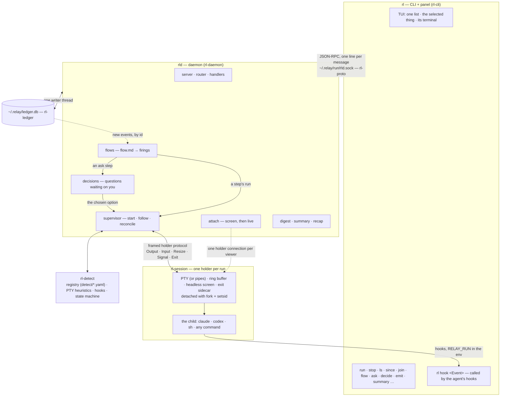
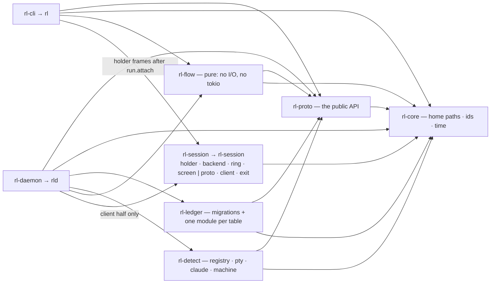
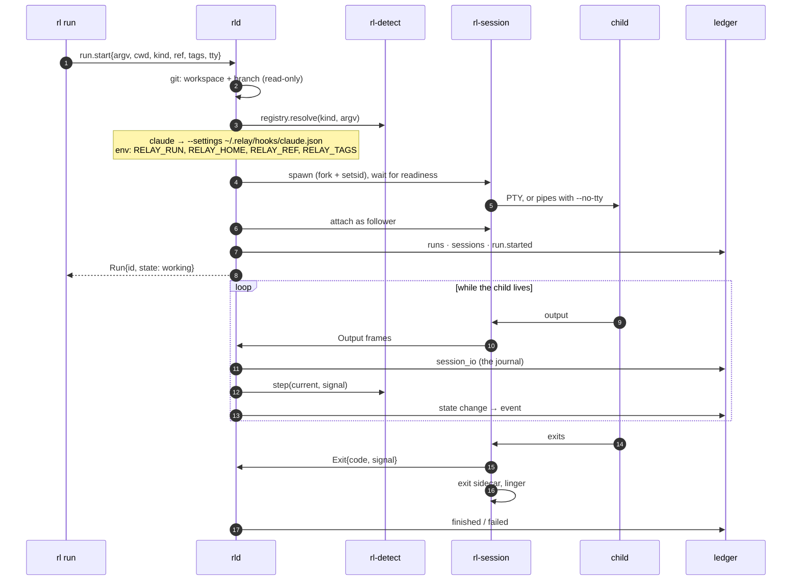
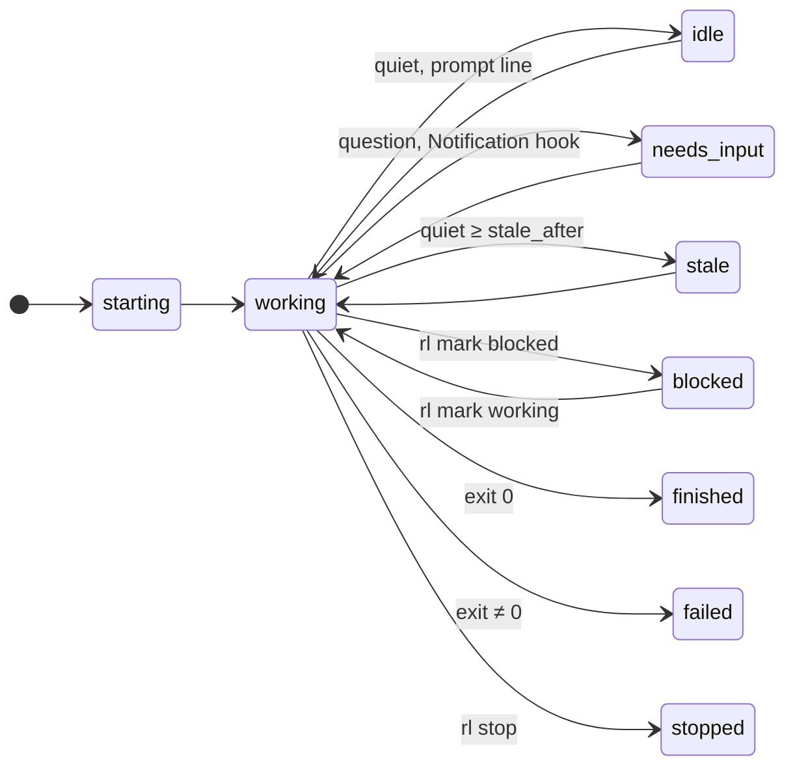
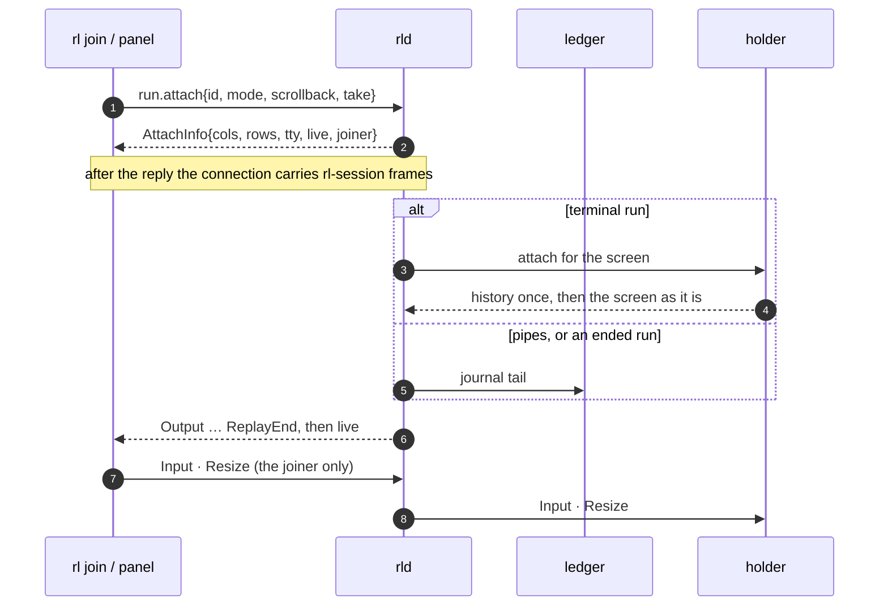
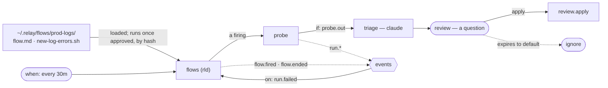

# Relay — architecture

**Status:** as built · **Date:** 2026-10-13 · **Tree:** `main`

[PRODUCT.md](PRODUCT.md) says what Relay is for. This file says how the tree under `code/` is
wired: the processes, who owns what, and what crosses which boundary. It names the code to read
rather than repeating it; what the panel does key by key lives in `rl-cli/src/tui` and `^h`.

---

## 1. Processes

Three kinds of process, two socket protocols, one SQLite file.



The rules the picture enforces:

- **`rld` never owns a child.** Every run lives under its own `rl-session`; the daemon is a
  client of it. A daemon crash, restart or upgrade costs no sessions: `Supervisor::reconcile`
  walks the open sessions, re-attaches where the holder answers (resuming the journal, noting
  bytes lost meanwhile), and otherwise closes the run from its exit sidecar or as lost.
- **The holder depends on nothing else in Relay.** Its protocol is not JSON-RPC and not shared
  with `rl-proto`, so a session stays reachable with only that binary alive.
- **`rl` speaks only `rl-proto`.** No client reads the ledger; `--json` is the data the TUI draws.
- **The ledger is one SQLite file behind one writer thread.** A call that returns has been applied.
- **Nobody starts the daemon by hand.** Every `rl` command goes through `daemon::ensure`: spawn
  `rld` if the socket is missing; same release, carry on; another release on the same wire
  protocol, offer `rl daemon restart`; another protocol, refuse. `rl hook` never starts one.

---

## 2. Crates



- `rl-session` splits on purpose: `proto`, `client` and `exit` are what `rld` links; `holder`,
  `backend` and `screen` are the process.
- `rl-flow` is all the deciding about a flow and none of the doing: `flow.md` parsed and
  checked (`def`), step order (`plan`), what a firing does next (`advance`), `if:` (`cond`),
  placeholders (`template`), step state rules (`state`), `rl flow test` (`preview`), whether an
  event reaches a flow's `on` and `where` (`events`, shared by the daemon's trigger check and the
  pane's links), cron, and the folder hash. `rld` carries out its answers; `rl` uses it to draw a flow.
- `vendor/crossterm` is crossterm 0.29 with one fix (a `CSI ?` reply no longer swallows the keys
  after it), patched in from the workspace manifest until a release carries it.

---

## 3. A run



**The holder's lifetime.** After its child exits it lingers (a day by default) with the tail and
the exit, and leaves on `Close` once the daemon has journaled the end. It also leaves — hanging
up a child still going — when its socket file is deleted (checked once a minute) or when nobody
at all has been attached for `runs.reap_after` (default `6h`). `rl daemon stop --with-runs`
stops every run deliberately and waits for each holder to hang up.

**Reading.** A holder reads its child on one thread and pauses `runs.settle` (default `5ms`)
once caught up, so the next read takes a whole burst. That is the backpressure a terminal gives:
without it a child redrawing in a loop spins against a reader that may have no viewers.

**State.** Every source produces a `Signal{state, source, confidence}`; `rl_detect::step` is the
only place a `(current, signal)` pair becomes a transition.

| Source | Confidence | Where from |
|---|---|---|
| `hook` | exact | Claude Code hooks → `rl hook <Event>` → `run.hook` |
| `manual` | exact | `rl mark done \| blocked \| working` |
| `pty` | guess / likely | output-idle timers, prompt and question patterns |
| `transcript`, `git` | exact | not wired yet (git is placement only) |

Terminal states never change; `stale` only replaces `working`/`starting`; a PTY guess never
overrides an exact state; the same state again only upgrades source and confidence. A shell's
prompt marks are read from the stream too: OSC 133 turns each command into a `shell.command`
event, OSC 7 says the shell's folder.



`needs_input`, `blocked` and `failed` are the attention states. Trouble that does not end a run
(output lost while no daemon was there, a holder gone without an exit) is a `run.trouble` event.
A daemon restart that took a holder closes its run as failed with `run.lost`; `rl resume`
picks an ended run back up as a new run in the same chain — an agent via `claude --resume` /
`codex resume`, a shell as a fresh shell, a command run again only when asked.

**Grouping** is derived, never a table: `group_key = ref → branch → workspace`, written onto each
event row. The list files a run by `place_key = ref → workspace`, so a folder is one project
whichever branch it is on.

---

## 4. Watching and joining



- **A terminal run's viewer is handed its screen, not bytes.** The holder feeds every byte to a
  headless terminal (`rl-session/src/screen.rs`); a byte tail would start mid-redraw and replay
  every reprint an inline app made. An ended terminal run is drawn the same way from the journal
  (`Screen::render`).
- **One viewer, who is the joiner.** Attaching to a live run claims its seat (`user@host` plus
  terminal); a second attach is refused unless `take`, which mutes the one it took over from
  without cutting its stream. There is no reading over a shoulder: `rl watch` and the wire's
  attach mode are gone. The supervisor's follow connection journals regardless.
- **A young run is nudged once.** Node/Bun agents miss a resize in their first half-second, so the
  panel starts runs at the size its join will hand them, and a run joined under three seconds old
  gets one held row-less resize (`attach.rs`, `NUDGE_HOLD`).
- **Frames are read through `FrameReader`.** Every hop reads inside a `select!`; a bare read loses
  its partial frame when it loses the race, and the next read takes payload for a header.
- **A stream ending without an exit is not a run ending.** `rl join` asks what became of the run
  and says so, and exits with its code, or 1 — never 0, which would read as a clean finish.
- Taking the terminal back drops input the run's terminal queries left behind (`tui/input.rs`).

---

## 5. The panel

`rl` with no command (`rl-cli/src/tui`) is `digest.get` and `run.attach` behind one screen.

- **The list** (`tui/rows.rs`) is one column: pinned runs, then projects (registered folders,
  shown before anything runs there), each holding its runs and agents' own sessions in the order
  they came; a question sits under the run that asked it. Flows are not on the list: the project
  line tallies them (how many, how many running, and in amber the ones that need you), an
  `everywhere` line after the projects tallies those with no `in`, and the headline counts every
  flow that needs you. `enter` on a project's line (or `everywhere`'s) opens its overview:
  `View::Overview` over a `Scope` (`Project(folder)` or `Everywhere`), `tui/overview.rs`. It has the
  project's last summary on top (`/summary` there, on `+ new flow` or a flow, writes it; everywhere has
  none), then its flows as rows (those that need you first, then by name, each with its open questions
  under it), each opening its page, and a last row, `+ new flow` (`NEW_FLOW`), which puts `flow new` on
  the line. Flows are reached only there, and from the catch-up and the events. Rows never move by themselves; `⇧↑↓` reorders the
  runs, kept in `row_order` via `digest.order`. Toggles (`a` agents, `s` shells, `h` hidden) and a
  search (`tui/query.rs`, words plus `in: is: kind: by: on:` tokens) narrow it.
- **The line** (`tui/line.rs`) always takes typing. A first word naming an agent starts that
  agent; one this machine can run goes to the project's **warm shell** (one persistent `$SHELL -i`
  per folder, written to via `run.input`); anything else goes to the interpreter (§6), and the run
  it proposes comes back in the pane (`tui/proposal.rs`) to run, change with more words, or edit as
  the form. The line's right edge says which, before `enter`; `⇧tab` turns a misread line round. Everything else is a
  `/` command (`tui/palette.rs`) or one of a few chords (`^x ^r ^t ^o ^f`, `^h` for the keys).
- **A row is read by entering it.** `enter` opens the selected row's **subpage**: full width,
  full height, the list stepped aside, under one header row saying what the page is of and that
  `esc` leaves. `enter` again acts — a flow's walk, a question's choices, an agent's own session
  carried on. `esc` steps back one level (a sub-mode first, then the page); `ctrl-\` goes
  straight to the list from however deep in, the same gesture that detaches a join. `^o` opens
  and leaves the selected row's page without entering it.
- **Enter on a live run** is the same move at its fullest: ratatui steps aside and the run gets
  the real terminal (`attach.rs`, shared with `rl join`), `ctrl-\` lets go. An **ended** run's
  page is a static render of its journal (`tui/term.rs`): read once to its exit, scrolled, with
  no holder connection held open.
- **The pane** (`tui/pane.rs`) is what a subpage draws: facts for whatever is selected — a run, a
  flow and its firings, a project, a question and its choices, a summary. A flow's page draws its wiring
  (`tui/flow_graph.rs`): what starts it, its steps as boxes by rank with their `if`s and its
  last firing's marks, and the flows it starts — worked out from every loaded flow's definition
  (`tui/flow_links.rs`), with no ledger. At a width too small for the drawing, it lists the steps.
- **The events view** (`tui/events.rs`) lists the ledger's events newest first, each with what
  it set off, read from causes, never guessed.
- **The catch-up** (`rl-cli/src/catchup.rs`) opens instead of the list when you were away longer
  than `catch_up.after` (default `8h`; presence is touched once a minute). It is the list's own
  rows cut to the stretch, with a top written by `assistants.summary` when `catch_up.summary:
  auto`, else counted. Flows with `catch_up: top` head it with their latest firing's outcome.
  `rl since` prints the same.
- **Setup** (`tui/setup.rs`, `rld`'s `setup.rs`) asks which agents to offer, who summarises,
  whether to move Claude's own background sessions in (`import.rs`; nothing picked by default,
  since moving one stops it), and, per agent with a `sessions:` profile, whether to add Relay's
  hook to its user-level settings, so its own sessions show (below).

### Agents' own sessions

Sessions an agent CLI runs that Relay did not start are rows too (`Row::Outside`,
`tui/outside.rs`), under the project a run in their folder would be filed under, in the order
they came. They come from `rld`'s store (`rl-daemon/src/outside/`), never from a digest's path:

- **Told by hooks.** `rl setup` adds, on a yes, one entry per event to the agent's user-level
  file (`~/.claude/settings.json`, `~/.codex/hooks.json`, `~/.gemini/settings.json`; the file and
  events come from the profile). Each calls `'<rl>' hook <agent> <Event> || true` (Claude's with
  `--user`, to tell it from Relay's per-run hooks). Only Relay's own entries are ever changed, and
  a file that does not read is left alone. `rl hook` posts `outside.hook` with the session, its
  folder and the event, or under `RELAY_RUN` the run's signal (`run.hook`); it finishes within
  1.5s, prints nothing, exits 0, never starts `rld`, and runs `ps` for the agent's pid only when
  `rld` says it knows none (`wants_pid`).
- **Filled in by asking, only with a reason.** An agent with a `list:` (Claude's `claude agents
  --json`, read by `outside/claude.rs`, asked by `outside/lister.rs`) is asked only while a panel
  is watching (`digest.get{watching}`): when the list is first wanted, for a session a hook told
  of that it did not list, every 60s while one of Claude's background sessions is listed, and
  every 30s when its hook is not installed. An ask fills in what a hook cannot say: background,
  the attach id, the pid. `claude` children `rld` runs carry `RELAY_ASKING`, so their own hooks
  never feed another ask.
- **Not Relay's.** A session a run is tagged with (`<agent>-session:<id>`, on `SessionStart`), or
  whose pid is a live run's, is left out. One left open in its terminal while a run carries it on
  shows while it works there; a Claude background session an ended run was sent to
  (`/background`) says `was <title>`, and the run `went to Claude's background`.
- **Gone** on `SessionEnd`, when its process is (checked every 5s), or after long silence.

Enter attaches to a Claude background session: `claude attach <id>` runs under a pty of the
panel's (`held.rs`), the terminal passed through as for a joined run, so `ctrl-\` lets go of it
and the session goes on. Enter carries an idle one in another terminal on here as a Relay run,
with its profile's `resume`; a busy one is refused, saying why.

**Adding an agent** is a profile: `detect/<agent>.yaml` (built in, or in `$RELAY_HOME/detect`)
with `bins`, `resume` and a `sessions:` block — the hooks file, `timeout` and its `unit`, each
event hooked and the state it says (`started idle working needs carries-on ended nothing`,
narrowed by one payload field where needed), and optionally `list:` and `attach:`.
`rl_detect::sessions` reads and checks it, and a bad block fails to load naming its file;
`rl daemon restart` picks a change up. `rl-daemon/tests/profile_agent.rs` adds a made-up agent
this way and nothing else. Code is needed only for a hooks file in another shape than the JSON
the three share (`user_hooks`), a new list reader, or reading its transcript for a recap.

Still to be checked by hand, with a real agent: whether Claude runs user-level hooks in its
background sessions and keeps the starting session's environment there; that `/background`
keeps the session id; whether `startedAt` is the process's or the conversation's; how `claude
attach` exits on a detach; codex's trust prompt for the hook; that the pid is found in real `ps`
output; and what Gemini's synchronous `AfterTool` hook costs per tool call.

Every run carries `RELAY_RUN` in its environment, so a prompt can mark a Relay shell itself
(`RPROMPT='${RELAY_RUN:+●}'`); Relay never draws over a run's screen or writes your rc.
`rl shell-init <shell>` prints the OSC 133/7 snippet for prompts that don't emit them.

---

## 6. Flows

Every run says why it is there: `Run.cause` is `manual`, `decision:<id>`, `flow:<flow>/<step>`
or `assistant:<job>`, and `Run.chain` is the chain it belongs to. A **flow** is a trigger and
steps; one run of it is a **firing**, whose id is the chain of every run in it.



**A flow is a folder** in the Relay home only — `~/.relay/flows/<name>/` — never in a checkout,
so cloning a repo can't make Relay run anything. `flow.md` is YAML frontmatter
(`rl_proto::flow::FlowSpec`; unknown keys refused) and prose, with each agent step's prompt under a
`## <step>` heading. The folder's other files are the flow's own and go first on its steps'
`PATH`. `runs/` holds firings' state and is never hashed; `rld` writes `flows/.gitignore` so the
folder can be a git repo.

```yaml
in: ~/Projects/api            # a project Relay knows; a step's own in overrides it
when: every 30m               # or a quoted cron line; and/or on: run.failed (where: narrows)
missed: catch-up-once         # or skip
overlap: skip                 # or queue, kill
catch_up: top                 # heads the catch-up with its latest firing
steps:
  probe:  { run: new-log-errors.sh }            # string → sh -c, list → argv
  triage: { after: probe, if: probe.out, run: { agent: claude } }
  review:
    after: triage
    ask: "{triage.out}"
    options: { apply: { run: { agent: claude } }, ignore: {} }
    default: ignore
    expires: 4h
    group: prod-logs          # asking again restates the open question
```

**Placeholders and safety.** `{probe.out}` (the last 64 KB a step printed), `{review.choice}`,
`{review.note}`, `{probe.<value>}` and `{event.*}` are spliced into prompts and `ask:` text only,
in one pass (`rl-flow/src/template.rs`). A command that names one is refused at load, and told
which variable to read instead (`$RELAY_IN/probe.out`, `$RELAY_V_probe_key`, `$RELAY_CHOICE`,
`$RELAY_EVENT`…) — so a log line can never become shell. A prompt goes after `--`. All load
errors are reported at once, each at its line (`rl-flow/src/def.rs`).

**State between steps** (`flows/work.rs`, `flows/state.rs`): a step's out, `key=value` lines it
appends to `$RELAY_OUT` (kept in `step_values`), and files in `$RELAY_WORK` (`runs/<firing>/`).
An agent uses `rl flow state set|get|write|read`, which goes through `rld` — one allow rule gives
an agent its firing's state and nothing else.

**Approval** (`flows/store.rs`, `rl-flow/src/hash.rs`). Flows are read at start, on reload, on
registering or removing a folder, and after an edit. Each folder is hashed (sha256 over every
path and byte but `runs/`); a flow runs only while its approved hash equals the folder's. Any
change asks again. The hash is checked again before a firing and before each step starts, so a
firing waiting four hours on a question never runs a script changed meanwhile, and a firing runs
the definition and version it began with. `rl flow approve` says yes to one hash; `rl flow edit`
and `rl flow new` approve only exactly what was saved (`rl-cli/src/flow/edit.rs`, `new.rs`);
nothing an agent wrote is approved for you.

**The engine** is pure decisions (`rl-flow/src/advance.rs`) carried out by `rl-daemon/src/flows/
engine.rs`, under one lock. A pending step starts when all its `after` are `done` and its `if:`
holds; after a failed, skipped or stopped step it is skipped. A firing ends `stopped`, `failed`
or `done`. Ask steps raise ordinary questions (`flows/ask.rs`); the answer starts the option as
the step's own run. On restart, open firings are reconciled before the socket answers; a lost
step's run can be resumed in place.

**Triggers** (`flows/triggers.rs`) are a scheduler and a reactor in one loop, reading new events
by id from a cursor in `meta`. Three things stop runaway loops: a flow never hears its own runs,
questions or events; `throttle` collapses bursts; events older than five minutes are ignored.
Flows talk to each other only through events — Relay's own or `rl emit`'s (the daemon's own
families are refused).

**`rl flow`**: `list`, `new <name> [words…] [--go]`, `edit`, `run`, `pause`, `resume`,
`approve`, `test` (what would fire and which steps would run, starting nothing; `flows/
preview.rs`), `reload`. Example flows to copy are in `examples/flows/`, held to the code by
`rl-cli/tests/examples.rs`.

### Decisions

`rl ask` writes a question and returns; nothing blocks. Answering moves the row to `taken`
before starting the option's runs, so two answers can't both fire, and each run gets
`RELAY_DECISION`, `RELAY_CHOICE` and `RELAY_NOTE`. A `group` keeps one open question per group
and asker kind; `expires` takes the default or expires it. Relay talks to no one itself: getting
a question to Slack is a flow `on: decision.raised`.

### Assistants

`~/.relay/config.yaml` (`rl_proto::config`, `rl-daemon/src/config.rs`) holds your defaults —
`agents`, `assistants`, `catch_up`, `retention`, `workspaces` — unknown keys refused. Which CLIs
are agents is the detection registry's (`detect/*.yaml`: bins, headless args, model flag, icon,
colour); `assistants` maps Relay's own jobs to them:

- **interpret** — plain words on the line or `rl interpret` → the context pack
  (`rl-cli/src/context.rs`, built from the code and held to it by tests) plus the words, run as an
  ordinary headless run (`assistant.rs`, `cause: assistant:interpret`). The client reads the last
  `kind: run` / `kind: flow` block out of the answer (`interpret.rs`) into a draft; nothing runs
  without your `enter` or `--go`.
- **summary** — `summary.make` over a run, flow, firing, project or everything
  (`rl-daemon/src/summary.rs`). Brief takes the cheapest source: Claude's own `away_summary`
  recap, Codex's turns, else an assistant reading the stretch. Deep reads everything, in 48 KB
  parts joined by further calls; `dry` counts calls first. Results are kept in `summaries` and
  `summary_kept` and reused until what they cover moves on. Agents' own recaps are picked up as
  written (`recap.rs`), with no one asked. The daemon never calls an assistant on its own — every
  call is a client's.

---

## 7. On disk

```text
~/.relay/                   ($RELAY_HOME overrides)
  ledger.db                 runs, events, sessions, session_io, presence, workspaces,
                            decisions, flows, firings, steps, step_values, summaries,
                            summary_kept, transcripts, hidden, row_order, meta
  flows/<name>/             flow.md, its scripts, runs/<firing>/
  config.yaml               your defaults
  run/                      0700: rld.sock, rld.pid, <run>.sock, <run>.exit, bin/rl
  log/                      rld.log, <run>.log
  hooks/claude.json         written at daemon start, passed to claude as --settings
  detect/*.yaml             overrides, merged over the built-ins
  plugins/                  badge commands (gh-pr written when missing)

detect/*.yaml               built-in profiles: generic, claude, codex, cursor, gemini, opencode, sh
scripts/{rl,rld}            dev shims: build if needed, run the debug binaries
scripts/ci                  the CI checks, on Linux, in a container
scripts/live                a live Relay on live/home, seeded from live/seed
examples/                   flows to copy: flows/prod-logs, flows/morning-brief, weather-alert
```

**Retention is the one delete** (`rl-daemon/src/gc.rs`). Runs and events are kept for good;
`archive` and `hide` only put things away. What grows — a run's journal (`session_io`,
`log/<run>.log`, sidecars) and a firing's `runs/<firing>/` — goes once ended longer ago than
`retention` (default `30d`, `never` to keep). `rld` prunes daily; `rl prune` does it now. A
`run.journal_dropped` event records what went.

A long `$RELAY_HOME` would overflow `sockaddr_un`, so sockets then fall back to a short hashed
directory under the temp dir.

---

## 8. Not built yet

- **Plugins** — the Bun plugin host, broker, `relay.d.ts`, manifests and approval. Standing in for
  one piece: **workspace badges** (`badges.rs`) — commands in `workspaces.badges` whose first line
  goes on a project's header, asked in the background at most every five minutes.
- **Facts** — commits, diffs, commands and cost per run. `Run.cost` is carried, never set.
- **Worktrees and refs** — `--worktree`, ref derivation. `Run.worktree` and `Run.parent_run` are
  carried, never set.
- **Notifications** — today you find out from the panel or `rl since`.
