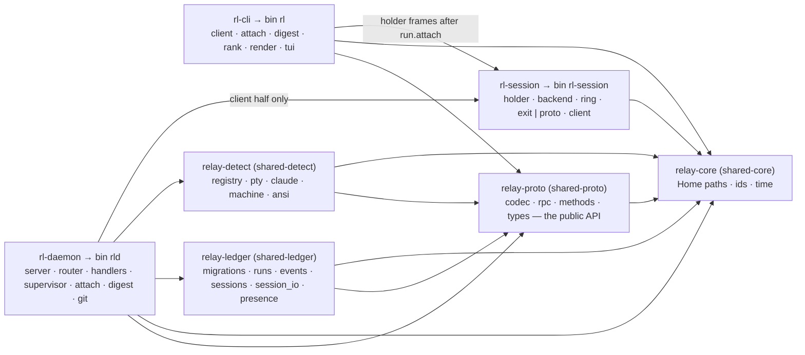
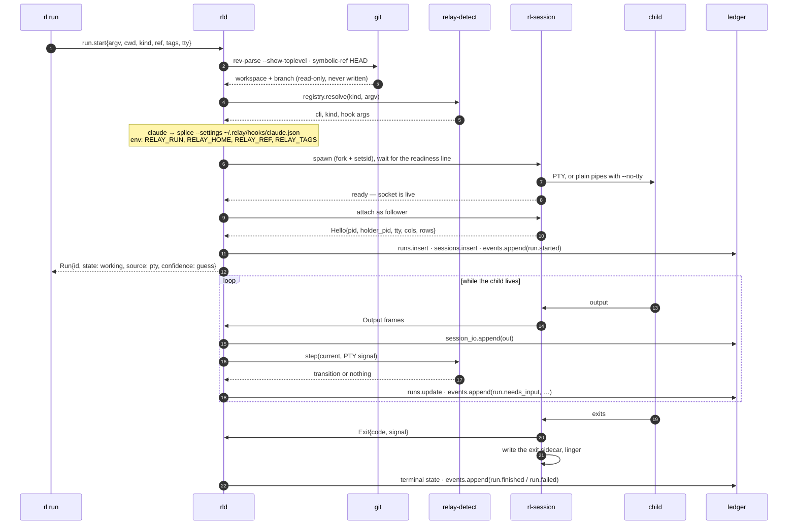
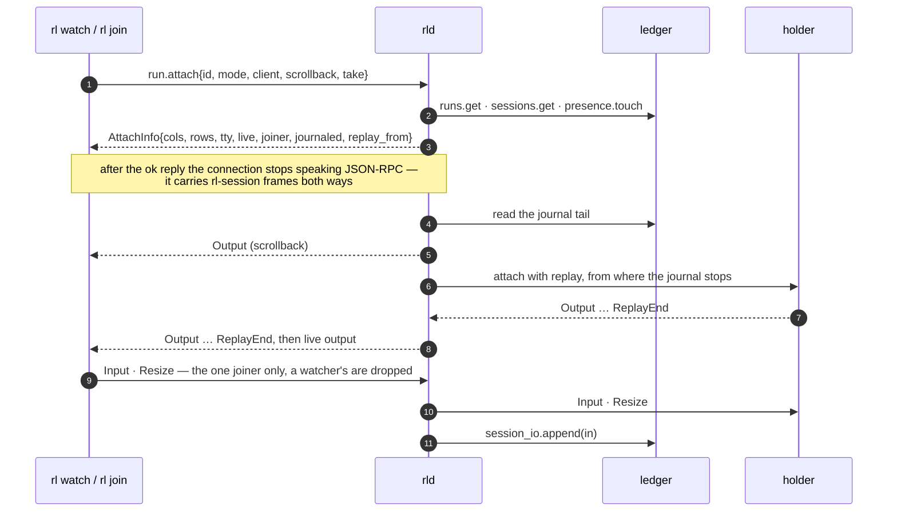
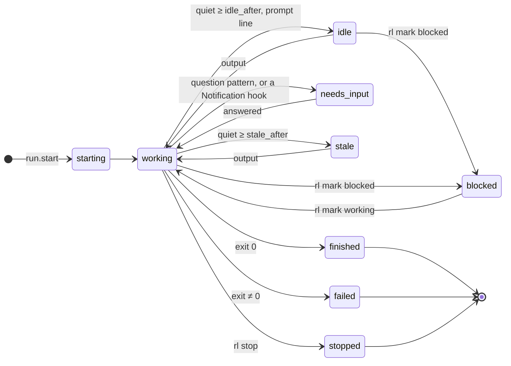
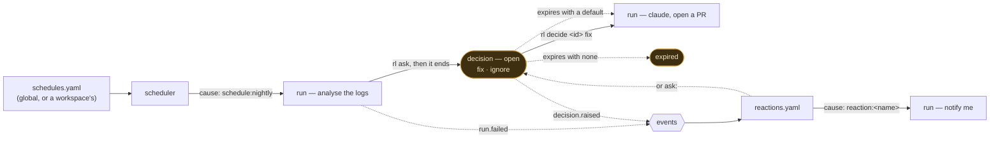

# Relay — architecture

**Status:** as built · **Date:** 2026-09-09 · **Tree:** `reactions` branch

[PRODUCT.md](PRODUCT.md) says what Relay is for and where it is going. This file says how the
tree that exists is wired: which processes there are, who owns what, and what crosses which
boundary. Every diagram describes code under `code/`; what is not built yet is listed at the
end and marked in the diagrams with dashes.

---

## 1. Processes

Three kinds of process and two socket protocols. Nothing else talks to anything.


What the picture is enforcing:

- **`rld` never owns a child.** Every run lives under its own `rl-session`; the daemon is only a
  client of that holder. A daemon crash, restart or upgrade therefore costs no sessions —
  `Supervisor::reconcile` finds the open sessions in the ledger and resumes the journal exactly
  where it stopped.
- **The holder depends on nothing else in Relay.** Its protocol is deliberately not JSON-RPC and
  not shared with `relay-proto`: a session must stay reachable with only that one binary alive.
- **`rl` speaks only `relay-proto`.** No client reads the ledger, and `--json` is the same data
  the TUI draws.
- **The ledger is one SQLite file behind one writer thread.** Every access ships a closure to
  that thread, so a call that returns has been applied.

---

## 2. Crates



`rl-session` splits in two on purpose: the library half (`proto`, `client`, `exit`) is what `rld`
links, the binary half (`holder`, `backend`) is the process itself.

---

## 3. Starting a run



After a daemon restart, `reconcile` walks `sessions` where `closed_at IS NULL`: re-attach where
the holder still answers (resuming the journal, with a `note` line if bytes were lost while the
daemon was down), otherwise close the run from its exit sidecar — or as lost.

---

## 4. Watching and joining



Several watchers, one joiner; a second `join` is refused unless `take` turns the previous joiner
into a watcher. Each viewer gets its own holder connection, and the supervisor's follow
connection journals regardless — so a viewer leaving costs nothing and the run never notices.

The panel (`rl` with no command, `rl-cli/src/tui`) is the same two calls behind one screen. It
is one list, the width of the screen, built from `digest.get` (`tui/rows.rs`): questions first,
then runs by attention, grouped by the folder they belong to, and named — a workspace by the
name it was registered under, a cause as "schedule nightly" or "rule tests-failed", never an id.
A row is a mark (`✱` needs you, `·` going, `•` ended, `▸` a job), the title, the state as a word,
the summary to the edge, and the ref and the age at the right. A group's header is the folder,
its name, and at the right the rules that live there — `↻ nightly 4h · ⚡ tests-failed`, in
yellow when one waits for a yes; your own rules get a line only then. Runs a schedule or a rule
started fold, once ended, into one line per job — name, cadence, how many went well, the last
outcome — so a job firing every thirty seconds is a row, not a screen; a run still going or
waiting on you is never folded, and `enter` on a job opens it to its last twenty. When the list
is taller than the screen, its first and last lines say how much is above and below. A group's
header says which folder it is in. Moving the cursor onto a row is looking at it;
`d` on an ended run (or a job) is being done with it — `run.archive` sets `runs.archived_at`, the
digest leaves it out, `rl ls --all` and the ledger keep it — and `D` is done with everything
ended that has been looked at. Ended runs also leave on their own after a day; `d` is for the
impatient. On the line: `rl done <id>…`, `rl done --all`. Nothing is ever deleted here; that is
retention, not yet built. `enter` on a run is its terminal, full screen and joined — the
keyboard is the run's, as it would be in a tab of your own — and `ctrl-\` lets go; `w` only
watches, and `esc` is the list again. `i` opens a pane of facts beside the list (`tui/pane.rs`):
a run's facts and recent events, a job's tally, a question with its options numbered; pressing
the number is `decision.take`, and the run it starts becomes the selection. `n` is a form at the
foot of the screen (`tui/form.rs`): for a run, the folder, a line and a title — a line starting
with an agent's name (`claude fix the build`) is that agent with the rest as its prompt, anything
else is a shell line — and `enter` is `run.start`, sized to this screen, an agent's terminal joined
at once. `N` (or `n` in the rules view) is the same form for a rule: `in` (a folder, or `yours`),
`name`, `when` (`every 30m`, a cron line, or `on run.failed` — which decides between
`schedules.yaml` and `reactions.yaml`), `run`, `title`, `tags`, `cwd`. `enter` writes the block
into the file (`rulefile.rs`: the block of that name replaced in place or added at the end of the
mapping, comments and the other rules untouched, the result checked to parse), reloads, and
approves it — your keystroke is the yes; a folder new to Relay is registered on the way. `e` on a
rule, or on a job row, is the same form filled in; saving rewrites only that block and keeps what
the form does not show (`env`, `where`, `ask`), and a rename or a move takes the old block out.
`E` opens the file in `$EDITOR` at the rule's line and reloads on return — an edit made there is
a file change, so it waits for `y` like any other. Nothing is remembered between openings except
presence: leaving the panel is what `rl since` counts from.

---

## 5. How a run's state is decided

Every source produces a `Signal{state, source, confidence}`; `relay_detect::step` is the only
place a `(current, signal)` pair becomes a transition, and it decides against the ledger row.

| Source | Confidence | Wired today | Where from |
|---|---|---|---|
| `hook` | exact | yes | Claude Code hooks → `rl hook <Event>` → `run.hook` |
| `manual` | exact | yes | `rl mark done \| blocked \| working` |
| `pty` | guess / likely | yes | output-idle timers + prompt/question patterns over the byte stream |
| `transcript` | exact | not yet | `~/.claude` transcripts |
| `git` | exact | placement only | commits landed, branch done |

The rules, in order: terminal states never change here; `stale` only ever replaces
`working`/`starting`; a PTY guess never overrides an exact state from another source; the same
state again upgrades source/confidence at most; anything else is a transition, journaled as an
event.



`needs_input`, `blocked` and `failed` are the attention states: they sort to the top of the
panel's list and are what `rl since` leads with. Confidence rides along in the UI, always visible.

Grouping is derived, never a table: `group_key = ref → branch → workspace`, materialised onto
each event row at write time so the digest groups without a join.

---

## 6. What starts a run

Every run says why it is there. `Run.cause` is one string — `manual`, `schedule:<name>`,
`decision:<id>`, and later `reaction:<name>` and `workflow:<name>/<step>` — and `Run.flow` is
the chain it belongs to: its own id when it starts one, the flow it was handed otherwise. A
nightly schedule that asks a question whose answer opens a pull request is three rows and one
flow.



**Actions.** A schedule's entry and a decision's option are the same shape, and one function
turns that shape into a `RunSpec`. Adding workflow steps later adds no third dialect. What runs
is written under one key, in whichever of the three forms fits:

```yaml
run: "date +%T >> pulse.log"     # a string goes through sh -c
run: [grep, -c, ERROR, app.log]  # a list is argv, no shell
run:                             # a map is an agent, run headless:
  agent: claude                  #   the profile's headless args, then args, then the prompt
  prompt_file: standup.md
  args: [--model, opus]
cwd: ~/work/api                  # and these decorate it, whichever form
env: { CI: "1" }
tags: [nightly]
ref: gh:1
title: nightly checks
no_tty: false
```

The parser for those three forms is hand-written, so a mistake says which form it could not
read rather than that nothing matched.

**Decisions** are the human node, and they never block. `rl ask` writes the question and
returns; the run that asked can finish, and the question waits in the ledger with its options.
Answering is the only thing that starts the follow-up runs, and the row moves to `taken` before
they start, so two `rl decide` racing cannot both fire. A `group` key is unique among open
questions: asking the same thing again restates the open one, keeping its id, so a nightly job
leaves one line rather than thirty. An `expires` either takes the option marked `default` or
moves the question to `expired`; the sweeper sleeps until the earliest deadline and does
nothing when there is none.

**Reactions** are the other direction: every event the ledger records is offered to the rules in
`reactions.yaml`, and a rule either runs something or asks a question. A rule says which kinds
it wants (`run.failed`, `run.*`, `*`), may narrow by `where` (the run's tag, cause, cli, or the
event's group), and fills `{summary}`, `{title}`, `{run}`, `{data.x}` and the rest into whatever
it runs. The whole event is in the child's environment as `RELAY_EVENT`.

Three things keep a rule from running away with itself. A run it starts carries `cause:
reaction:<name>` and a question it asks remembers the same, so no rule ever answers its own
doing. A throttle, ten seconds by default, collapses a burst. And the loop reads the event table
by id from a cursor kept in `meta`, ignoring anything older than five minutes, so a daemon that
was down does not come back and fire a day of history.

`rl on run.failed -- notify "{summary}"` appends a rule to your own file and reloads; the file
stays yours, comments and all. `rl react test <event>` replays one real event through every rule
and prints what each would do, and why it would not. `rl every 30m -- make test` (a cron line in quotes works too; `--agent claude -- <prompt>`,
`--in <folder>`, `--global`, `--cwd`, `--title`, `--tag`, `--name`, `--replace`) writes a schedule into
this folder's `.relay/schedules.yaml` — or yours with `--global` — through `rulefile.rs`, registers
a folder new to Relay, reloads and approves it: the command line is the yes. A name already
there is refused unless `--replace`.

**Rules** is how both are shown: `rule.list` returns every schedule and reaction as one
`Rule` (`relay-proto/src/rule.rs`, a tagged enum over the two rows with one set of accessors —
`when()`, `does()`, `status()`), and `rule.approve` says yes to one of them by name, which the
per-folder `rl up --yes` never allowed. `rl rules` is the table; `rl rules approve|pause|resume|run
<name>` act on one, finding its kind by name (`--kind` when a schedule and a reaction share it,
`--in` when two folders do). In the panel, `r` flips the list to rules — grouped by whose file,
what needs a yes on top, narrowed to the folder of the row it was pressed on until `esc` — and
`y` approves, `p` pauses, `enter` fires a schedule now. The two YAML
files, the two ledger tables and `rl schedule` / `rl react` are unchanged underneath.

**Your defaults, and the agents Relay itself uses.** `~/.relay/config.yaml` is the one place for
defaults (`relay_proto::config`, read by `rld` at start, on `config.get` and on a rules reload —
`rl-daemon/src/config.rs`). Absent means all defaults; a key it does not know is refused with the
line, so a typo cannot silently do nothing, and a file that does not parse is reported by
`rl config` (exit 1) while the daemon runs on defaults. Keys arrive one at a time, when a need
does. The first is `assistants`: the agents Relay hands its own jobs to, keyed by job, each a
name or a map:

```yaml
assistants:
  interpret: claude     # what you type at n / e / rl "…" in plain words → a draft for your enter
  # interpret: { agent: claude, model: claude-haiku-4-5-20251001, args: ["--max-turns", "1"] }
```

Which CLIs are agents is not configured: the detection registry says (`detect/*.yaml`,
`kind: agent`, `bins`, `headless`, and now `model_flag`, the flag that names a model), and `rld`
looks for each on `PATH` when asked — `agent.list`, `rl agents`. An assistant resolves to an
argv: the binary, the headless arguments, the model through the profile's flag, the extra
arguments; the prompt goes last. Unset, it is the first available agent; a name the registry
does not know, or a `model` for a profile without `model_flag`, is an error, never a guess.
`rl config` prints the resolved assistant and where it came from; `rl config edit` opens the
file, and `rld` seeds it, all comments, when there is none. Later assistants (`summarise`,
`triage`, `answer`) will be keys in the same map.

**What an assistant is told** is the context pack (`rl-cli/src/context.rs`, `rl context
[--in <folder>]`), built from the code so it cannot drift: the words (run, folder, `yours`,
rule, job, question, agent, `when`), one line per event kind in `event_kind::ALL` (a kind
without words fails a test), the fields of a schedule and a reaction (every serde field of
the specs must be explained, or a test fails), the placeholders a reaction can use, `rl
--help` plus the help of `run`, `every`, `on` and `ask`, what is here (the folder and its
name, the folders Relay knows, this folder's and the person's rules, the agents on this
machine), and the answer contract: exactly one YAML document, `kind: run | schedule |
reaction` then the form's fields. The interpreter, next, hands this and the typed words to
`assistants.interpret` and shows what comes back in the form.

Relay still talks to no one itself. A question surfaces in `rl decisions`, in `rl since` and at
the top of the panel, where a number key answers it; getting it to Slack or mail is a reaction on
`decision.raised` running your own command.

---

## 7. On disk

```text
~/.relay/                     ($RELAY_HOME overrides; tests and scripts/live point it elsewhere)
  ledger.db                   SQLite: runs, events, sessions, session_io, presence, schedules,
                              workspaces
  schedules.yaml              user-level schedules; the file is the interface, the ledger keeps
                              versions (by sha256), pause state, last/next firing
  config.yaml                 your defaults (`assistants:`); absent means defaults, unknown keys refused
  reactions.yaml              user-level rules: events → actions, or questions; same file-first
                              deal, same versioning (`rl on` appends to it)
  run/                        0700 — rld.sock, rld.pid, <run>.sock, <run>.exit
  log/                        rld.log, <run>.log
  hooks/claude.json           written at daemon start; passed to claude as --settings
  detect/*.yaml               user overrides, merged field by field over the built-ins
  plugins/                    (empty — see below)

<workspace>/.relay/           per folder registered with `rl up` — the trust boundary
  schedules.yaml              versioned with the folder; a version fires only once approved
                              (approved_hash == hash); an edit asks again
  reactions.yaml              the same, for rules; `rl up` loads and approves both

detect/*.yaml                 in-tree, compiled in: generic, claude, codex, cursor, sh
scripts/{rl,rld,relay-dev}    dev shims: build if needed, run the debug binaries
scripts/live                  a live Relay to poke at: its home is live/home, seeded from
                              live/seed by `scripts/live reset`; `scripts/live <rl args>` talks
                              to it, and the recorded claude player is first on its PATH
live/seed/                    what reset copies: global schedules.yaml + reactions.yaml and a
                              ws/ workspace (everything else under live/ is throwaway)
```

Sockets normally live in `run/`; a long `$RELAY_HOME` would blow the ~104-byte `sockaddr_un`
limit, so both sides fall back to the same short hashed directory under the temp dir.

---

## 8. Not built yet

Named here so the diagrams above are not read as the whole plan — see §7 of the brief for
phasing.

- **Workflows** — `workflows/<name>.yaml`, steps with `after`/`when` and decision steps, as
  declarative sugar over the engine that reactions and decisions already are. `Run.cause` and
  `Run.flow` carry `manual`, `schedule:<name>`, `decision:<id>` and `reaction:<name>` today;
  `workflow:` is reserved. `rl up` loads a folder's `schedules.yaml` and `reactions.yaml`;
  `workflows/` is not read yet.
- **Plugins** — `rl-plugin-host` (Bun), the broker, `relay.d.ts`, the manifest/approval flow,
  action keys and the detail tab. `~/.relay/plugins/` exists, unused.
- **Facts and summaries** — the collector, transcript ingestion, cached narrative, cost. No
  `facts` or `summaries` tables yet; `Run.cost` is carried but never set.
- **Worktrees and ref rules** — `--worktree`, branch-naming, `.relay/config.yaml` ref derivation.
  `Run.worktree` and `Run.parent_run` are carried, never set.
- **Notifications** — the notify reference plugins.
